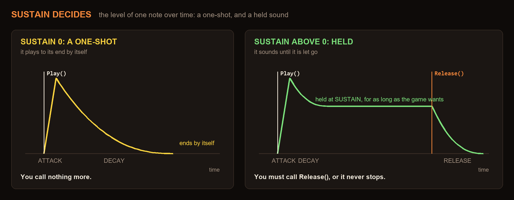
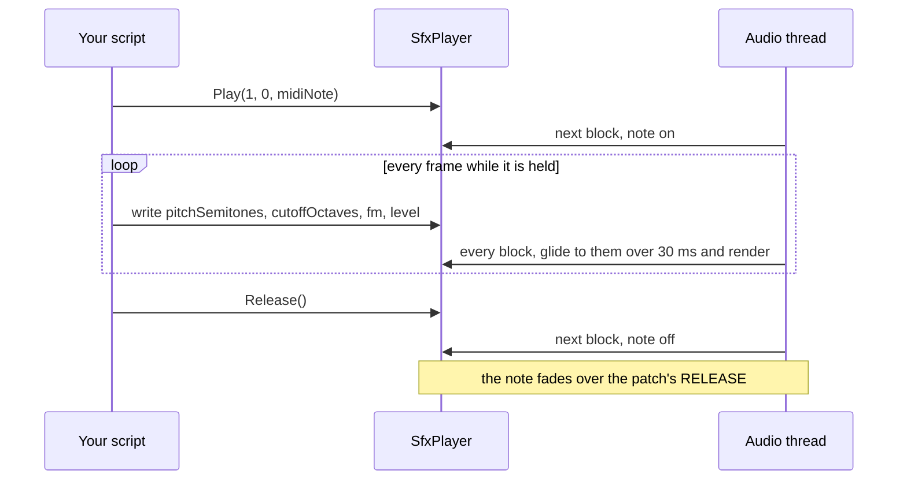
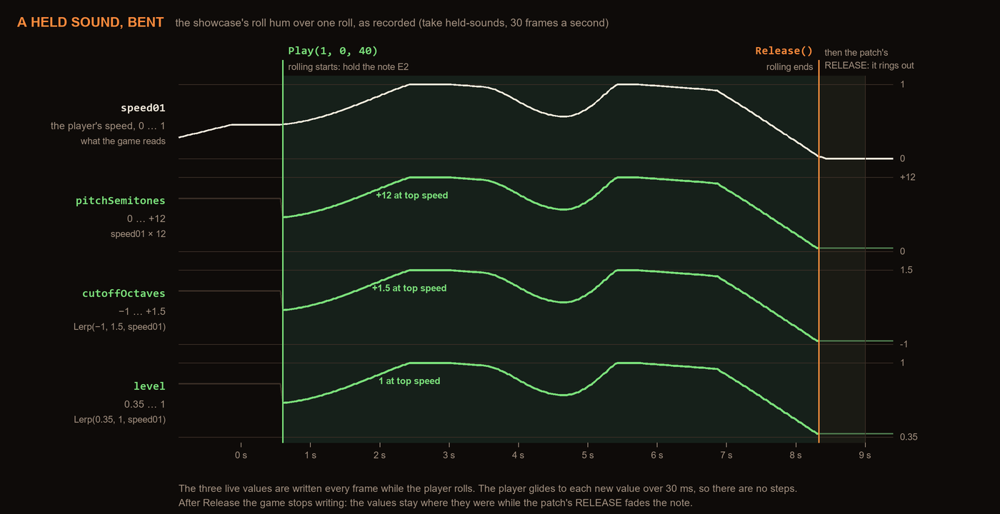

# Unity Held Sounds

The held route: start a sound, keep it sounding for as long as the game wants, bend it every frame, then let it
go. Use it for a sound that follows the game: an engine, wind, a charge.

A sound is *held* when its patch has `sustain` above 0. Such a sound does not end by itself: it sounds until you
call `Release()`.



*A sketch, not a measurement. Left: with SUSTAIN at 0 the sound rises over ATTACK, falls over DECAY and ends.
Right: with SUSTAIN above 0 it falls to the SUSTAIN level and stays there until `Release()`, then fades over
RELEASE.*

## What happens when



The four live values are plain fields. Your script writes them on the main thread; the audio thread reads them
every block and glides to each over 30 ms, as the device does. So you can write them every frame without clicks.

## The shortest version

```csharp
using CatSplat.SfxForge;
using UnityEngine;

[RequireComponent(typeof(SfxPlayer))]
public class EngineHum : MonoBehaviour
{
    [Range(0f, 1f)] public float speed01;        // your game sets this: 0 standing … 1 flat out
    readonly SfxPatch hum = SfxPatch.Create(SfxEngine.SciFiFm, 22, 64, 0, 21, 55, 8, 78, 45, 60, 0, 60, 127, 60);
    SfxPlayer player;

    void Start()
    {
        player = GetComponent<SfxPlayer>();
        player.Play(hum, 1f, 0f, 40);            // held (sustain 127), as the MIDI note E2
    }

    void Update()
    {
        player.pitchSemitones = speed01 * 12f;
        player.cutoffOctaves = Mathf.Lerp(-1f, 1.5f, speed01);
        player.fm = speed01 * 0.5f;
        player.level = Mathf.Lerp(0.35f, 1f, speed01);
    }

    void OnDisable()
    {
        if (player != null) player.Release();
    }
}
```

Steps:

1. On a GameObject: **Add Component > SFX Forge > SFX Player**.
2. Add the script above to the same object. The patch is written in the script, so the player needs no preset.
3. Press Play. A low, quiet hum starts and stays.
4. Drag **Speed 01** in the script's Inspector to the right. The script raises the hum's pitch by up to an
   octave, opens its filter and raises its level.

In the patch above, the twelfth number is `sustain`: 127, so the sound is held.

## The four live values

| Live value | Range | What it moves |
|---|---|---|
| `pitchSemitones` | 0 … 24 | the pitch, upwards |
| `cutoffOctaves` | −4 … 4 | the filter, in octaves from the patch's cutoff |
| `fm` | 0 … 1 | the timbre: FM depth, or a wavetable's position |
| `level` | 0 … 1 | the loudness. 1 = as designed |

The ranges are those of the sliders in the player's Inspector, and of what telemetry sets. A script can write any
number: the engine limits `level` to 0 … 1 and takes the other three as they come.



*The showcase's roll hum over one roll, as recorded. The white curve is the player's speed. The three green curves
are live values the game writes from it every frame, between `Play(1, 0, 40)` and `Release()`.*

## With a preset, and without code

- **With a preset:** set the preset's SUSTAIN above 0 on its ENV page, put it in the player's **Preset** field,
  and call `player.Play(1f, 0f, 40)`.
- **Started by itself:** tick **Play On Enable** on the SFX Player. It then starts at the patch's own FREQ.
- **Without a script:** an `SfxTelemetrySender` writes a live value from a Rigidbody's speed, an Animator float
  or your own value. Put the `SfxPlayer` into its `localPlayers`. See
  [Unity Telemetry And Encoders](Unity-Telemetry-And-Encoders).

## Common mistakes

| What you see | What it is |
|---|---|
| the sound never stops | nobody called `Release()`. A held sound needs it, also when the object that started it goes away |
| a click when it fades out | you faded with `volume`. `volume` is not smoothed: fade with `level`, which glides |
| the hum is out of tune | a bare `Play()` sounds at the patch's FREQ. Start a pitched held sound with its MIDI note. Noise, such as wind, has no note: start it with 0 |
| it stops after 1.5 seconds | that is a *baked* held patch: a clip holds for `holdSeconds`, then lets go. For as long as you want, use a player |
| two held sounds fight | one sound per player. `Release()` lets go of every note of that player. Give each held sound its own `SfxPlayer` |
| the pitch slider will not go below the note | the slider of `pitchSemitones` goes from 0 to 24. Start on the lowest note you need |

## Next

- [Unity Telemetry And Encoders](Unity-Telemetry-And-Encoders): the same without code, and from the device
- [Unity Live Voices](Unity-Live-Voices): the player's other fields, and the one-patch rule
- [Unity Presets And Patches](Unity-Presets-And-Patches): SUSTAIN, RELEASE and the ENV page
- [Unity Recipes](Unity-Recipes): an engine hum that follows speed

## Reference

- [The Unity manual, "Route 3: held, and bent while it plays"](../docs/UNITY.md#route-3-held-and-bent-while-it-plays)
- [The Unity manual, "One-shot or held: sustain decides"](../docs/UNITY.md#one-shot-or-held-sustain-decides)
- [The Unity manual, recipe 3: An engine hum that follows speed](../docs/UNITY.md#3-an-engine-hum-that-follows-speed)
- [The Unity manual, recipe 4: The same without code](../docs/UNITY.md#4-the-same-without-code-sfxtelemetrysender)
- [SfxPlayer.cs](../unity/com.catsplat.sfxforge/Runtime/SfxPlayer.cs) (the live values, `Release`),
  [HeldSound.cs](../unity/Demo/Assets/Showcase/Scripts/Audio/HeldSound.cs)
