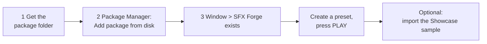
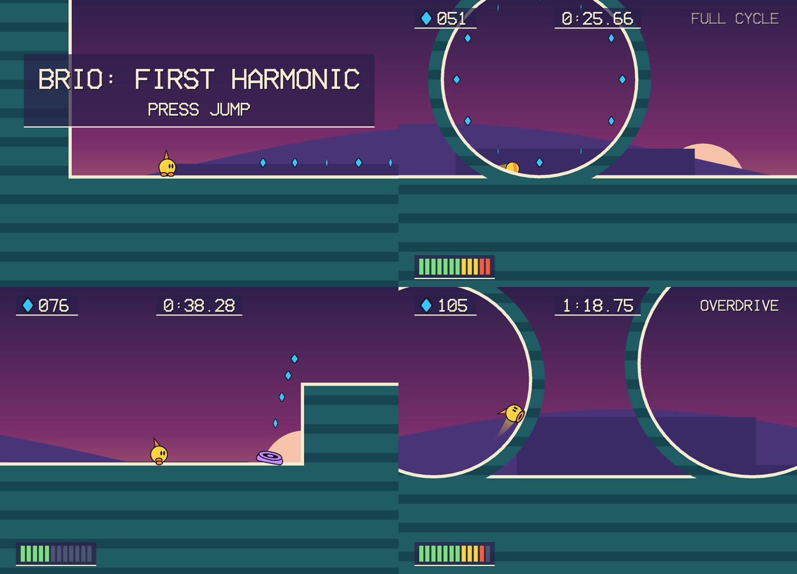

# Unity Install

This page gets the SFX Forge package into a Unity project and checks that it makes a sound. It takes a few minutes.



## What you need

| | |
|---|---|
| **Windows x64** | the engine is a native library, `sfxforge.dll`, built for Windows x64 only. On any other platform the package compiles, but nothing is synthesized ([What Is Tested](What-Is-Tested)) |
| **Unity 6000.3** | the generated package's `package.json` asks for `6000.3`. It is developed and tested with Unity 6.3 (6000.3.8f1) only |
| **No device** | sounds, presets, players and baking work on their own. The device and MIDI are only for [the link](Unity-Device-Link-Setup) |
| **A licence that fits** | the package is under the GNU General Public License, version 3 or any later version, with an additional permission for the Unity engine itself ([ADDITIONAL-PERMISSIONS.md](../ADDITIONAL-PERMISSIONS.md)). A game that is itself offered under the GPL, with its source, can use it at no cost; a game that is not needs another licence from the copyright holder. This is a summary, the licence text decides: [FAQ, Shipping](FAQ#shipping) |

## 1. Get the package folder

You add a folder from your disk. Which one depends on what you have:

| You have | The folder to add | The Package Manager then lists |
|---|---|---|
| the package repository [`sfx-forge-unity`](https://github.com/Cat-Splat-Studios/sfx-forge-unity), cloned or downloaded | its top folder, the one with `package.json` in it | "SFX Forge" |
| only this source repository | [`unity/com.catsplat.sfxforge`](../unity/com.catsplat.sfxforge/package.json) | "SFX Forge Bridge" |

The package repository is the usual way: clone it, or download it as a zip and unpack it. If you already have
this source repository, the second row works too: the code, the namespace `CatSplat.SfxForge` and the native
library are the same, and nothing has to be built first. What differs is in
[the table further down](#the-two-forms-of-the-package).

## 2. Add it to your project

1. In Unity, open **Window > Package Manager**.
2. Click **+** (top left), then **Add package from disk...**
3. Pick the `package.json` in the folder from step 1.
4. "SFX Forge" (or "SFX Forge Bridge") appears in the list of packages.

Or add one line to the `dependencies` that are already in your project's `Packages/manifest.json`. Put a comma after
the line before it; do not replace the file. For the source repository's folder the name is `com.catsplat.sfxforge`.

```json
{
  "dependencies": {
    "com.catsplatstudios.sfxforge": "file:<path to the package folder>"
  }
}
```

Write the path as an absolute path, or relative to your project's `Packages` folder.

The manifest line is the way that was tried, in an empty project. Nobody clicked the Package Manager's
buttons; the calls behind them were run from the command line ([What Is Tested](What-Is-Tested)).

Once the package repository is public there will be a third way: **+ > Add package from git URL...** with its URL.

## The two forms of the package

There is one package in two forms. Read this only if the names confuse you, or if you work on the package itself.

| | The package repository | This source repository |
|---|---|---|
| Where | the generated repository `sfx-forge-unity` (written to `../unity-sfx-forge`) | the folder `unity/com.catsplat.sfxforge` |
| Package id | `com.catsplatstudios.sfxforge` | `com.catsplat.sfxforge` |
| Name in the Package Manager | "SFX Forge" | "SFX Forge Bridge" |
| Unity version in its manifest | `6000.3` | `2022.3`; it is developed and tested with 6000.3.8f1 only |
| Showcase | a sample you import | already in the demo project `unity/Demo` |
| Manuals | in its `Documentation~` folder | in `docs/` |

The package repository is written by [`tools/make_unity_package.py`](../tools/make_unity_package.py) from this
repository. Nothing in it is edited by hand. The demo project `unity/Demo` refers to the source folder with
`file:../../com.catsplat.sfxforge`.

## 3. A first check

1. Look for **Window > SFX Forge** in the menu. If it is there, the package compiled.
2. In the Project window: **Assets > Create > SFX Forge > Preset**. An asset named `New SFX` appears. It holds a
   laser.
3. Select it. Its Inspector is drawn like the device's display. Press the soft key **PLAY**.
4. You hear a short laser through the editor's speakers.

If **PLAY** and **BAKE WAV** are dark and the picture's place says `NATIVE LIBRARY NOT FOUND`, the native library
did not load: the editor is not running on Windows x64. For anything else, see
[Unity Troubleshooting](Unity-Troubleshooting).

> The Inspector's pictures in this wiki are rendered by the package's tests from the same elements the Inspector
> hosts. They are not photographs of the Unity editor. [What Is Tested](What-Is-Tested) says what was tried.

## Your own scripts

| Your code is | What to do |
|---|---|
| in `Assets`, with no assembly definition | nothing. `using CatSplat.SfxForge;` compiles |
| in its own `.asmdef` | add `CatSplat.SfxForge` to its references |
| an editor script that uses the package's editor helpers (`CatSplat.SfxForge.Editor`) | it must be in an `.asmdef` that references `CatSplat.SfxForge.Editor`. That assembly is not referenced automatically |

## Import the Showcase sample



*Brio: First Harmonic*, the showcase, is a one-level 2D platformer in which every sound is SFX Forge at runtime.
In the package repository it is a sample:

1. **Window > Package Manager**, select **SFX Forge**, open the **Samples** tab.
2. Next to **Showcase**, click **Import**. Unity copies it to `Assets/Samples/SFX Forge/1.0.0/Showcase`.
3. Open `Showcase.unity` in that folder and press Play. Arrows or A/D run, Space jumps, Down tucks into a roll.

| The sample needs | Why |
|---|---|
| the built-in render pipeline | it was made with it, and was not tried with another |
| **Active Input Handling** set to the legacy Input Manager or Both (Project Settings > Player) | it reads the Input Manager |
| the Test Framework package, only if you want its tests | without `com.unity.test-framework` the test assembly is left out |

In this source repository there is nothing to import: open the project `unity/Demo` and the scene
`Assets/Showcase/Showcase.unity`.

## Next

- [Unity Quick Start](Unity-Quick-Start): a sound from your own scene in five minutes
- [Unity Concepts](Unity-Concepts): the handful of types and how they fit
- [Unity Showcase Walkthrough](Unity-Showcase-Walkthrough): what the sample does, and where
- [Unity Troubleshooting](Unity-Troubleshooting): when something is silent

## Reference

- [The Unity manual, section 1: Five minutes](../docs/UNITY.md#1-five-minutes)
- [The Unity manual, section 9: Limits](../docs/UNITY.md#limits)
- [README, Unity](../README.md#unity)
- [The maintainer's guide, "Regenerate the package"](../docs/MAINTAINING.md#regenerate-the-package)
- [tools/make_unity_package.py](../tools/make_unity_package.py) (the package id, the Unity version, the sample's name)
- [unity/com.catsplat.sfxforge/package.json](../unity/com.catsplat.sfxforge/package.json)
