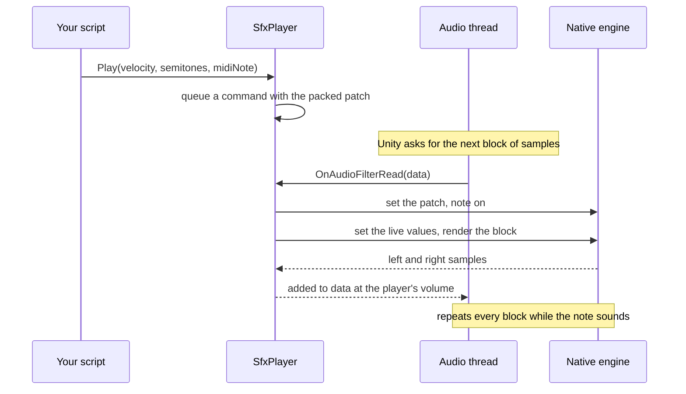
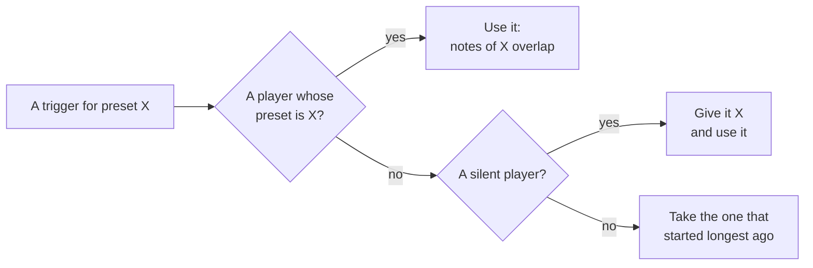

# Unity Live Voices

The live route: an `SfxPlayer` synthesizes the sound each time it plays, so every trigger can have its own pitch,
loudness, or even its own patch. Use it for a sound that is decided at the moment it plays.

## What happens when



`Play` itself does no audio work. It puts a command into a queue and returns. The audio thread takes the command
the next time Unity asks the player for samples, so the sound starts at the next audio block.

## The shortest version

```csharp
using CatSplat.SfxForge;
using UnityEngine;

[RequireComponent(typeof(SfxPlayer))]
public class PickupSound : MonoBehaviour
{
    SfxPlayer player;        // its Preset field holds the sound
    int count;

    void Start() => player = GetComponent<SfxPlayer>();

    public void Collected()
    {
        player.Play(1f, count % 8);      // one semitone higher each time, eight steps, then again from the start
        count++;
    }
}
```

Steps:

1. On a GameObject: **Add Component > SFX Forge > SFX Player**. It adds the Audio Source it needs. Leave the Audio
   Source's AudioClip empty.
2. Drag a preset onto the player's **Preset** field. For a pickup, make one with **TOOLS > NEW > CHIME**
   ([Unity Sound Design Tools](Unity-Sound-Design-Tools#new-a-sound-of-a-kind)).
3. Add the script above to the same object.
4. Call `Collected()` from your game. Each call sounds one semitone higher than the one before; the ninth starts
   again at the preset's own pitch.

## The three ways to call Play

```csharp
// in: SfxPlayer player
player.Play(1f, 7f);               // the preset: full velocity, 7 semitones up
player.Play(0.6f, 0f, 76);         // the preset: softer, as the MIDI note E5

SfxPatch coin = SfxPatch.Create(SfxEngine.UiBlip, 86, 64, 0, 26, 60, 0, 127, 0, 62, 0);
player.Play(coin, 1f, 3f);         // a patch directly: no preset needed
```

| Argument | Range | What it does |
|---|---|---|
| `velocity` | 0 to 1 | how hard the note is played. Softer is quieter |
| `semitones` | any | transposes it, up or down. 12 are an octave |
| `midiNote` | 0, or a note number | 0 plays the sound at the patch's own FREQ. Above 0 it is played as that note (69 = A, 440 Hz) |

## The player's fields

| Field | Default | What it is |
|---|---|---|
| `preset` | none | what `Play()` plays |
| `volume` | 0.8 | the player's place in your mix, 0 to 1. It is not smoothed |
| `playOnEnable` | off | start the sound when the component is enabled |
| `pitchSemitones`, `cutoffOctaves`, `fm`, `level` | 0, 0, 0, 1 | the four live values. They act on every note of this player; [Unity Held Sounds](Unity-Held-Sounds) is about them |
| `IsPlaying` (read only) | | true while it sounds, its echoes included. It turns true at the first audio block after `Play`, not at the call |

## One player, one patch

An `SfxPlayer` overlaps up to 16 notes, and all of them are the same patch. If you play a different patch on a
player that still sounds, the notes that are ringing are reshaped to the new patch.



That is what the showcase's `LiveVoicePool` does. "Silent" there means: `IsPlaying` is false and its last trigger
is more than 0.1 seconds ago, because a player reports sound only once the audio thread has started the note. For
two or three different live sounds, simply give each its own `SfxPlayer`.

## Common mistakes

| What you see | What it is |
|---|---|
| nothing plays, and no error | `Play()` with no preset does nothing. Or `Play` was called before the player's own `OnEnable` ran, or while it is disabled: call from `Start` or later |
| live sounds change each other | two patches on one player. Use a player per patch, or a pool |
| the sound is out of tune with the music | play it as a MIDI note (`midiNote`), not at the patch's FREQ |
| transposing a noise does nothing | pure noise has no pitch. Change its band (`filterCutoff`) instead |
| the sound never stops | the patch is held (`sustain` above 0). Call `Release()`: see [Unity Held Sounds](Unity-Held-Sounds) |
| it is not placed in 3D | a player is not spatialized. For 3D, bake a clip: [Unity One Shots](Unity-One-Shots) |
| a warning "the native library (sfxforge) is not available" | not Windows x64. The player stays silent there |

## Next

- [Unity Held Sounds](Unity-Held-Sounds): keep a note and bend it
- [Unity One Shots](Unity-One-Shots): the cheaper route for sounds that are always the same
- [Unity Recipes](Unity-Recipes): a pickup that rises with the combo
- [Unity API Sounds](Unity-API-Sounds): every member of `SfxPlayer`

## Reference

- [The Unity manual, "Route 2: a live voice"](../docs/UNITY.md#route-2-a-live-voice)
- [The Unity manual, recipe 2: A pickup that rises with the combo](../docs/UNITY.md#2-a-pickup-that-rises-with-the-combo)
- [The Unity manual, API: SfxPlayer](../docs/UNITY.md#sfxplayer-component-needs-an-audiosource)
- [SfxPlayer.cs](../unity/com.catsplat.sfxforge/Runtime/SfxPlayer.cs) (`Play`, `OnAudioFilterRead`),
  [LiveVoicePool.cs](../unity/Demo/Assets/Showcase/Scripts/Audio/LiveVoicePool.cs)
