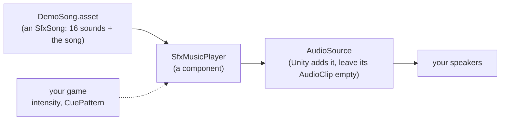
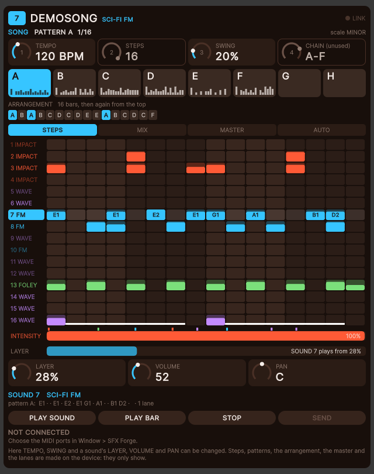

# Unity Music: First Song

This page gets the demo song playing in a scene of yours, and lets you hear the band grow and shrink as you drag
one slider. It takes five steps and no code.



Two things make music in Unity:

| Thing | What it is |
|---|---|
| **`SfxSong`** | an asset: the 16 sounds of a kit and a song sequenced for them. A song is made on the device; the package plays it and shows it |
| **`SfxMusicPlayer`** | a component that plays an `SfxSong` with the same player code the device runs, and lets your game shape it while it plays |

## What you need

- The package installed: [Unity Install](Unity-Install). It runs on Windows x64 only; see
  [What Is Tested](What-Is-Tested).
- A song asset. One is ready: the firmware's own demo song, `DemoSong.asset`. Where it is depends on how you
  installed the package:

| You installed | Where the demo song is | Step 1 is |
|---|---|---|
| the package repository ("SFX Forge") | in the Showcase sample: `Assets/Samples/SFX Forge/1.0.0/Showcase/Song/DemoSong.asset`, once you have [imported the sample](Unity-Install#import-the-showcase-sample) | import the sample; the song is then in your project |
| from the source repository ("SFX Forge Bridge") | in the source repository: `unity/Demo/Assets/SfxDemo/DemoSong.asset` | copy it into your project, as below |

The two files are the same song, byte for byte.

## The five steps

| | Do this | What you see or hear |
|---|---|---|
| **1** | Get `DemoSong.asset` into your project (the table above). To copy it, use a file manager and take `DemoSong.asset` **and** `DemoSong.asset.meta` from `unity/Demo/Assets/SfxDemo/` into your project's `Assets` folder | An `SfxSong` named DemoSong is in the Project window. Select it: its Inspector shows TEMPO 120 BPM, the patterns A to H and a row of steps for each of the 16 sounds |
| **2** | Make an empty GameObject. **Add Component > SFX Forge > SFX Music Player** | The component appears, and Unity adds an `AudioSource` with it. Leave the AudioSource's AudioClip empty |
| **3** | Drag DemoSong onto the player's **Song** field. Leave **Play On Enable** ticked and **Intensity** at 1 | Nothing yet: the player starts when the scene runs |
| **4** | Press Play | The whole band plays: drums, FM bass, FM keys and strings, then brass, bells and choir as the song goes on |
| **5** | While it plays, drag **Intensity** (under the heading **Live**) down in the Inspector | Instruments drop out one by one. At 0 only the kick is left |

Copying the asset this way was not tried in a second project; it is the asset the demo project itself plays.

Step 5 is the main idea of the music side: one song, and one number from your game that decides how much of the band
plays it. [Unity Adaptive Music](Unity-Adaptive-Music) explains it.

## The player's fields



*The song you just copied, in its own Inspector (page STEPS). The fields in the table below are on the
`SfxMusicPlayer` component instead. [Unity Song Inspector](Unity-Song-Inspector) is a tour of this picture.*

| Field | Default | What it does |
|---|---|---|
| `song` | none | the `SfxSong` it plays |
| `volume` | 0.6 | the music's volume, 0 to 1. Not smoothed: see [Unity Music Mix And Notes](Unity-Music-Mix-And-Notes#ducking) |
| `playOnEnable` | on | start the song when the component is enabled |
| `startPattern` | 0 | the pattern it starts on: 0 = A … 7 = H |
| `intensity` | 1 | 0 to 1: which layers of the song play |
| `loopPattern` | off | on: the pattern that plays repeats. Off: the song's own order. See [Unity Cues And Patterns](Unity-Cues-And-Patterns) |

## The same from code

```csharp
using CatSplat.SfxForge;
using UnityEngine;

public class StartMusic : MonoBehaviour
{
    public SfxMusicPlayer music;    // drag the object from step 2 here

    public void Begin() => music.Play();   // starts on startPattern
    public void End() => music.Stop();

    void Update()
    {
        if (music.IsPlaying && music.Step == 0)
        {
            // true in every frame of a bar's first sixteenth.
            // music.Pattern is 0 for A; music.Bar counts bars since Play, from 0
        }
    }
}
```

`Play()` is only needed when `playOnEnable` is off, or after a `Stop()`. Called while the song plays, it starts the
song again from the top of `startPattern`. `Step`, `Pattern` and `Bar` are read back from the audio thread a moment
after the fact.

## If you hear nothing

| Check | Why |
|---|---|
| The Console warns "the native library (sfxforge) is not available on this platform" | the player stays silent where the library does not load |
| The **Song** field is empty, or the song's Inspector says NO SONG YET | an `SfxSong` made with **Assets > Create > SFX Forge > Song** is empty until a song is put into it |
| `volume` is 0, or the AudioSource is muted | the music is added to what that AudioSource plays |
| `intensity` is 0 and the pattern has no kick | at 0 only sounds with a LAYER mark of 0 play |

The full list is in [Unity Troubleshooting](Unity-Troubleshooting).

## Next

- [Unity Adaptive Music](Unity-Adaptive-Music): drive `intensity` from a value of your game.
- [Unity Cues And Patterns](Unity-Cues-And-Patterns): change the music on the bar line.
- [Unity Song Inspector](Unity-Song-Inspector): read the song you just copied.
- [Unity Send And Receive](Unity-Send-And-Receive): get a song of your own from the device.

## Reference

- [The Unity manual, section 5: Music](../docs/UNITY.md#5-music) and [A first song](../docs/UNITY.md#a-first-song)
- [A song without MIDI](../docs/UNITY.md#a-song-without-midi): how the demo song's asset is made
- [The silence checklist](../docs/UNITY.md#the-silence-checklist)
- [SfxMusicPlayer in the API tables](../docs/UNITY.md#sfxmusicplayer-component-needs-an-audiosource)
- [SfxMusicPlayer.cs](../unity/com.catsplat.sfxforge/Runtime/SfxMusicPlayer.cs) ·
  [SfxSong.cs](../unity/com.catsplat.sfxforge/Runtime/SfxSong.cs)
