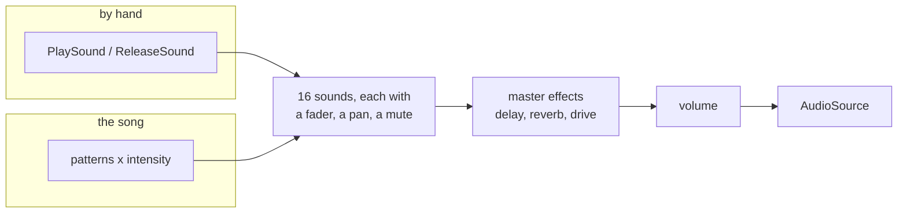
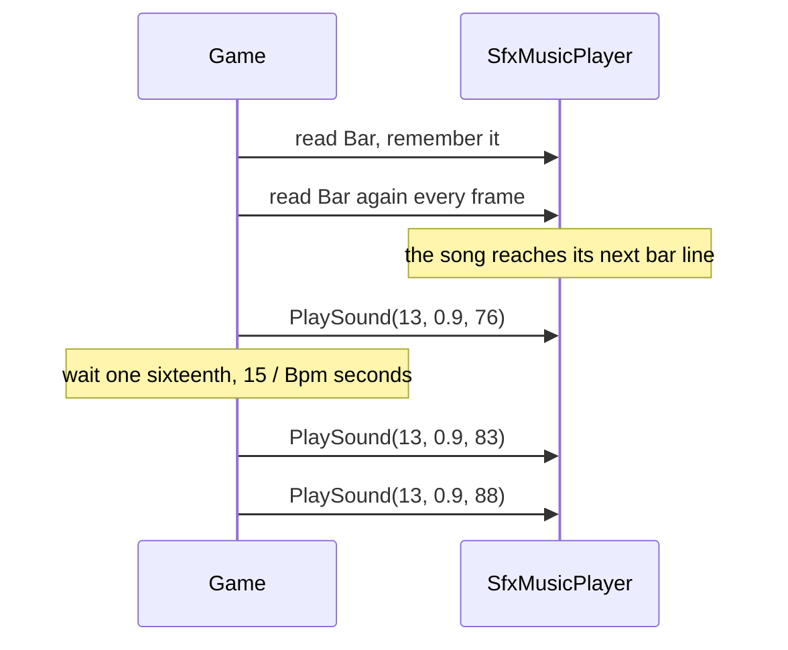

# Unity Music Mix And Notes

While a song plays, your game can move its mix, duck it, and play notes on its instruments by hand. This page shows
each, and ends with the bar's length and why Unity knows no beat.



Everything here is a method or field of `SfxMusicPlayer`. A **sound** is one of the song's 16 instruments, numbered
0 to 15 in code: the pad on the device minus one. The demo song's are listed at the foot of this page.

## The mix

| Call | Range | What it moves |
|---|---|---|
| `volume` (a field) | 0 … 1, default 0.6 | the whole music |
| `SetTrackVolume(sound, v)` | 0 … 1.27 | a sound's fader. 1 = as designed |
| `SetTrackPan(sound, p)` | −1 … 1 | left … right |
| `SetTrackMute(sound, mute)` | `true` / `false` | silences a sound, or lets it be heard again |
| `SetMaster(SfxMaster.DelayTime, v)` | 0 … 5 | the delay: 1, 2, 3, 4, 6 or 8 sixteenths |
| `SetMaster(what, v)` for `DelayFeedback`, `ReverbSize`, `ReverbDamping`, `Drive` | 0 … 127 | the other master effects |

```csharp
// in: SfxMusicPlayer music
music.SetTrackMute(5, true);                    // the demo song's brass is silent
music.SetTrackVolume(13, 1.2f);                 // its bells a little forward
music.SetMaster(SfxMaster.ReverbSize, 110);     // a bigger room
// later
music.Reload();                                 // the song's own mix again
```

The song carries its own mix (`SfxSong.HasMix`, `Volume(sound)`, `Pan(sound)`, `Muted(sound)`, `Master(what)`).
Your calls replace its values in the running player, not in the asset, and last until `Reload()`, which takes the
song asset again without stopping.

A mute is not the same as a layer. A layer follows `intensity` ([Unity Adaptive Music](Unity-Adaptive-Music)); a
mute stays until you lift it.

## Ducking

`volume` is applied as it is, block by block, without a ramp. A jump is a click. Move it over a few frames.

```csharp
using CatSplat.SfxForge;
using UnityEngine;

public class MusicDuck : MonoBehaviour
{
    public SfxMusicPlayer music;
    public float normalVolume = 0.6f;
    [Range(0f, 1f)] public float duckedPart = 0.5f;      // the volume while ducked, as a part of normal
    public float dipSeconds = 0.05f, recoverSeconds = 2f;
    float duck, target;                                  // 0 = normal … 1 = fully ducked

    /// <summary>A hit, a line of dialogue: the music steps back and comes forward again by itself.</summary>
    public void Duck() => target = 1f;

    void Update()
    {
        duck = Mathf.MoveTowards(duck, target, Time.deltaTime / (target > duck ? dipSeconds : recoverSeconds));
        if (duck >= target) target = 0f;
        music.volume = normalVolume * Mathf.Lerp(1f, duckedPart, duck);
    }
}
```

Call `Duck()` and the volume falls to half in 50 ms, then returns over 2 s. The showcase does the same after a hit,
from 0.36 to 0.18; the lower panel of the second picture on [Unity Adaptive Music](Unity-Adaptive-Music) is a
recording of it.

## Notes by hand

`PlaySound(sound, velocity, midiNote)` plays one of the song's sounds beside the music. `velocity` is 0 to 1.
`midiNote` 0 plays the sound as designed (a drum, an effect); above 0 it plays at that pitch (60 is middle C).

| Rule | What it means for you |
|---|---|
| **It is not quantised** | the note sounds at once. To land on the beat, wait until `Step` or `Bar` changes, then play |
| **A held instrument must be released** | in the demo song brass, organ, sweep, choir and strings: call `ReleaseSound(sound, midiNote)` with the same two numbers, or the note never stops |
| **Layers do not apply** | a note by hand sounds whatever the intensity is |
| **It works while the song is stopped** | the showcase stops the song at the goal and plays a fanfare by hand. The sound's fader, pan and mute still apply |
| **Same note, two instruments** | a note by hand is named by its MIDI note alone. If a held instrument is sounding a note and you play the same `midiNote` on another instrument, the held one is let go |



The same as a script: three bell notes of the demo song, starting on the next bar line.

```csharp
using System.Collections;
using CatSplat.SfxForge;
using UnityEngine;

public class Stinger : MonoBehaviour
{
    public SfxMusicPlayer music;
    public int instrument = 13;                  // 0 … 15: the demo song's bells
    public int[] notes = { 76, 83, 88 };         // E5 B5 E6

    public void Play() => StartCoroutine(OnTheNextBar());

    IEnumerator OnTheNextBar()
    {
        int bar = music.Bar;
        float giveUp = Time.time + 4f;
        while (music.IsPlaying && music.Bar == bar && Time.time < giveUp) yield return null;

        float sixteenth = 60f / (music.song != null && music.song.Bpm > 0 ? music.song.Bpm : 120) / 4f;
        foreach (int note in notes)
        {
            music.PlaySound(instrument, 0.9f, note);
            yield return new WaitForSeconds(sixteenth);
        }
    }
}
```

For a held instrument, call `music.ReleaseSound(instrument, note)` after the note's length. `Step`, `Bar` and
`Pattern` are read back from the audio thread a moment after the fact: near enough for a stinger, not exact to the
sample.

## The bar, and why Unity has no beat

| | Whose it is | In Unity |
|---|---|---|
| **the bar's length** | the song's: 1 to 16 sixteenths. It is in the packed song and arrives with it | `SfxSong.StepsPerPattern` · STEPS in the song's Inspector |
| **the beat** | the device's own, chosen there with SHIFT + B: an eighth, three sixteenths, a quarter or a dotted quarter. It is not in the song and in no message of the link | nothing. No member reads it |

So a bar of 12 sixteenths is `BAR 3/4` on a device whose beat is a quarter and `BAR 6/8` on one whose beat is a
dotted quarter, and in Unity it is simply 12 sixteenths. The beat changes no note: the game plays the song the same
whatever the device calls it.

What you can count on:

- `SfxSong.Bpm` counts quarters, whatever the beat: a sixteenth lasts 15 / `Bpm` seconds.
- `SfxMusicPlayer.Step` is the sixteenth of the bar, 0 … 15, also in a pattern with a finer grid. `GridStep` is the step in the pattern's own grid, and `StepsPerSixteenth` is 1, 2 or 4.
- A game that wants the beat counts sixteenths itself:

```csharp
// in: SfxMusicPlayer music
int beatLength = 6;                                  // a dotted quarter: the two beats of 6/8
bool onTheBeat = music.Step >= 0 && music.Step % beatLength == 0;
```

That fragment was not run, and nobody has played a bar of 12 or 14 sixteenths in Unity:
[What Is Tested](What-Is-Tested). On the device side: [Device Time Signatures](Device-Time-Signatures).

## The demo song's sounds

| | | | |
|---|---|---|---|
| 0 timpani | 1 snare | 2 kick | 3 cowbell |
| 4 pizzicato | 5 brass (held) | 6 FM bass | 7 FM keys |
| 8 harp | 9 celesta | 10 organ (held) | 11 sweep (held) |
| 12 hi-hat | 13 bells | 14 choir (held) | 15 strings (held) |

## Next

- [Unity Cues And Patterns](Unity-Cues-And-Patterns): change the pattern on the same bar line.
- [Unity Recipes](Unity-Recipes): the stinger, the duck and the boss theme with the other recipes.
- [Unity API Music](Unity-API-Music): every member of the player and the song.
- [Unity Testing Your Audio](Unity-Testing-Your-Audio): check a mix without ears.

## Reference

- [The Unity manual: Notes by hand: PlaySound](../docs/UNITY.md#notes-by-hand-playsound) ·
  [The mix](../docs/UNITY.md#the-mix) · [The bar and the beat](../docs/UNITY.md#the-bar-and-the-beat) ·
  [A finer grid](../docs/UNITY.md#a-finer-grid)
- [Recipe 7: A stinger on the bar line](../docs/UNITY.md#7-a-stinger-on-the-bar-line) ·
  [Recipe 9: Ducking the music](../docs/UNITY.md#9-ducking-the-music)
- [The device's manual: The beat is the device's, not the song's](../docs/MANUAL.md#the-beat-is-the-devices-not-the-songs) ·
  [section 14: The mixer and the master effects](../docs/MANUAL.md#14-the-mixer-and-the-master-effects)
- [SfxMusicPlayer.cs](../unity/com.catsplat.sfxforge/Runtime/SfxMusicPlayer.cs) ·
  [SfxSong.cs](../unity/com.catsplat.sfxforge/Runtime/SfxSong.cs) ·
  [MusicDirector.cs](../unity/Demo/Assets/Showcase/Scripts/Audio/MusicDirector.cs) ·
  [MusicKit.cs](../unity/Demo/Assets/Showcase/Scripts/Audio/MusicKit.cs)
