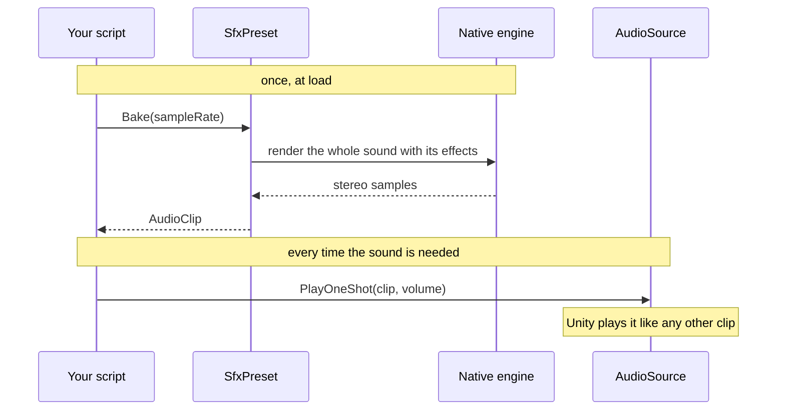

# Unity One Shots

The baked route: render a sound once into an ordinary `AudioClip`, then play that clip as often as you like. It is
the cheapest route, it works in 3D, and it is the right one for most short sounds.

## What happens when



After the bake the engine is not involved any more. The clip holds the whole sound, with its chorus, delay and
reverb, in stereo.

## The shortest version

```csharp
using CatSplat.SfxForge;
using UnityEngine;

[RequireComponent(typeof(AudioSource))]
public class JumpSound : MonoBehaviour
{
    public SfxPreset preset;         // drag a preset here
    AudioSource source;
    AudioClip clip;

    void Awake()
    {
        source = GetComponent<AudioSource>();
        if (preset != null) clip = preset.Bake(AudioSettings.outputSampleRate);   // once; null without the native library
    }

    public void Jump()
    {
        if (clip != null) source.PlayOneShot(clip, 0.7f);                         // every time
    }
}
```

Steps:

1. Make a preset: **Assets > Create > SFX Forge > Preset**. It starts as a laser. For another kind of sound, click
   one under **TOOLS > NEW** in its Inspector, for a jump **LEAP** ([Unity Sound Design Tools](Unity-Sound-Design-Tools#new-a-sound-of-a-kind)), then
   tune it by ear ([Unity Quick Start](Unity-Quick-Start#1-make-a-sound)).
2. Put the script on a GameObject. Unity adds an Audio Source.
3. Drag the preset onto the script's **Preset** field.
4. Call `Jump()` from your game code. You hear the sound; calls that overlap all play.

## What Bake takes

`AudioClip Bake(int sampleRate = 48000, float semitones = 0f, float velocity = 1f, int midiNote = 0)`

| Argument | What it does |
|---|---|
| `sampleRate` | the clip's rate. Pass `AudioSettings.outputSampleRate` to match the game's output |
| `semitones` | transposes the sound |
| `velocity` | 0 to 1: how hard the note is played |
| `midiNote` | above 0, the sound is played as that note (69 = A, 440 Hz) and the patch's FREQ is ignored. That is how you tune an effect to the music |

To have the same sound at three pitches, bake three clips. A [MIDI note](Glossary#playing-a-sound) is a pitch as a
number. (A fragment; `preset` is an `SfxPreset`.)

```csharp
// in: SfxPreset preset
AudioClip low = preset.Bake(48000, midiNote: 64);    // E4
AudioClip mid = preset.Bake(48000, midiNote: 71);    // B4
AudioClip high = preset.Bake(48000, midiNote: 76);   // E5
```

## Without a preset asset

A patch written in code is baked by `SfxNative` (a fragment for inside a method):

```csharp
SfxPatch coin = SfxPatch.Create(SfxEngine.UiBlip, 86, 64, 0, 26, 60, 0, 127, 0, 62, 0);
int rate = AudioSettings.outputSampleRate;
float[] samples = SfxNative.BakeInterleaved(coin, rate);          // L R L R …; null without the native library
if (samples != null && samples.Length > 0)
{
    AudioClip clip = AudioClip.Create("Coin", samples.Length / 2, 2, rate, false);
    clip.SetData(samples, 0);
}
```

`BakeInterleaved` takes the same choices as `Bake`, as optional arguments: `velocity`, `midiNote`, `semitones`,
and `holdSeconds` (1.5) for a held patch.

## In 3D

A baked clip is an ordinary clip, so everything an `AudioSource` can do applies: spatial blend, roll-off, a mixer
group.

```csharp
// in: AudioClip clip, Vector3 hitPosition
AudioSource.PlayClipAtPoint(clip, hitPosition, 0.8f);
```

## Good to know

| | |
|---|---|
| **Baking is synchronous** | it renders on the calling thread. Bake in `Awake` or at load, not in the middle of play |
| **The longest clip** | 12 seconds |
| **A held patch** (`sustain` above 0) | is held for the preset's `holdSeconds` (1.5 by default), then let go. The clip ends after its release |
| **Volume still follows the game** | pass it to `PlayOneShot`. The showcase's landing is louder the harder it hits |
| **A file instead of a clip in memory** | the key **BAKE WAV** in a preset's Inspector writes a `.wav` next to the asset. See [Unity Baking And WAV](Unity-Baking-And-WAV) |

## Common mistakes

| What you see | What it is |
|---|---|
| `Bake` returns null | the native library is not there (not Windows x64), or the patch is not valid |
| editing the preset in Play mode changes nothing | the clip was rendered at start. Live players follow an edit; a baked clip does not. Bake again |
| the pitch change also makes the sound shorter | you changed the AudioSource's `pitch`. Bake with `semitones` or `midiNote` instead |
| a hitch when the sound first plays | the bake happened at that moment. Bake at load |
| the same footstep over and over | use a [variation set](Unity-Variations): several baked variants in a shuffled order |

## Next

- [Unity Variations](Unity-Variations): a baked sound that is never the same twice
- [Unity Live Voices](Unity-Live-Voices): when every trigger needs its own pitch
- [Unity Baking And WAV](Unity-Baking-And-WAV): files, the Bake window, bake options
- [Unity Recipes](Unity-Recipes): UI clicks baked at load, a 3D impact

## Reference

- [The Unity manual, "Route 1: baked"](../docs/UNITY.md#route-1-baked)
- [The Unity manual, recipe 5: UI clicks, baked at load](../docs/UNITY.md#5-ui-clicks-baked-at-load)
- [The Unity manual, recipe 11: A 3D one-shot](../docs/UNITY.md#11-a-3d-one-shot)
- [The Unity manual, API: SfxPreset](../docs/UNITY.md#sfxpreset-scriptableobject) and
  [SfxNative](../docs/UNITY.md#sfxnative-static)
- [SfxPreset.cs](../unity/com.catsplat.sfxforge/Runtime/SfxPreset.cs) (`Bake`),
  [SfxNative.cs](../unity/com.catsplat.sfxforge/Runtime/Core/SfxNative.cs) (`Bake`, `BakeInterleaved`)
