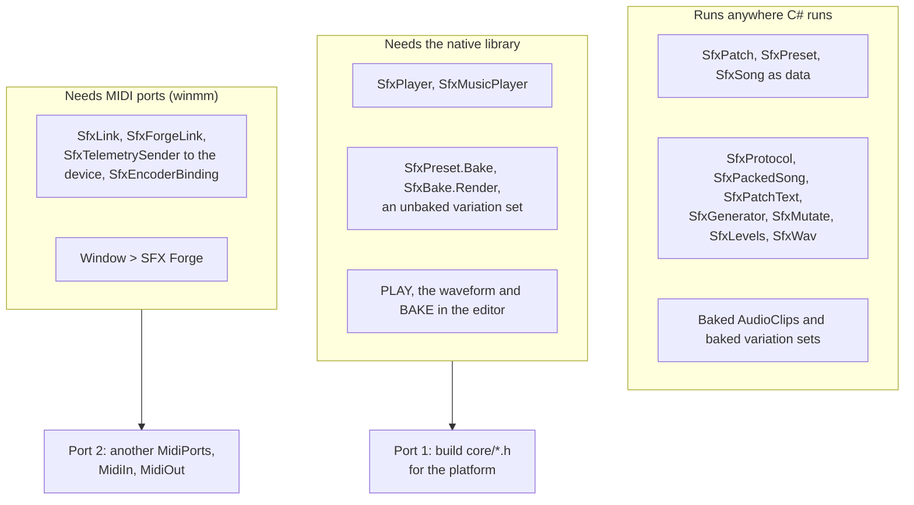
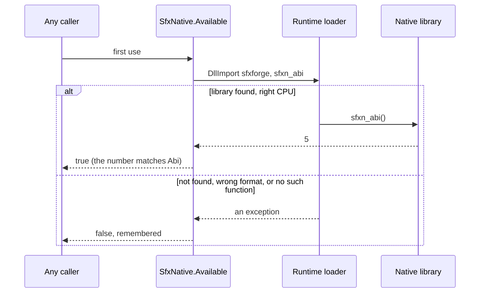

# Unity Porting The Native Library

What it would take to make the package sound on a platform other than Windows x64: what is built today, the C
functions a port must export, how C# finds them, and which parts of the package are tied to Windows.

> **Status, plainly.** Only one build exists: `sfxforge.dll` for Windows x64. Only that was built and tested. Everything
> on this page about macOS, Linux, consoles or WebGL is a guide written from reading the code. Nobody has done it.
> See [What Is Tested](What-Is-Tested).

## What is tied to Windows, and what is not



The two ports are independent. A game that only plays sounds and music needs port 1. The link is a tool for tuning
on a desk, so port 2 matters only for an editor on another operating system.

Without either port the package is written to compile all the same. `SfxNative.Available` is false, the players stay silent with one
warning each, `Bake` returns null, and `MidiPorts.Supported` is false. By the code, a game can therefore use
**baked** clips on any platform (bake on Windows, play the clips anywhere). That, too, was not tried off Windows.

## What exists today

[native/build.sh](../native/build.sh) finds Zig, makes one compiler call, and deletes the `.lib` and `.pdb` the
linker leaves beside the DLL. The call, with the paths written out:

```sh
zig cc -target x86_64-windows-gnu -shared -O2 -s \
  -o unity/com.catsplat.sfxforge/Runtime/Plugins/x86_64/sfxforge.dll native/sfx_native.c
```

| Fact | Where it comes from |
|---|---|
| One source file, [native/sfx_native.c](../native/sfx_native.c), which includes `core/sfx_song.h` (and through it the other two headers) | the file's own `#include` |
| The engine has no heap and no libc; the only system header is `<stdint.h>` | [core/sfx_core.h](../core/sfx_core.h); the maintainer's guide, section 1 |
| Nothing in the library allocates: the caller owns all memory | the header comment of `sfx_native.c` |
| The export macro is already written for other compilers: `__declspec(dllexport)` on Windows, `__attribute__((visibility("default")))` elsewhere | `sfx_native.c`, the `API` macro |
| The compiler is Zig 0.13.0, used as a C compiler | `native/build.sh` |
| The built DLL is committed to the repository | `Runtime/Plugins/x86_64/sfxforge.dll` |

So the C side asks nothing of an operating system. A port is a build for another target, not a rewrite.

## The C API: 29 functions

All are in `sfx_native.c`. A port must export every one that C# imports with the same name and arguments.
"Imported" says whether [SfxNative.cs](../unity/com.catsplat.sfxforge/Runtime/Core/SfxNative.cs) has a `DllImport` for it.

**What the library is**

| Function | Imported | Returns |
|---|---|---|
| `int sfxn_abi(void)` | yes | 5: the interface's number |
| `int sfxn_patch_bytes(void)` | no | 28 |
| `int sfxn_song_bytes(void)` | yes | the most bytes a packed song has |

**One voice, dry and mono**

| Function | Imported |
|---|---|
| `int sfxn_voice_size(void)` | yes |
| `int sfxn_trigger(void *voice, const uint8_t *patch, float vel, float note_st, float sr, uint32_t seed)` | yes |
| `int sfxn_update(void *voice, const uint8_t *patch)` | yes |
| `void sfxn_release(void *voice)` | yes |
| `int sfxn_active(const void *voice)` | yes |
| `int sfxn_render(void *voice, const float *mods4, float *out, int n)` | yes |

**The player: 16 sounds, the effects, a song and its sequencer**

| Function | Imported |
|---|---|
| `int sfxn_player_size(void)` | yes |
| `void sfxn_player_init(void *player, float sr)` | yes |
| `int sfxn_player_set_patch(void *player, int slot, const uint8_t *patch)` | yes |
| `int sfxn_player_set_song(void *player, const uint8_t *song, int n)` | yes |
| `void sfxn_player_start(void *player, int pattern)` | yes |
| `void sfxn_player_stop(void *player)` | yes |
| `void sfxn_player_cue(void *player, int pattern)` | yes |
| `void sfxn_player_set_loop(void *player, int on)` | yes |
| `void sfxn_player_set_track(void *player, int slot, int vol, int pan, int mute)` | yes |
| `void sfxn_player_set_master(void *player, int index, int value)` | yes |
| `void sfxn_player_set_live(void *player, const float *mods4, float intensity)` | yes |
| `void sfxn_player_note_on(void *player, int slot, int key, float vel, int midi_note, float note_st)` | yes |
| `void sfxn_player_note_off(void *player, int key)` | yes |
| `unsigned sfxn_player_render(void *player, float *l, float *r, int n)` | yes |
| `void sfxn_player_state(const void *player, int *out4)` | yes |
| `void sfxn_player_grid(const void *player, int *out2)` | yes |

**Tools for a packed song, and a sound as samples**

| Function | Imported |
|---|---|
| `int sfxn_song_convert(const uint8_t *in, int n, uint8_t *out, int max)` | yes |
| `int sfxn_song_regrid_loss(const uint8_t *in, int n, int pattern, int grid)` | yes |
| `int sfxn_song_regrid(const uint8_t *in, int n, int pattern, int grid, uint8_t *out, int max)` | yes |
| `int sfxn_bake(void *player, const uint8_t *patch, float sr, float vel, int midi_note, float note_st, float hold_seconds, float *l, float *r, int max)` | yes |

`mods4` is four floats: pitch in semitones, cutoff in octaves, timbre 0..1, level 0..1. C# passes its struct
`SfxMods` by reference for it.

## How C# finds and checks the library



- Every import is `[DllImport(Lib)]` with `const string Lib = "sfxforge"`: a plain name, no path and no extension. The runtime turns the name into
  the platform's file name.
- `Available` calls `sfxn_abi()` once and compares it with the constant `Abi = 5`. It catches
  `DllNotFoundException`, `EntryPointNotFoundException` and `BadImageFormatException` and answers false. The answer is
  kept in a static field, so the library is asked once.
- A library with another number is refused. When you add, remove or change a function, change `sfxn_abi`'s number in
  C and `Abi` in C# together.
- One function is optional: a library without `sfxn_player_set_loop` still works, and `PlayerSetLoop` returns false.

## Where the plugin goes, and its import settings

Today: `Runtime/Plugins/x86_64/sfxforge.dll` with a committed `sfxforge.dll.meta` that says:

| Platform in the `.meta` | Enabled |
|---|---|
| Editor (CPU `x86_64`, OS `Windows`) | yes |
| Win64 (CPU `x86_64`) | yes |
| Any, Win, Linux64, OSXUniversal | no |

The settings are written down on purpose. A package installed from a git URL is read-only, so Unity could not write
its own guess there.

## Port 1: the steps

These follow from the code above. They were not carried out.

1. **Build** `native/sfx_native.c` as a shared library for the target, optimised, without debug information. Add the
   call to `native/build.sh` beside the Windows one. The untried equivalent for Linux x64 would be the same line with
   `-target x86_64-linux-gnu` and an output named `libsfxforge.so`.
2. **Place** the file in its own folder under `Runtime/Plugins/` and give it a `.meta` with a fresh GUID.
3. **Set its platforms** in Unity's Inspector (the plugin importer): only the platform and CPU it was built for, and
   the editor of that operating system if you want PLAY and BAKE there. Apply, and commit the `.meta`.
4. **Keep the name** `sfxforge`, so that `DllImport("sfxforge")` finds it.
5. **Teach the generator.** `make_code` in [tools/make_unity_package.py](../tools/make_unity_package.py) stops unless
   the DLL's `.meta` pins it to the editor and Windows x64 with Linux and macOS off. It also needs a `.meta` beside
   every file it copies. The package's description there says "Windows x64 only".
6. **Run the tests** on that platform (below).
7. **Update the words**: the Limits table of the Unity manual, the README, and [What Is Tested](What-Is-Tested).

Platforms where a plugin is linked into the player instead of loaded from a file (Unity documents this for iOS and
WebGL, and consoles have their own toolchains) need the import name `__Internal` instead of `sfxforge`. That is
Unity's rule, not something this package does: `SfxNative.cs` has the one constant `Lib` and no `#if` around it, so
this is a change to that file. On WebGL also check, in Unity's manual for your version, whether
`OnAudioFilterRead` runs at all: both players make their sound there.

## Port 2: MIDI

[WinMidi.cs](../unity/com.catsplat.sfxforge/Runtime/Core/WinMidi.cs) holds three public types twice:

```csharp
#if UNITY_EDITOR_WIN || UNITY_STANDALONE_WIN || SFX_WINDOWS
    // MidiPorts, MidiIn, MidiOut over winmm.dll
#else
    // the same three types as stand-ins: no ports, nothing opens, nothing arrives
#endif
```

`SfxLink` uses only these members: `MidiPorts.Inputs()`, `MidiPorts.Outputs()`, `MidiIn.TryOpen(int)`,
`MidiIn.TryRead(out byte[])`, `MidiOut.TryOpen(int)`, `MidiOut.Send(byte, byte, byte)`,
`MidiOut.SendSysEx(byte[])`, `Name` and `Dispose()`. A port to another system is a third block with the same three
types over that system's MIDI API. The contract to keep:

- `MidiIn` receives on whatever thread the system uses and puts whole messages in a queue; `TryRead` hands out one
  message: three bytes or fewer, or a whole SysEx from `F0` to `F7`.
- `MidiOut.SendSysEx` returns when the driver has taken the message.
- Nothing else in the package changes: `SfxLink` and the components above it have no Windows code.

## How you would know it works

| Check | What it proves | Command |
|---|---|---|
| The .NET tests | the library loads, bakes, plays the test song like the firmware's recording | `dotnet run -c Release --project tests/dotnet -- .` |
| The showcase's PlayMode tests | the players sound inside Unity | see [Running The Tests](Running-The-Tests) |

The .NET project is set up for Windows today: [SfxForge.Tests.csproj](../tests/dotnet/SfxForge.Tests.csproj) targets
x64, defines `SFX_WINDOWS` and copies `sfxforge.dll` beside the program. For another platform, copy that platform's
library instead and drop the define: `WinMidi.cs` then compiles its stand-ins. Whether the section `Midi` of the
tests passes with them was not tried.

**Not known:** whether another compiler or CPU gives the same samples bit for bit. The tests that compare with the
firmware's recorded audio would say.

## Next

- [Unity Architecture](Unity-Architecture): where the native layer sits
- [Building From Source](Building-From-Source): Zig, the SDK and the firmware's build
- [Unity Baking And WAV](Unity-Baking-And-WAV): shipping baked clips where the library is missing
- [Unity Troubleshooting](Unity-Troubleshooting): what silence on a platform looks like

## Reference

- [The maintainer's guide: The native library](../docs/MAINTAINING.md#the-native-library) and
  [Never tested](../docs/MAINTAINING.md#never-tested)
- [The Unity manual: Limits](../docs/UNITY.md#limits) and [SfxNative](../docs/UNITY.md#sfxnative-static)
- Source: [native/sfx_native.c](../native/sfx_native.c), [native/build.sh](../native/build.sh),
  [SfxNative.cs](../unity/com.catsplat.sfxforge/Runtime/Core/SfxNative.cs),
  [WinMidi.cs](../unity/com.catsplat.sfxforge/Runtime/Core/WinMidi.cs),
  [core/sfx_song.h](../core/sfx_song.h)
