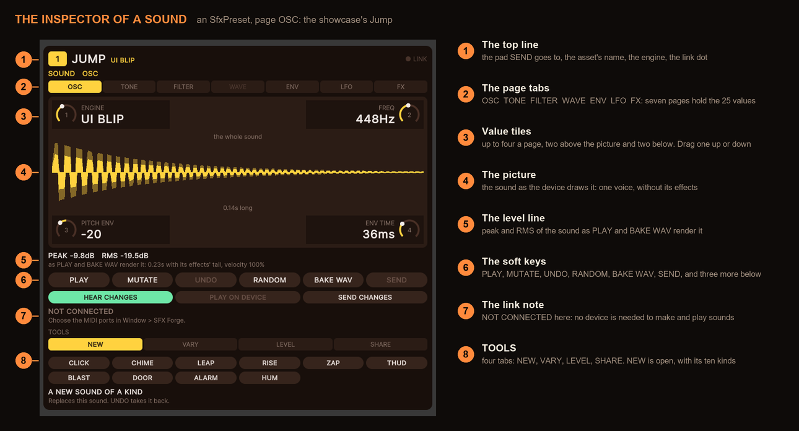
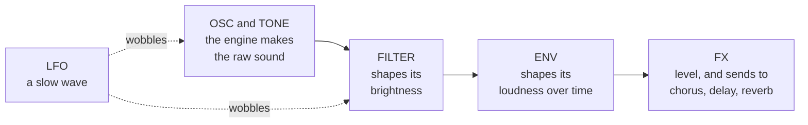
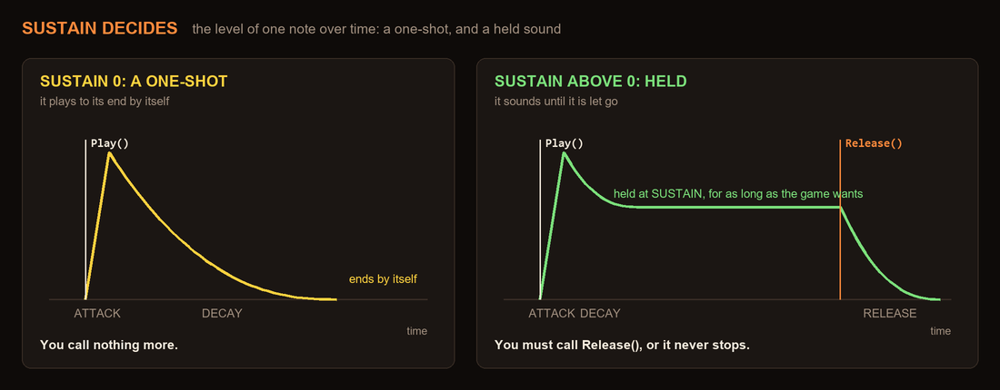

# Unity Presets And Patches

A sound in SFX Forge is a *patch*: an engine and 25 numbers. A *preset* is a patch saved as an asset. This page
shows the 25 values in groups you can remember, the five engines, and the three forms a patch takes: asset, code
and text.

## The preset's Inspector

**Assets > Create > SFX Forge > Preset** makes a preset. Its Inspector is the device's sound page:



*The showcase's Jump, page OSC. Rendered by the package's tests, not photographed in the editor.*

| You | What happens |
|---|---|
| click a page tab (2) | the four tiles show that page's values |
| drag a tile (3) up or down | the value goes up or down. With SHIFT held it moves finer |
| double-click a value | it becomes a field to type in, in the display's units: `200Hz`, `1.2s`, `40%` |
| double-click a tile's ring | the value goes to that of a plain patch |
| press **PLAY** (6) | the sound plays through the editor's speakers, with its effects |
| press **MUTATE** / **RANDOM** | a variation of this sound / a new one-shot from nothing |
| press **BAKE WAV** | a stereo 16-bit `.wav` at 48 kHz is written next to the asset |

Every change is an undo step: **UNDO** or Ctrl+Z takes it back.

## The 25 values, page by page

The sound follows one path. Each page of the Inspector is one stop on it:



| Page | Knob 1 | Knob 2 | Knob 3 | Knob 4 |
|---|---|---|---|---|
| **OSC** | ENGINE `engine` | FREQ `baseFreq` | PITCH ENV `pitchEnvAmount` | ENV TIME `pitchEnvDecay` |
| **TONE** | **A** `fmRatio` | **B** `fmDepth` | NOISE `noiseMix` | CRUSH `bitcrush` |
| **FILTER** | CUTOFF `filterCutoff` | RESO `filterRes` | FILTER ENV `filterEnv` | F.ENV TIME `filterEnvDecay` |
| **WAVE** | TABLE `table` | SPREAD `spread` | | |
| **ENV** | ATTACK `attack` | DECAY `ampDecay` | SUSTAIN `sustain` | RELEASE `release` |
| **LFO** | LFO RATE `lfoRate` | > PITCH `lfoPitch` | > FILTER `lfoFilter` | > TIMBRE `lfoTimbre` |
| **FX** | CHORUS `chorus` | DELAY `delay` | REVERB `reverb` | LEVEL `level` |

That is the engine and all 25 values, each once. The word in capitals is what the Inspector and the device show;
the word in `code` is the field of `SfxPatch`. Every value is a `byte` from 0 to 127. The WAVE page opens only for
the WAVETABLE engine.

Four values to know first:

| Value | Remember |
|---|---|
| PITCH ENV and FILTER ENV | **64 is none.** Above 64 the pitch (or the filter) starts higher and falls back; below 64 it starts lower and rises |
| SUSTAIN | **0 is a one-shot.** Above 0 the sound is held ([below](#one-shot-or-held)) |
| LEVEL | **100 is as designed.** 0 is silent |

What each value does, with its range in Hz, ms and per cent, is in
[the manual's table "Every value"](../docs/UNITY.md#every-value).

## The five engines

ENGINE chooses how the raw sound is made. The knobs **A** and **B** on the TONE page mean something else in each:

| `SfxEngine` | On the display | What it is | A | B | Good for |
|---|---|---|---|---|---|
| `Impact` | IMPACT | a sine whose pitch falls, with FM and noise, driven hard | FM RATIO | FM DEPTH | hits, kicks, explosions |
| `UiBlip` | UI BLIP | a square wave that can step upwards | ARP STEP | ARP SPEED | coins, menus, chiptune |
| `SciFiFm` | SCI-FI FM | two sines, one bending the other | FM RATIO | FM DEPTH | lasers, engines, FM bass and keys |
| `Foley` | FOLEY | noise through a band, in grains | GRAIN RATE | GRAIN AMT | steps, wind, fire, hi-hats |
| `Wavetable` | WAVETABLE | a wave that morphs through a table | POSITION | WARP | pads, strings, brass, organs |

With FOLEY, CUTOFF reads BAND: it is the band the noise sits in. Set NOISE to 127 there. With WAVETABLE, TABLE
picks one of six tables: Saw to Square, Pulse, Peak, Vowel, Organ, Glass.
[Device The Five Engines](Device-The-Five-Engines) has each engine in depth.

## One-shot or held



*A sketch, not a measurement.*

| `sustain` | The sound is | `IsSustained` | You must |
|---|---|---|---|
| **0** | a **one-shot**: it plays to its end | `false` | do nothing. It ends by itself |
| **above 0** | **held**: it sounds until it is let go, then rings out over RELEASE | `true` | call `Release()`, or it never stops |

For a held preset the Inspector shows one more tile, **HOLD** (`holdSeconds`, `1.50s` at first): how long a baked
clip or the PLAY key holds the sound before letting go. A player in the game holds it as long as you want:
[Unity Held Sounds](Unity-Held-Sounds).

## A patch in code

```csharp
// in: SfxPreset preset
// the engine, then the values in the order FREQ, PITCH ENV, ENV TIME, A, B, NOISE, CUTOFF, RESO, DECAY, CRUSH, …
SfxPatch coin = SfxPatch.Create(SfxEngine.UiBlip, 86, 64, 0, 26, 60, 0, 127, 0, 62, 0);
coin.reverb = 25;                             // every value is a field
coin[SfxParam.FilterCutoff] = 110;            // … and reachable by index

SfxPatch copy = preset.patch;                 // a struct: this is a copy
copy.Mutate(new System.Random(7));            // a variation, as MUTATE makes
```

`Create` takes as many values as you give; the rest come from a plain patch (a short one-shot, level 100). The
full order is that of `SfxParam`. `Mutate` moves every value by up to 15 % of its range and leaves LEVEL, TABLE
and a SUSTAIN of 0 alone, so a one-shot stays a one-shot.

> **A bare `new SfxPatch()` is silent.** All its values are 0, and that includes `level`. Start from
> `SfxPatch.Create` or `SfxPatch.Default`.

## A patch as text

Packed, a patch is 28 bytes: a format number, the engine, the 25 values and a checksum. As text it is `SFXF1:` and
those bytes as 56 hex digits, 62 characters in all. The default laser:

```
SFXF1:0202466E2D32460078143A0000002240283200000000000000640043
```

In the Inspector: **TOOLS > SHARE**, then **COPY** and **PASTE**. Paste the text into a chat, a commit message or
a comment in the code. In code:

```csharp
// in: SfxPreset preset
string text = SfxPatchText.ToText(preset.patch);
if (SfxPatchText.TryParse(text, out SfxPatch patch)) preset.patch = patch;
```

The text is the patch only: not the asset's name and not HOLD.

## Which form when

| Form | Use it when |
|---|---|
| **Preset** (asset) | the sound is designed by ear in the Inspector, or came from the device. The usual choice |
| **Patch in code** | the sound is computed, or you want no asset: `player.Play(patch)`, `SfxNative.BakeInterleaved(patch)` |
| **Text** | you pass a sound to someone, or keep it in a note |
| **Variation set** | one preset should sound a little different at every play: [Unity Variations](Unity-Variations) |

## Next

- [Unity Choosing A Route](Unity-Choosing-A-Route): now play it
- [Unity Sound Design Tools](Unity-Sound-Design-Tools): NEW, VARY, LEVEL and SHARE in the Inspector
- [Device Make A Sound](Device-Make-A-Sound): the same values on the device's knobs
- [Patch Format](Patch-Format): the 28 bytes, one by one

## Reference

- [The Unity manual, section 3: A sound: SfxPatch](../docs/UNITY.md#3-a-sound-sfxpatch)
- [The Unity manual, "Every value"](../docs/UNITY.md#every-value) and
  ["The five engines, and what A and B mean"](../docs/UNITY.md#the-five-engines-and-what-a-and-b-mean)
- [The Unity manual, "The patch as an asset: SfxPreset"](../docs/UNITY.md#the-patch-as-an-asset-sfxpreset)
- [The Unity manual, "SHARE: a sound as text, and as a .syx file"](../docs/UNITY.md#share-a-sound-as-text-and-as-a-syx-file)
- [The device's manual, section 6: How a sound is built](../docs/MANUAL.md#6-how-a-sound-is-built)
- [SfxPatch.cs](../unity/com.catsplat.sfxforge/Runtime/Core/SfxPatch.cs),
  [SfxPreset.cs](../unity/com.catsplat.sfxforge/Runtime/SfxPreset.cs),
  [SfxPatchText.cs](../unity/com.catsplat.sfxforge/Runtime/Core/SfxPatchText.cs),
  [SfxPresetEditor.cs](../unity/com.catsplat.sfxforge/Editor/SfxPresetEditor.cs)
