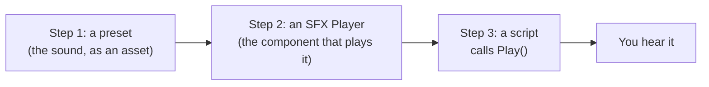
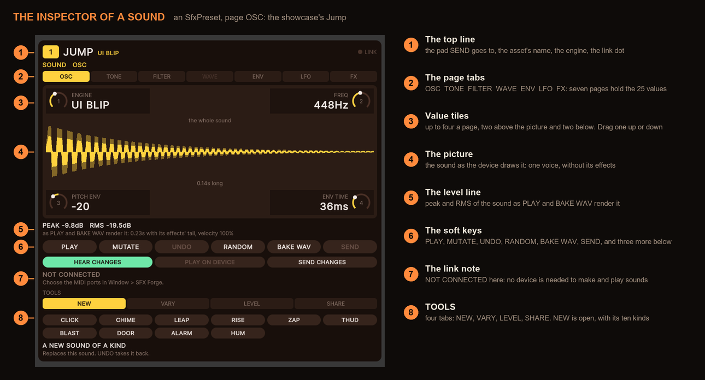

# Unity Quick Start

From an empty scene to a sound you trigger yourself, in about five minutes. You make one asset, add one component
and write one short script. No device is needed.



Before you start: the package is installed ([Unity Install](Unity-Install)), and you are on Windows x64.

## 1. Make a sound

1. In the Project window, right-click a folder: **Create > SFX Forge > Preset** (the same as
   **Assets > Create > SFX Forge > Preset** in the menu bar).
2. An asset named `New SFX` appears. Rename it `Laser`. A new preset holds `SfxPatch.Default`, which is a laser.
3. Select it. The Inspector shows the sound the way the device's display does:



*The Inspector of a preset. This one is the showcase's Jump on page OSC; yours says the name of your asset and
SCI-FI FM. The picture is rendered by the package's tests, not photographed in the editor.*

4. Press the soft key **PLAY** (6 in the picture). You hear the laser through the editor's speakers.
5. Drag a value tile (3) up or down, for example **FREQ**. The key **HEAR CHANGES** is lit at first, so the sound
   plays again a moment after each change (outside Play mode).
6. Press **MUTATE** a few times for variations. **UNDO** or Ctrl+Z takes a change back.
7. Not after a laser? Under **TOOLS** (8), on the tab **NEW**, click a kind: **CHIME** for a pickup, **THUD** or
   **CLICK** for a footstep. Every click gives another sound of that kind; **UNDO** takes it back
   ([Unity Sound Design Tools](Unity-Sound-Design-Tools#new-a-sound-of-a-kind)).

A *tile* shows one value; a *key* is one of the buttons under the picture. Both words are in the
[Glossary](Glossary#unity).

[Unity Presets And Patches](Unity-Presets-And-Patches) explains every page and value.

## 2. Put a player in the scene

1. **GameObject > Create Empty**. Name it `Sound`.
2. With it selected, click **Add Component** and choose **SFX Forge > SFX Player**. Unity adds an **Audio Source**
   beside it, because the player needs one. Leave the Audio Source's **AudioClip** empty: the player keeps that
   source running itself.
3. Drag your `Laser` asset onto the player's **Preset** field.
4. Check that the scene has an **Audio Listener**. The default Main Camera has one.

To hear it without any code: tick **Play On Enable** on the SFX Player and press Play. The laser plays once when
the scene starts. Untick it again before the next step.

## 3. Play it from a script

1. Create a C# script named `FirstSound.cs` with this content:

```csharp
using CatSplat.SfxForge;
using UnityEngine;

[RequireComponent(typeof(SfxPlayer))]
public class FirstSound : MonoBehaviour
{
    SfxPlayer player;

    void Start()
    {
        player = GetComponent<SfxPlayer>();
    }

    void OnGUI()
    {
        if (GUI.Button(new Rect(20, 20, 160, 40), "Laser")) player.Play();
        if (GUI.Button(new Rect(20, 70, 160, 40), "Higher")) player.Play(1f, 7f);
        if (GUI.Button(new Rect(20, 120, 160, 40), "Soft")) player.Play(0.4f);
    }
}
```

2. Drag the script onto the `Sound` object.
3. Press Play. Three buttons appear in the Game view.
4. Click **Laser**: the preset plays. **Higher**: the same sound, 7 semitones up. **Soft**: at velocity 0.4, so
   quieter.

`Play(velocity, semitones, midiNote)` takes all three as optional arguments:

| Argument | What it is |
|---|---|
| `velocity` | how hard the note is played, 0 to 1. Softer is quieter |
| `semitones` | moves the pitch up or down; 12 are an octave |
| `midiNote` | above 0, the sound plays as that note (69 is the A at 440 Hz) instead of at its own FREQ |

The [Glossary](Glossary#playing-a-sound) has these words.

## Without an asset at all

A sound is also just a value in code. `SfxPatch.Create` takes an engine and up to 25 numbers, each 0 to 127; the
ones you leave out come from a plain patch. The first ten, as the Inspector names them: FREQ, PITCH ENV, ENV TIME,
A, B, NOISE, CUTOFF, RESO, DECAY, CRUSH. [Unity Presets And Patches](Unity-Presets-And-Patches#a-patch-in-code)
has the whole order.

```csharp
// in: SfxPlayer player
// a fragment: put it where `player` is known, for example in OnGUI of the script above
SfxPatch coin = SfxPatch.Create(SfxEngine.UiBlip, 86, 64, 0, 26, 60, 0, 127, 0, 62, 0);
player.Play(coin);                 // no preset needed
player.Play(SfxPatch.Default);     // the laser
```

## Edit it while the game runs

While the game is in Play mode, select the `Laser` asset and turn a value. A sound of that preset that is ringing
on the player takes the new values, and the next `Play()` uses them. That is how you tune a sound in place.

## If it is silent

| Check | Why |
|---|---|
| Is there a warning "the native library (sfxforge) is not available"? | you are not on Windows x64. Nothing is synthesized there |
| Does the SFX Player have a preset? | `Play()` without a preset does nothing |
| Did the patch start from `new SfxPatch()`? | all its values are 0, also `level`. Use `SfxPatch.Create` or `SfxPatch.Default` |
| Is `Play` called from another object's `Awake`? | a player ignores `Play` until its own `OnEnable` has run, and while it is disabled. Call from `Start` or later |
| Is there an Audio Listener, and is the Game view not muted? | the player goes through Unity's audio like everything else |

The full list is in [Unity Troubleshooting](Unity-Troubleshooting).

## Next

- [Unity Concepts](Unity-Concepts): what the preset, the patch and the player are
- [Unity Choosing A Route](Unity-Choosing-A-Route): baked clip, live voice, held sound or music?
- [Unity Presets And Patches](Unity-Presets-And-Patches): shape the sound
- [Unity Music First Song](Unity-Music-First-Song): the same five minutes for music

## Reference

- [The Unity manual, section 1: Five minutes](../docs/UNITY.md#1-five-minutes)
- [The Unity manual, "The patch as an asset: SfxPreset"](../docs/UNITY.md#the-patch-as-an-asset-sfxpreset)
- [The Unity manual, "The silence checklist"](../docs/UNITY.md#the-silence-checklist)
- [SfxPlayer.cs](../unity/com.catsplat.sfxforge/Runtime/SfxPlayer.cs),
  [SfxPreset.cs](../unity/com.catsplat.sfxforge/Runtime/SfxPreset.cs),
  [SfxPatch.cs](../unity/com.catsplat.sfxforge/Runtime/Core/SfxPatch.cs)
