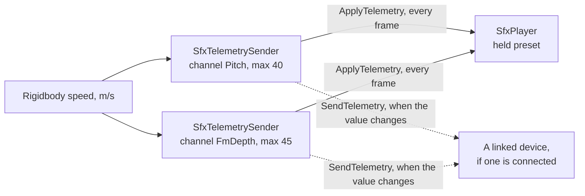
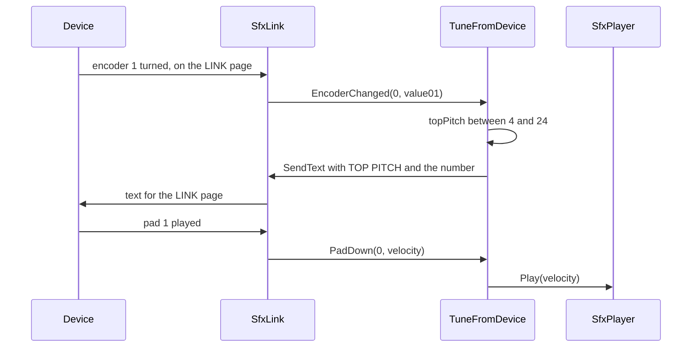

# Unity Recipes Link

Two recipes that use the link's vocabulary: a held sound driven by `SfxTelemetrySender` instead of your own update
code, and a knob of the device that tunes a value in the running game. They are recipes 4 and 13 of
[Unity Recipes](Unity-Recipes); the code is that of [the Unity manual, section 8](../docs/UNITY.md#8-recipes).

*Telemetry* is a game value from 0 to 1 on one of eight channels. A local `SfxPlayer` and a linked device do the
same with it ([Unity Telemetry And Encoders](Unity-Telemetry-And-Encoders)). Recipe 4 needs no device. Recipe 13
needs one, and receiving from a device was tested against the SDK's emulator only, not on hardware
([What Is Tested](What-Is-Tested)).

## 4. An engine hum wired with SfxTelemetrySender

**Goal:** the engine hum of [recipe 3](Unity-Recipes#3-an-engine-hum-that-follows-speed) without an `Update` of
your own: one `SfxPlayer` holds the sound, and one `SfxTelemetrySender` per value reads the Rigidbody's speed and
moves it.



Each sender turns its reading into 0 to 1 between `min` and `max`, passes it through `curve`, and hands it to every
player in `localPlayers`. What a channel does with the value:

| Channel | 0 … 1 becomes |
|---|---|
| `SfxTelemetry.Pitch` | `pitchSemitones` 0 … +24 |
| `SfxTelemetry.Cutoff` | `cutoffOctaves` −4 … +4, with 0.5 as "no change" |
| `SfxTelemetry.FmDepth` | `fm` 0 … 1 |
| `SfxTelemetry.Level` | `level` 0 … 1 |

In the Inspector: add **SFX Forge > SFX Player** with a held preset and **Play On Enable**, then one
**SFX Forge > SFX Telemetry Sender** per value, and drag the player into each sender's **Local Players**. The
script below builds the same list in code.

```csharp
using CatSplat.SfxForge;
using UnityEngine;

[RequireComponent(typeof(Rigidbody))]
public class EngineHumWiring : MonoBehaviour
{
    public SfxPreset humPreset;              // a held preset: sustain above 0

    void Awake()
    {
        var player = gameObject.AddComponent<SfxPlayer>();
        player.preset = humPreset;
        player.volume = 0.5f;
        player.Play();

        var pitch = gameObject.AddComponent<SfxTelemetrySender>();
        pitch.channel = SfxTelemetry.Pitch;                               // 0 … 1 becomes 0 … +24 semitones
        pitch.source = SfxTelemetrySender.Source.RigidbodySpeed;
        pitch.max = 40f;                                                  // 20 m/s is one octave up
        pitch.localPlayers = new[] { player };

        var timbre = gameObject.AddComponent<SfxTelemetrySender>();
        timbre.channel = SfxTelemetry.FmDepth;
        timbre.source = SfxTelemetrySender.Source.RigidbodySpeed;
        timbre.max = 45f;
        timbre.localPlayers = new[] { player };
    }
}
```

**Listen for:** at rest the hum as designed. At 20 m/s it is an octave higher (20 of 40 is 0.5, and 0.5 of 24
semitones is 12) and its FM is deeper. A sender reads the Rigidbody on its own object or a parent.

| `Source` | Reads |
|---|---|
| `RigidbodySpeed` | the speed of the `Rigidbody` |
| `Rigidbody2DSpeed` | the speed of the `Rigidbody2D` |
| `AnimatorFloat` | the Animator's float named in `animatorParameter` (default `"Speed"`) |
| `Manual` | the sender's own `value` field: write it from your code |

## 13. A knob on the device tunes a game value

**Goal:** during a tuning session, turn encoder 1 of the device to change a number in the running game, and read
the number in the bottom line of the device's LINK page. The scene needs an **SFX Forge Link** component (`SfxForgeLink`): it opens
the MIDI ports and polls the link every frame ([Unity Device Link Setup](Unity-Device-Link-Setup)).



```csharp
using CatSplat.SfxForge;
using UnityEngine;

public class TuneFromDevice : MonoBehaviour
{
    public SfxPlayer engine;
    public float minTopPitch = 4f, maxTopPitch = 24f;
    public float topPitch = 12f;                         // read this where you set engine.pitchSemitones

    void OnEnable()
    {
        SfxLink.Shared.EncoderChanged += OnEncoder;
        SfxLink.Shared.PadDown += OnPad;
    }

    void OnDisable()
    {
        SfxLink.Shared.EncoderChanged -= OnEncoder;
        SfxLink.Shared.PadDown -= OnPad;
    }

    void OnEncoder(int encoder, float value01)           // 0 … 5: encoders 1 – 4, then A, B
    {
        if (encoder != 0) return;
        topPitch = Mathf.Lerp(minTopPitch, maxTopPitch, value01);
        SfxLink.Shared.SendText("TOP PITCH " + topPitch.ToString("0"));
    }

    void OnPad(int pad, float velocity)                  // 0 … 15
    {
        if (pad == 0 && engine != null) engine.Play(velocity);
    }
}
```

**Look and listen for:** turn encoder 1 on the device's LINK page: `topPitch` moves between 4 and 24 in the
Inspector, and the bottom line of the device's LINK page shows `TOP PITCH` and the number. Play pad 1: the `engine` player plays its
preset at the pad's velocity. Without code, the component **SFX Forge > SFX Encoder Binding** sends an encoder to
an AudioMixer parameter or a UnityEvent.

## Next

- [Unity Device Link Setup](Unity-Device-Link-Setup): ports, the virtual cable, the SFX Forge window
- [Unity Telemetry And Encoders](Unity-Telemetry-And-Encoders): all eight channels, both directions
- [Unity Recipes Music](Unity-Recipes-Music): recipes 6 to 10
- [Unity Troubleshooting](Unity-Troubleshooting#the-console-says): "could not open every MIDI port"

## Reference

- [The Unity manual, recipe 4](../docs/UNITY.md#4-the-same-without-code-sfxtelemetrysender) and
  [recipe 13](../docs/UNITY.md#13-a-knob-on-the-device-tunes-a-game-value)
- [The Unity manual, section 6: From the device to the game](../docs/UNITY.md#6-from-the-device-to-the-game), with
  [Telemetry](../docs/UNITY.md#telemetry-the-game-drives-the-device-while-you-listen) and
  [Encoders and pads](../docs/UNITY.md#encoders-and-pads-the-device-drives-the-game)
- [SfxTelemetrySender.cs](../unity/com.catsplat.sfxforge/Runtime/SfxTelemetrySender.cs),
  [SfxForgeLink.cs](../unity/com.catsplat.sfxforge/Runtime/SfxForgeLink.cs),
  [SfxEncoderBinding.cs](../unity/com.catsplat.sfxforge/Runtime/SfxEncoderBinding.cs),
  [SfxLink.cs](../unity/com.catsplat.sfxforge/Runtime/Core/SfxLink.cs),
  [SfxProtocol.cs](../unity/com.catsplat.sfxforge/Runtime/Core/SfxProtocol.cs)
