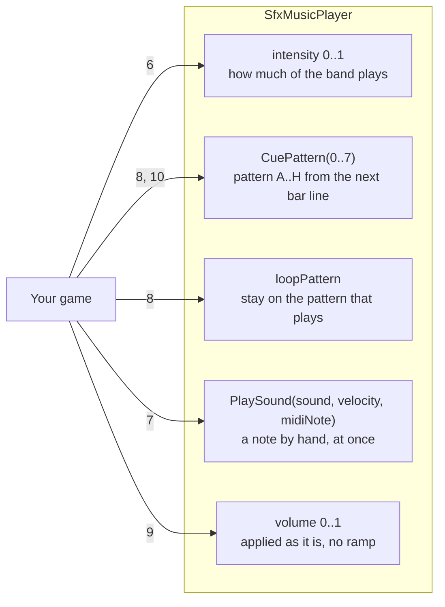

# Unity Recipes Music

Five small scripts that make a song follow the game: intensity, a stinger on the bar line, a pattern per area,
ducking, a boss theme. They are recipes 6 to 10 of [Unity Recipes](Unity-Recipes), taken from
[the Unity manual, section 8](../docs/UNITY.md#8-recipes): the code is the manual's, only some comments are
shorter. It was compiled against the package and not listened to ([What Is Tested](What-Is-Tested)).

Every script has a field `music`: drag an `SfxMusicPlayer` that has a song onto it.
[Unity Music First Song](Unity-Music-First-Song) shows how to get one with the demo song.

## The five calls these recipes use



Two words first. A *pattern* is one bar of the song; a song has eight, A to H, and some may be empty. The
*arrangement* is the order the song plays its patterns in by itself. Both are in the [Glossary](Glossary).

## 6. Music that follows danger

**Goal:** more of the band the more dangerous it gets. Every sound of a song has a layer mark; it plays only when
`intensity` is at or above that mark ([Unity Adaptive Music](Unity-Adaptive-Music)).

```csharp
using CatSplat.SfxForge;
using UnityEngine;

public class DangerMusic : MonoBehaviour
{
    public SfxMusicPlayer music;                 // one that has a song, for example DemoSong.asset
    [Range(0f, 1f)] public float danger;         // set it from your game: 0 calm … 1 the enemy is on you
    public float floor = 0.15f;                  // the least the band ever plays
    public float riseSeconds = 0.6f, fallSeconds = 2.5f;
    float intensity;

    void Update()
    {
        float target = Mathf.Max(floor, danger);
        float seconds = target > intensity ? riseSeconds : fallSeconds;
        intensity = Mathf.MoveTowards(intensity, target, Time.deltaTime / seconds);
        music.intensity = intensity;
    }
}
```

**Listen for:** in Play mode, drag `danger` up in the Inspector: instruments join within 0.6 seconds. Drag it down:
they leave over 2.5 seconds, so the band lingers after the danger.

## 7. A stinger on the bar line

**Goal:** three bell notes that start on the song's next bar. `PlaySound` plays at once and is not quantised, so
the script waits for `Bar` to change first. Instrument 13 is the demo song's bells.

```csharp
using System.Collections;
using CatSplat.SfxForge;
using UnityEngine;

public class Stinger : MonoBehaviour
{
    public SfxMusicPlayer music;                 // one that has a song, for example DemoSong.asset
    public int instrument = 13;                  // 0 … 15: the song's sound, pad number minus one
    public int[] notes = { 76, 83, 88 };         // E5 B5 E6

    public void Play() => StartCoroutine(OnTheNextBar());

    IEnumerator OnTheNextBar()
    {
        int bar = music.Bar;
        float giveUp = Time.time + 4f;
        while (music.IsPlaying && music.Bar == bar && Time.time < giveUp) yield return null;

        float sixteenth = 60f / (music.song != null && music.song.Bpm > 0 ? music.song.Bpm : 120) / 4f;
        foreach (int note in notes)
        {
            music.PlaySound(instrument, 0.9f, note);
            yield return new WaitForSeconds(sixteenth);
        }
    }
}
```

**Listen for:** call `Play()` anywhere in a bar: nothing until the bar ends, then E5, B5, E6 a sixteenth apart on
top of the song. For a held instrument (the demo song's brass is 5, its strings 15) call
`music.ReleaseSound(instrument, note)` after the note's length, or it never stops.

## 8. A pattern per area, held

**Goal:** each area of the level has its own pattern, and the song stays on it until you say otherwise.

```csharp
using CatSplat.SfxForge;
using UnityEngine;

public class AreaMusic : MonoBehaviour
{
    public SfxMusicPlayer music;                 // one that has a song, for example DemoSong.asset

    /// <summary>0 = A … 7 = H, from the next bar line, and it stays. -1: let the song run by itself again.</summary>
    public void EnterArea(int pattern)
    {
        music.loopPattern = pattern >= 0;
        if (pattern >= 0) music.CuePattern(pattern);
    }
}
```

**Listen for:** `EnterArea(4)` with the demo song: from the next bar line the breakdown, pattern E, round and
round. `EnterArea(-1)`: the song walks on through its arrangement.

Without `loopPattern`, a cue of a pattern that is in the song's arrangement lasts only a bar or two: the arrangement
walks on from there. The demo song's arrangement contains every pattern it has.
[Unity Cues And Patterns](Unity-Cues-And-Patterns) has the whole rule. The showcase holds its patterns the older
way, by cueing again on every bar ([Unity Showcase Walkthrough](Unity-Showcase-Walkthrough)).

## 9. Ducking the music

**Goal:** the music steps back for a hit or a line of dialogue and comes forward again by itself.
`SfxMusicPlayer.volume` is applied without a ramp: a jump clicks. So the script moves it over 50 ms.

```csharp
using CatSplat.SfxForge;
using UnityEngine;

public class MusicDuck : MonoBehaviour
{
    public SfxMusicPlayer music;                 // one that has a song, for example DemoSong.asset
    public float normalVolume = 0.6f;
    [Range(0f, 1f)] public float duckedPart = 0.5f;      // the volume while ducked, as a part of normal
    public float dipSeconds = 0.05f, recoverSeconds = 2f;
    float duck, target;                                  // 0 = normal … 1 = fully ducked

    /// <summary>A hit, a line of dialogue: the music steps back and comes forward again by itself.</summary>
    public void Duck() => target = 1f;

    void Update()
    {
        duck = Mathf.MoveTowards(duck, target, Time.deltaTime / (target > duck ? dipSeconds : recoverSeconds));
        if (duck >= target) target = 0f;
        music.volume = normalVolume * Mathf.Lerp(1f, duckedPart, duck);
    }
}
```

**Listen for:** `Duck()`: the music drops to half within 50 ms, without a click, and is back after 2 seconds. This
script owns `music.volume`: set the level with `normalVolume`, not on the player.

## 10. A boss theme

**Goal:** a theme that starts when the boss appears and stays until it is beaten. On the device, write the theme in
pattern H and leave H out of the arrangement. A pattern outside the arrangement stays until the next cue, so two
calls are enough.

```csharp
using CatSplat.SfxForge;
using UnityEngine;

public class BossMusic : MonoBehaviour
{
    public SfxMusicPlayer music;                 // one that has a song with a theme in pattern H

    public void BossAppears()
    {
        music.CuePattern(7);                             // H, from the next bar line
        music.SetMaster(SfxMaster.Drive, 60);            // and a rougher mix
    }

    public void BossDefeated()
    {
        music.CuePattern(0);                             // back to A; the arrangement walks on from there
        music.Reload();                                  // the song's own mix again
    }
}
```

**Listen for:** with a song of your own that has a theme in H: the theme from the next bar line, with more drive,
until `BossDefeated()`. With the demo song this recipe cues silence: its patterns G and H are empty.

## Next

- [Unity Recipes Link](Unity-Recipes-Link): the engine hum without update code, and a knob of the device
- [Unity Adaptive Music](Unity-Adaptive-Music): layers and intensity in depth
- [Unity Music Mix And Notes](Unity-Music-Mix-And-Notes): `PlaySound`, `SetTrackVolume`, `SetMaster`
- [Unity Troubleshooting](Unity-Troubleshooting#the-music-is-silent): when the music stays silent

## Reference

- [The Unity manual, section 8: Recipes](../docs/UNITY.md#8-recipes)
- [The Unity manual, section 5: Music](../docs/UNITY.md#5-music), with
  [Cueing patterns](../docs/UNITY.md#cueing-patterns) and
  [Holding a pattern: loopPattern](../docs/UNITY.md#holding-a-pattern-looppattern)
- [SfxMusicPlayer.cs](../unity/com.catsplat.sfxforge/Runtime/SfxMusicPlayer.cs),
  [SfxSong.cs](../unity/com.catsplat.sfxforge/Runtime/SfxSong.cs)
