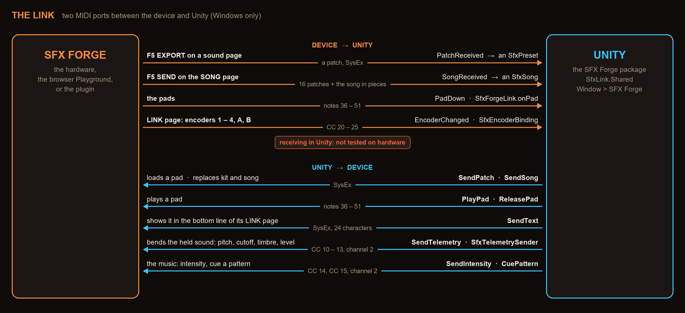
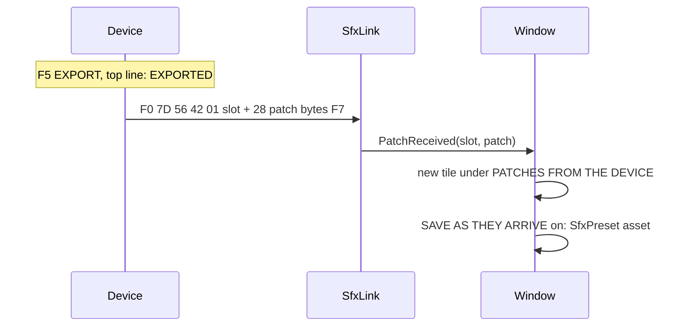
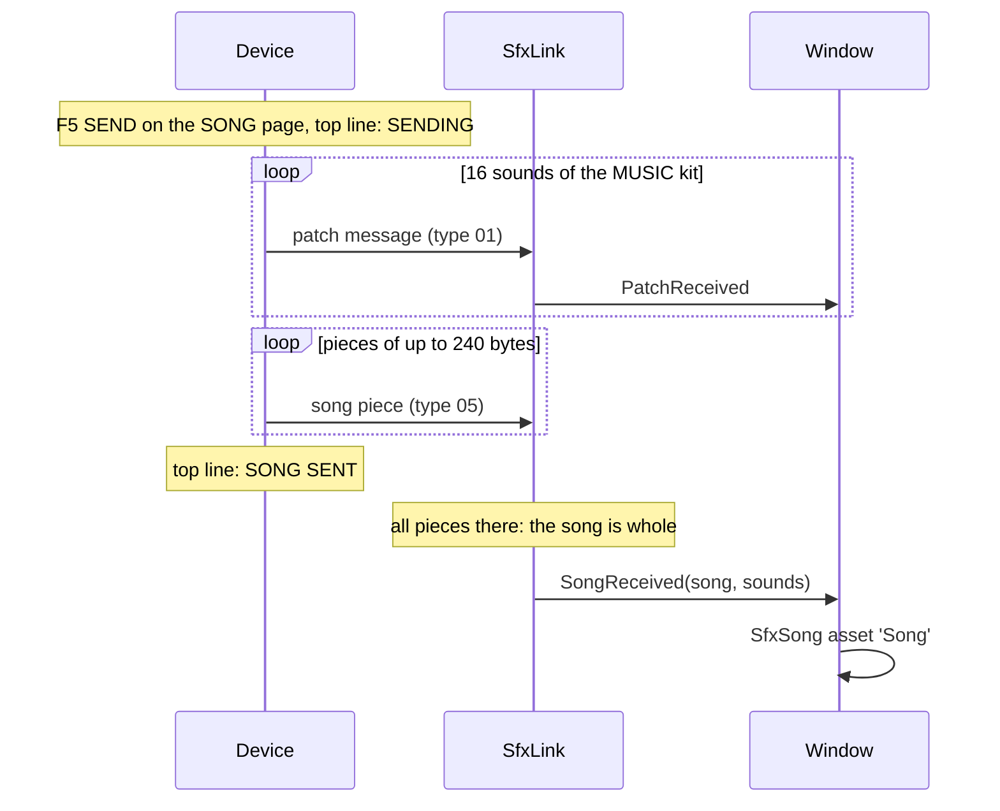
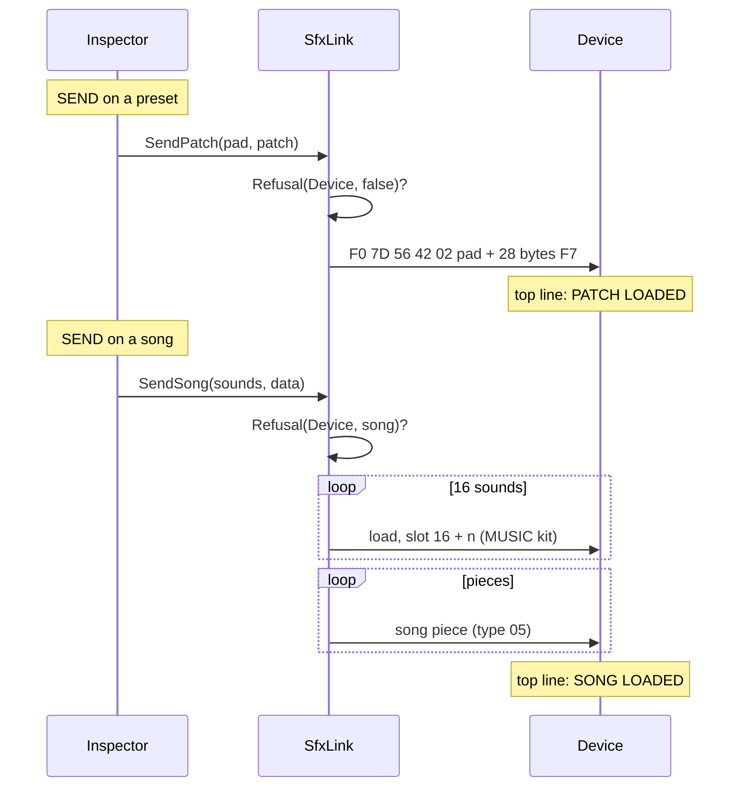

# Unity Send And Receive

This page shows how a sound and a song travel between the device and Unity: which key you press, which messages
cross, and which asset you end up with. It assumes the link is up
([Unity Device Link Setup](Unity-Device-Link-Setup)).



*Every line is one kind of traffic: what happens on the device, the MIDI message, and the call or event in Unity.
Orange goes to Unity, blue goes to the device. A text sent with `SendText` shows on the device's LINK page under
LINKED, and only while that page is open.*

## The short version

| You want | Do this | You get |
|---|---|---|
| one sound from the device | **F5 EXPORT** on a sound page or the LINK page of the device, or click a pad under **PADS FETCH THEIR PATCH** in the window | an `SfxPreset` asset |
| the device's song | **F5 SEND** on the device's SONG page, or **FETCH SONG** in the window | an `SfxSong` asset named `Song` |
| a sound onto the device | **SEND** in the preset's Inspector | the sound on a pad of the device's selected kit |
| a song onto the device | **SEND** in the song's Inspector | the device's song and the 16 sounds of its MUSIC kit replaced |

The window (**Window > SFX Forge**) must be open to save assets: it is the window that listens and writes them.

**Which kit travels.** The device has two kits of 16 sounds. SEND and FETCH SONG carry the MUSIC kit, always.
EXPORT and a fetched pad carry a sound of the kit that is chosen on the device at that moment, and the message
does not say which kit it was. Sound effects of the SFX kit therefore come one EXPORT at a time, with SFX chosen on
the device (SHIFT + ENTER changes kit). The device's side of this, in its own words:
[Device Saving And Reset](Device-Saving-And-Reset#hand-it-to-the-programmer).

## A sound: device to Unity



1. On the device, select the sound and press **F5 EXPORT**. Its top line says `EXPORTED`. The message is 35 bytes.
2. In the window a tile appears under **PATCHES FROM THE DEVICE**: pad number, engine, time, waveform.
3. With **SAVE AS THEY ARRIVE** lit (it is at first), the asset is written at once and Unity points at it.
   Otherwise press **SAVE** on the tile; the key then reads **SHOW**.

Asking from Unity does the same without touching the device: the tab **PADS FETCH THEIR PATCH**, then a click on a
pad. That sends `F0 7D 56 42 04 slot F7`, and the device answers with the same message as EXPORT.

**Where it lands.** `<FOLDER>/Pad03_SciFiFm.asset`: the pad's number and the engine's name (`Impact`, `UiBlip`,
`SciFiFm`, `Foley`, `Wavetable`). FOLDER is the field beside SAVE AS THEY ARRIVE, `Assets/SfxForge` at first; a
folder outside `Assets` is replaced by `Assets/SfxForge`. A name that is taken gets a number; nothing is
overwritten.

## A song: device to Unity



1. On the device, open the SONG page (K5, then K5 again) and press **F5 SEND**. Its top line says `SENDING`, or
   `SENDING - NO GAME SEEN` if nothing from a game has arrived yet; it sends all the same. Or press **FETCH SONG**
   in the window, which sends `F0 7D 56 42 06 F7` and gets the same answer.
2. The device sends the 16 sounds of its MUSIC kit, then the song in pieces of up to 240 bytes, and says
   `SONG SENT`. The factory song is 2487 bytes in 11 pieces: 27 messages with the sounds.
3. When the last piece is in, the window writes `<FOLDER>/Song.asset` (`Song 1.asset` if that is taken) and points
   at it. **SHOW SONG** points at the song fetched last.

Things to know:

- **The 16 sounds also arrive as patches.** Each one fires `PatchReceived`, so with SAVE AS THEY ARRIVE lit the
  window saves 16 presets beside the song. Switch it off before FETCH SONG if you only want the song.
- **The pieces may come in any order**, and twice. The receiver puts each where it belongs. A transfer that stops
  is forgotten after two seconds.
- **A song without all 16 sounds is not saved.** `SongReceived` then hands over `null` for the sounds, and the
  window warns in the Console and asks you to use FETCH SONG or SEND.
- **The same song sent twice** gives one `SongReceived`. `RequestSong()` (FETCH SONG) forgets what was collected,
  so a song you ask for again does arrive.

## Unity to the device



**A sound.** In a preset's Inspector, the number at the top left is the pad of the device. Click it to choose
another. Then:

| Key | What it does |
|---|---|
| **SEND** | loads the sound into that pad of the kit selected on the device; the device selects that pad |
| **PLAY ON DEVICE** | sends it, then plays the pad: a note on and a note off |
| **SEND CHANGES** | a toggle: sends the sound a moment after every change you make |

**A song.** **SEND** in the song's Inspector replaces the device's song and the 16 sounds of its MUSIC kit. The kit
selected on the device stays selected.

Under the keys both Inspectors say `LINKED` and where SEND goes, `NOT CONNECTED`, or why SEND is off.

Nothing comes back over MIDI for a send. The device answers on its top line: `PATCH LOADED` or `BAD PATCH` for a
sound; `SOUND LOADED` for each of a song's sounds, then `SONG LOADED`, `BAD SONG` or `NEWER SONG: UPDATE`.

## When formats differ

The package asks before it sends and refuses in words. `SendPatch` and `SendSong` then send nothing, return
`false`, and `SfxLink.Shared.LastRefusal` holds the reason. The Inspector shows it under its keys.

**Sending a song** (`SfxLink.Refusal(device, packedSong)`):

| The device | A format-6 song | A format-5 song | A format 1 – 4 song |
|---|---|---|---|
| said song format 6 (firmware 1.6.0 on) | sent | sent | sent |
| said song format 5 (firmware 1.4, 1.5) | refused: "update the device's firmware" | sent, in the older message | refused: "fetch the song again from the device" |
| said nothing (before 1.4, or no answer) | refused: "the device did not say that it takes song format 6" | sent, in the older message | refused |

Before any of that, two checks on the song itself: bytes that are not a packed song are refused ("this is not a
packed song", or for a newer format "update the package"), and so is a song with a value out of range ("the device
would answer BAD SONG").

**Sending a patch** is refused only when the device said a patch format other than 2. No firmware so far does.

**Receiving:**

| What arrives | What happens |
|---|---|
| a patch in format 2 | `PatchReceived` |
| a whole song, in either shape of the song message (firmware 1.6.0 on sends format 6; 1.4 and 1.5 sent format 5) | `SongReceived` |
| a patch or a song in a higher format | not taken. `NewerReceived` fires with a text; the window writes it to the Console and to LAST MESSAGES IN |
| an identity | never taken for a patch or a piece; a transfer in progress is left alone |

> **Right after CONNECT** the device has not answered yet, and a format-6 song is refused until it does. In code,
> wait for `IdentityReceived` before the first `SendSong`.

## In your own code

```csharp
using CatSplat.SfxForge;
using UnityEngine;

public class TakeTheSong : MonoBehaviour
{
    public SfxMusicPlayer music;

    void OnEnable() => SfxLink.Shared.SongReceived += OnSong;
    void OnDisable() => SfxLink.Shared.SongReceived -= OnSong;

    void OnSong(byte[] packedSong, SfxPatch[] sounds)
    {
        if (sounds == null) return;                      // not all 16 sounds came with it
        var song = ScriptableObject.CreateInstance<SfxSong>();
        song.Set(sounds, packedSong);
        music.song = song;
        music.Reload();                                  // the player takes the new song without stopping
    }
}
```

`Reload()` makes an enabled music player take its song again without stopping. If it is not playing yet, call
`music.Play()` instead: `Play()` takes a song asset that was assigned since the player took its song, and starts it.

Put an `SfxForgeLink` in the scene: events fire from `SfxLink.Poll()`, and that component opens the ports and
polls every frame. `SfxLink.Shared.RequestSong()` asks for the song; `RequestPatch(0)` asks for pad 1.

## What was tried

Run against the emulator: fetching a patch and the song, twenty transfers in a row, sending a song to the device
and reading it back, and EXPORT and SEND pressed on the device while a game ran. Not run: `SendPatch`, and the keys
of the window and the Inspectors against a device. See [What Is Tested](What-Is-Tested).

## Next

- [Unity Telemetry And Encoders](Unity-Telemetry-And-Encoders): live values instead of assets.
- [Unity Music First Song](Unity-Music-First-Song): play the song you fetched.
- [Song Format](Song-Format) and [Patch Format](Patch-Format): what is inside the bytes.

## Reference

- [Receiving a patch or a song](../docs/UNITY.md#receiving-a-patch-or-a-song) and [Sending](../docs/UNITY.md#sending)
- [When a song is not sent](../docs/UNITY.md#when-a-song-is-not-sent)
- [The song formats the package reads](../docs/UNITY.md#the-song-formats-the-package-reads)
- [The README's protocol table](../README.md#the-link-device--game-engine)
- [The device's manual: songs, formats and older firmware](../docs/MANUAL.md#songs-formats-and-older-firmware)
- Source: [SfxLink.cs](../unity/com.catsplat.sfxforge/Runtime/Core/SfxLink.cs),
  [SfxProtocol.cs](../unity/com.catsplat.sfxforge/Runtime/Core/SfxProtocol.cs),
  [SfxSongTransfer.cs](../unity/com.catsplat.sfxforge/Runtime/Core/SfxSongTransfer.cs),
  [SfxForgeWindow.cs](../unity/com.catsplat.sfxforge/Editor/SfxForgeWindow.cs),
  [fw_link.h](../sfx-forge/fw_link.h)
