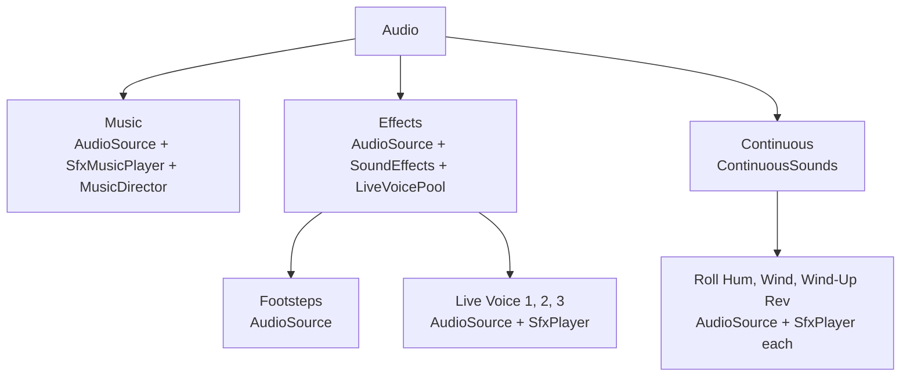
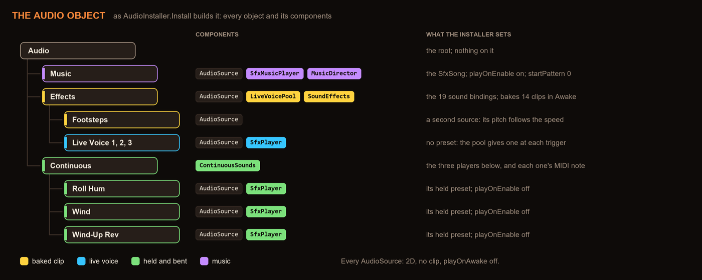
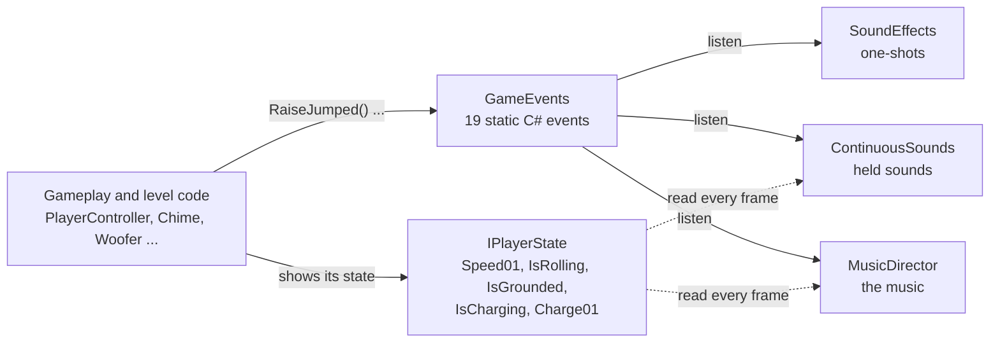
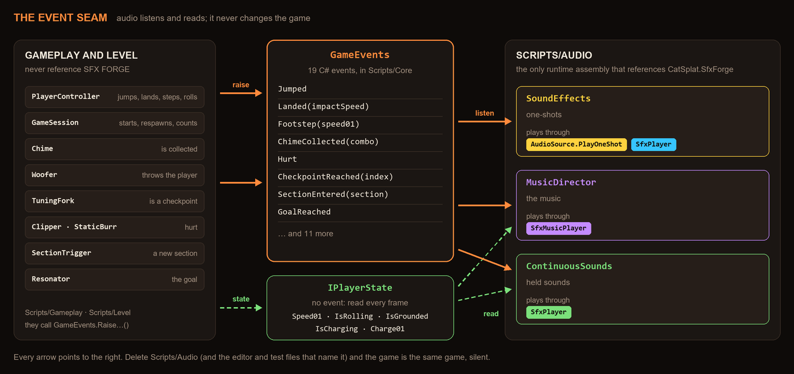
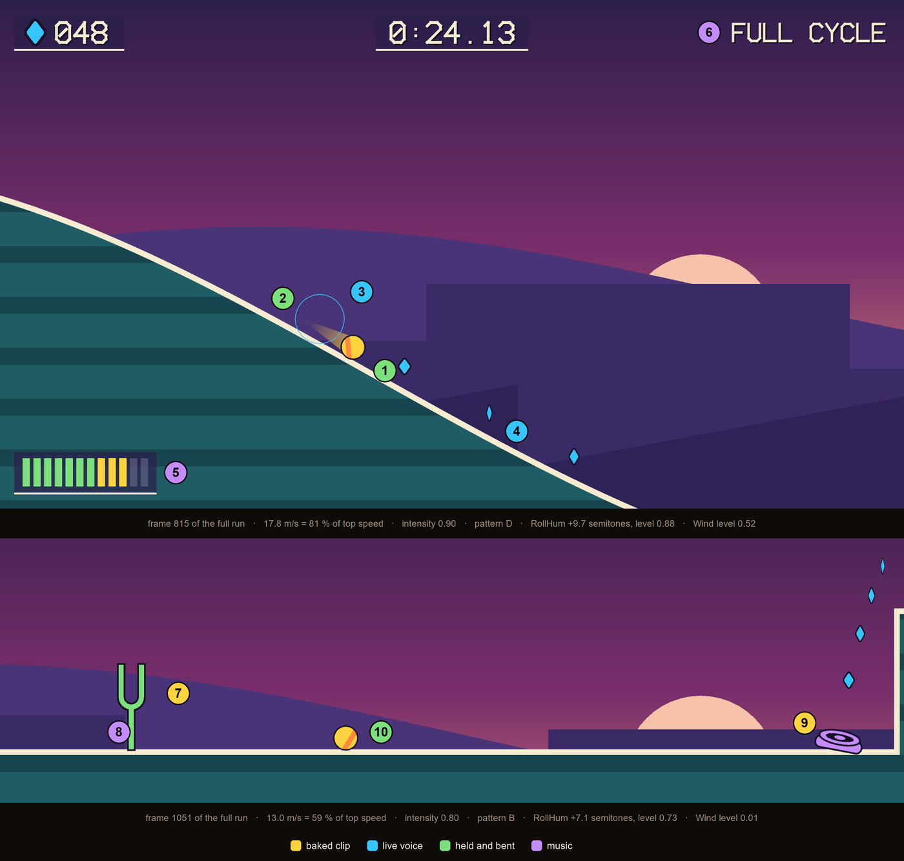
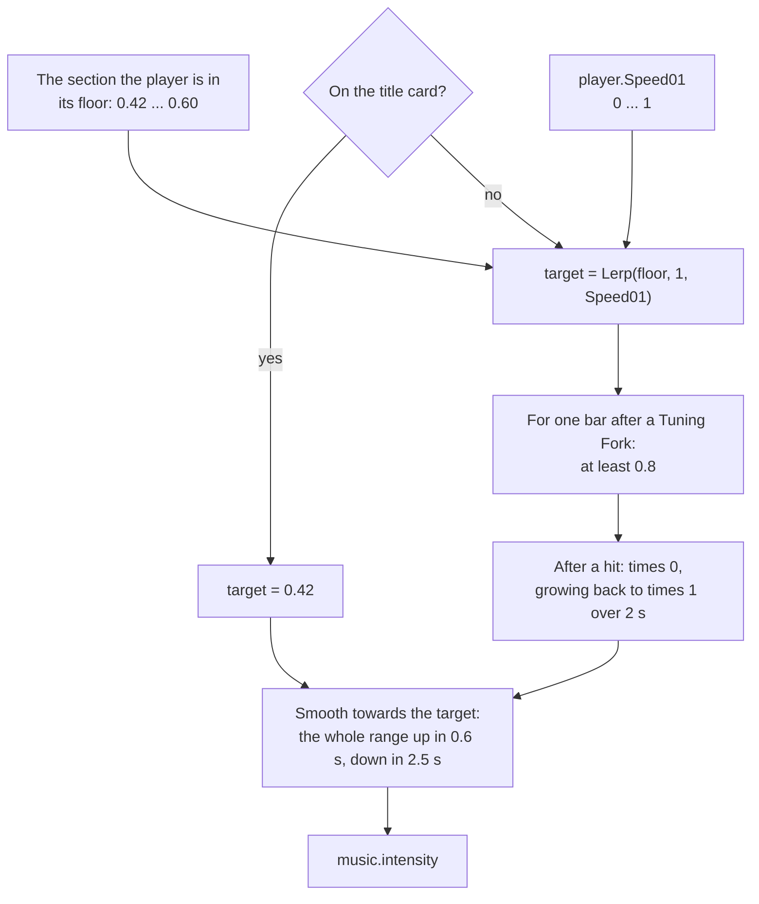
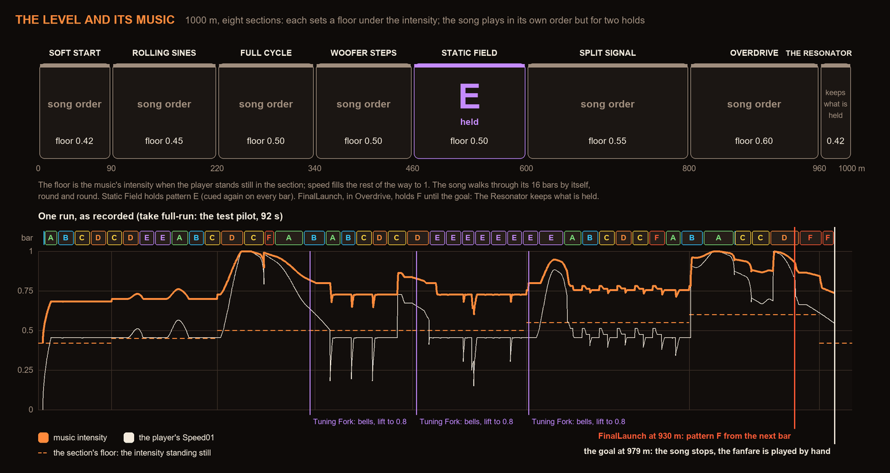

# Unity Showcase Walkthrough

A map of the example game: which objects make its sound, how the game tells them what happened, which sound takes
which route, and where the music gets its intensity. Read it before you open the code, or before you
[copy the pattern](Unity-Copy-The-Showcase-Pattern) into your own game.

*Brio: First Harmonic* is a one-level 2D platformer. Every sound in it is SFX FORGE at runtime: 19 sound effects
written as patches in code, and the demo song. There is no audio file in its folder.

## Open it and play

1. Open the Unity project `unity/Demo` of the repository with Unity 6000.3.8f1. (From the package instead: in the
   Package Manager, select **SFX Forge**, open **Samples** and import **Showcase**. It needs the built-in render
   pipeline and the legacy Input Manager.)
2. Open the scene `Assets/Showcase/Showcase.unity`. (Imported as a sample, the folder is
   `Assets/Samples/SFX Forge/<version>/Showcase`.)
3. Press Play. You see the title card `BRIO: FIRST HARMONIC`, `PRESS JUMP`, and hear the song's rhythm section.
4. Press Space. The run starts.

| | Keyboard |
|---|---|
| Run | Left / Right or A / D |
| Jump (hold for a full jump, tap for a hop) | Space or Z |
| Tuck into a roll, while moving | Down or S |
| Wind-Up, standing still: hold Down, tap Jump up to six times, let go of Down to Burst | Down + Space |

Sound needs Windows x64. Elsewhere the game runs silent and says so in the Console. No device is needed.
The video of a whole run is on [Videos](Videos).

## The audio objects

Everything that sounds is under one object, `Audio`. `AudioInstaller.Install` builds it in code.

*The same tree with what the installer sets. Yellow is a baked clip, blue a live voice, green held and bent, purple
music.*

Every `AudioSource` is 2D, has no clip and has `playOnAwake` off. An `SfxPlayer` or `SfxMusicPlayer` adds its sound
to the `AudioSource` beside it and keeps that source running.

## The event seam

> **Audio only listens to events and reads the player's state. Gameplay never calls SFX FORGE.**

*Every arrow points to the right: nothing in the audio changes the game.*

- **Events** are for things that happen at a moment: a jump, a landing, a Chime.
  [`GameEvents.cs`](../unity/Demo/Assets/Showcase/Scripts/Core/GameEvents.cs) has one `Raise…` method for each. The
  audio scripts subscribe in `OnEnable` and unsubscribe in `OnDisable`.
- **State** is for things that last: speed, rolling, charging. They have no event. The audio reads them every frame.
- `Scripts/Audio` is the only assembly of the game itself that references `CatSplat.SfxForge`. (The scene builder in
  `Editor` and the tests in `Tests` do too.)

## Which sound uses which route

A *route* is how a sound reaches the speakers: baked once into a clip, synthesized live for one play, or held and
bent while it plays ([Unity Choosing A Route](Unity-Choosing-A-Route)).

*Two frames of a recorded run. 1, 2, 10: the roll hum and the wind (held). 3, 4: Chimes (live). 7, 9: the Tuning
Fork and the Woofer (baked). 5, 6, 8: the speed meter, the section's name and the bells that answer the fork
(music). The line under each frame gives the game's values at that moment.*

| The game says | You hear | Route | Varies with |
|---|---|---|---|
| `Jumped` | Jump | baked | |
| `Landed(impactSpeed)` | Land | baked | silent below 4 m/s, louder up to 25 m/s |
| `Footstep(speed01)` | FootstepLeft, FootstepRight in turn | baked, on a source of its own | the source's pitch 1.0 … 1.3 with speed |
| `TuckStarted`, `Skidded`, `WooferBounced`, `ClipperDefeated`, `Respawned`, `UiConfirmed` | TuckStart, Skid, Woofer, ClipperPop, Respawn, UiConfirm | baked | |
| `BurstReleased(charge01)` | Burst | baked | volume 50 … 100 % with the charge |
| `Hurt` | Hurt, and the music flinches | baked, music | |
| `CheckpointReached(index)` | TuningFork, and three bell notes of the song | baked, music | |
| `GoalReached` | Goal, and a fanfare on the song's instruments | baked, music | |
| `ChimeCollected(combo)` | Chime | live voice | one step up E minor pentatonic per Chime of a combo, up to 10 |
| `ChimesScattered(count)` | ChimeScatter | live voice | a run of 5 … 8 pings, 55 ms apart, falling and fading |
| `WindUpCharged(charge01)` | WindUpRev, started again on each tap | held and bent | pitch, `fm` and cutoff with the charge |
| state: rolling on the ground | RollHum | held and bent | pitch, cutoff and level with `Speed01` |
| state: above 60 % of top speed | Wind | held and bent | level and cutoff with `Speed01`, faded over 0.4 s |

That is 14 baked sounds, 2 live and 3 held. The whole list, with each sound's patch, note and volume, is the table
at the end of [`SoundLibrary.cs`](../unity/Demo/Assets/Showcase/Scripts/Audio/SoundLibrary.cs). Every pitched
effect is tuned to a note of E minor pentatonic, the song's key, so the effects fit the music.

## Where the music gets its intensity

*Intensity* is a number from 0 to 1 on the `SfxMusicPlayer`. Every sound of the song has a layer mark and plays
only at or above it ([Unity Adaptive Music](Unity-Adaptive-Music)). `MusicDirector` computes it every frame:

A hit also sets the smoothed value itself to 0 at once, and dips the music's volume to half for the same two
seconds.

*Above: the eight sections and the floor each puts under the intensity. Below: one recorded run. The dashed line
is the floor, the white line the speed, the orange line the intensity.*

The song itself plays in its own order, 16 bars round and round. Two places hold one pattern instead, and the goal
ends the song:

| When | The music | How |
|---|---|---|
| the player is in Static Field | pattern E, the breakdown | `CuePattern(4)`, cued again whenever `music.Bar` changes |
| `FinalLaunch`, at the end of Overdrive | pattern F, the turnaround, until the goal | `CuePattern(5)`, the same way |
| `GoalReached` | the song stops; a fanfare by hand, in a bigger room | `Stop`, `SetTrackVolume`, `SetMaster(SfxMaster.ReverbSize, 110)`, `PlaySound` |
| `GameStarted` after a goal | the song's own mix, from pattern A | `Reload`, `Play` |

## Read the code in this order

| File in `Scripts/Audio` | Read it for |
|---|---|
| [`SoundLibrary.cs`](../unity/Demo/Assets/Showcase/Scripts/Audio/SoundLibrary.cs) | every patch, and the table of route, note and volume |
| [`SoundEffects.cs`](../unity/Demo/Assets/Showcase/Scripts/Audio/SoundEffects.cs) | `BakeClips`, `PlayBaked`, `OnChimeCollected` |
| [`LiveVoicePool.cs`](../unity/Demo/Assets/Showcase/Scripts/Audio/LiveVoicePool.cs) | three `SfxPlayer`s shared by the live one-shots |
| [`ContinuousSounds.cs`](../unity/Demo/Assets/Showcase/Scripts/Audio/ContinuousSounds.cs), [`HeldSound.cs`](../unity/Demo/Assets/Showcase/Scripts/Audio/HeldSound.cs) | `UpdateRollHum`, `UpdateWind`; hold, let go, retrigger |
| [`MusicDirector.cs`](../unity/Demo/Assets/Showcase/Scripts/Audio/MusicDirector.cs) | `TargetIntensity`, `HoldPattern`, `OnGoalReached` |
| [`AudioInstaller.cs`](../unity/Demo/Assets/Showcase/Scripts/Audio/AudioInstaller.cs) | how the `Audio` object is put together |

## Next

- [Unity Copy The Showcase Pattern](Unity-Copy-The-Showcase-Pattern): the same structure in your own game
- [Unity Testing Your Audio](Unity-Testing-Your-Audio): how the showcase's tests check all of this without ears
- [Unity Recipes](Unity-Recipes): the same ideas as single scripts
- [Videos](Videos): the showcase played from start to goal

## Reference

- [The Unity manual, section 7: The showcase, a worked example](../docs/UNITY.md#7-the-showcase-a-worked-example),
  with [What uses which route](../docs/UNITY.md#what-uses-which-route),
  [The event seam](../docs/UNITY.md#the-event-seam),
  [The sound table](../docs/UNITY.md#the-sound-table-soundlibrary) and
  [The MusicDirector](../docs/UNITY.md#the-musicdirector)
- [The showcase's README](../unity/Demo/Assets/Showcase/README.md#open-it-and-play): keys, checks, the folder map
- [The showcase's source](../unity/Demo/Assets/Showcase/Scripts/Audio)
