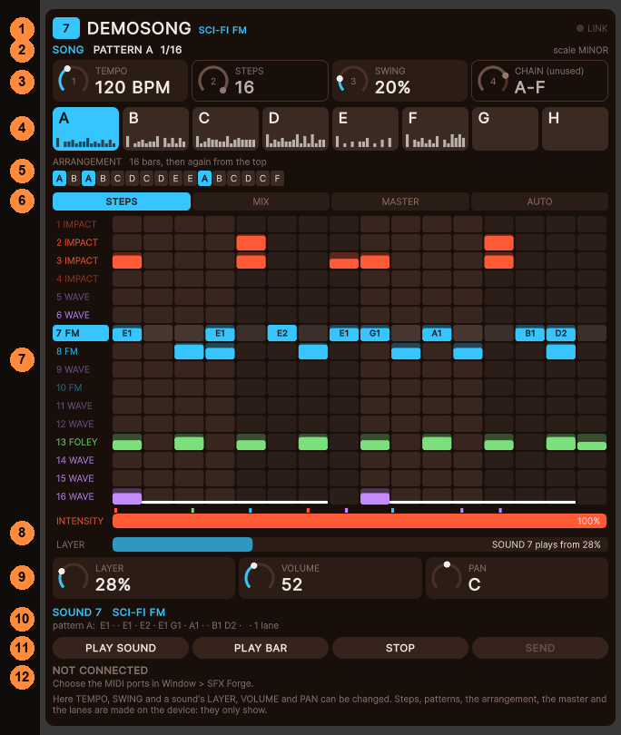
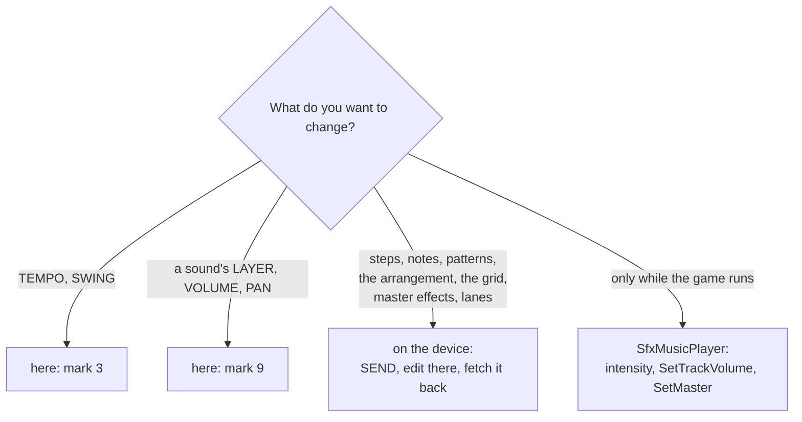
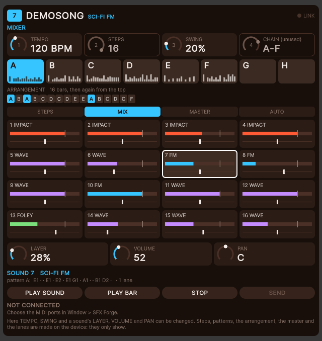
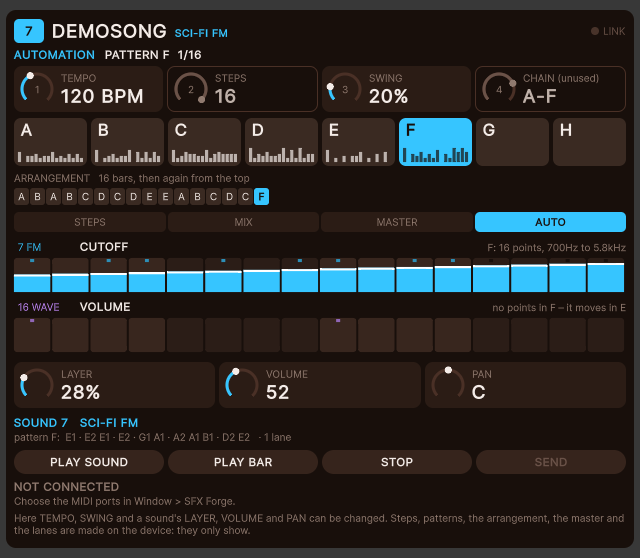
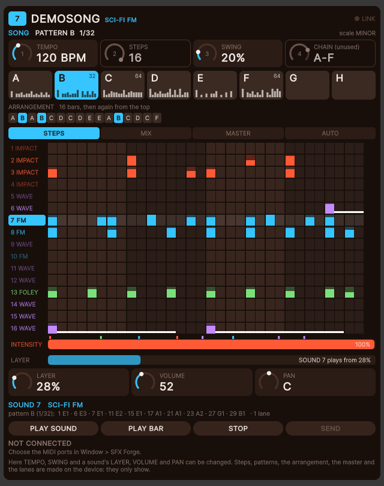

# Unity Song Inspector

Select an `SfxSong` asset and its Inspector shows the whole song as the device would. This page is a tour of it:
what each part says, the five numbers you can change in Unity, and what has to be made on the device.

*The demo song, page STEPS, pattern A. The marks are explained below. Like every picture of the editor on this wiki,
this is the panel rendered to a texture by the tests, not a photograph of the Inspector.*

## The parts

| Mark | Part | What it shows |
|---|---|---|
| **1** | the top line | the chosen sound's number (7, as on the device's pads: sound 6 in code), the asset's name, that sound's engine, and the LINK dot |
| **2** | the title | the page's title (SONG on page STEPS), on STEPS and AUTO the pattern looked at and its grid (`PATTERN A  1/16`), and on STEPS the scale |
| **3** | TEMPO · STEPS · SWING · CHAIN | the song's four numbers. STEPS is the bar's length in sixteenths, 1 to 16. CHAIN reads "(unused)" while the song has an arrangement |
| **4** | patterns A to H | a tile each. The little columns say how many sounds play on each sixteenth. Click a tile to look at that pattern |
| **5** | ARRANGEMENT | the bars as a row of letters; the bars with the pattern looked at are lit. Click a bar to look at its pattern |
| **6** | the page keys | STEPS, MIX, MASTER, AUTO: four views of the same song |
| **7** | the rows (page STEPS) | a row for each of the 16 sounds. A step is as high as it is hard; a white line says how long a note holds. The chosen sound's notes are written in its cells. Click a name to choose that sound and hear it |
| **8** | INTENSITY and LAYER | INTENSITY is a strip you drag, with a small mark for the LAYER of each sound that plays in the song. LAYER is the chosen sound's mark as a bar: "SOUND 7 plays from 28%" |
| **9** | LAYER · VOLUME · PAN | the chosen sound's layer mark and its place in the song's mix |
| **10** | the steps in words | the chosen sound's steps in the pattern looked at: a note, `x` for a step as designed, `·` for a rest; then how many automation lanes it has |
| **11** | the soft keys | PLAY SOUND, PLAY BAR, STOP, SEND |
| **12** | the link line | what SEND would do: here NOT CONNECTED |

## What you can change here, and what you cannot

The five numbers and how to move them:

| Number | Range | Change it by |
|---|---|---|
| **TEMPO** | 40 … 240 BPM | dragging the tile up or down, the mouse wheel over its dial, the arrow keys, or a double-click on the value to type one |
| **SWING** | 0 … 100 | the same |
| **LAYER** (the chosen sound) | 0 … 127 in the song, shown as a percentage. 0 = it always plays | the same |
| **VOLUME** (the chosen sound) | 0 … 127, 100 = as designed | the same |
| **PAN** (the chosen sound) | left … C … right | the same |

A double-click on a dial puts its number back: TEMPO 120, SWING 0, LAYER 0, VOLUME 100, PAN in the middle. Every
change is one Undo step ("Edit SFX Song").

Three things to know:

- **INTENSITY is not in the song.** Dragging the strip only shows you the song at that intensity (rows whose layer is
  silent go dim, as do muted ones) and sets what PLAY BAR plays. Your game sets the real one:
  [Unity Adaptive Music](Unity-Adaptive-Music).
- **A player that is already playing keeps the song it took.** It hears your change after its next `Reload()` or
  start.
- **VOLUME and PAN only show** in a song from before the device had a mixer (`SfxSong.HasMix` is false).

## The other three pages

### MIX

*A tile for each sound: its fader (the thin mark on it is 100, as designed) and its pan under it. Sound 7 is chosen.
Click a tile to choose a sound and hear it.*

The game moves the same faders while the music plays: [Unity Music Mix And Notes](Unity-Music-Mix-And-Notes).

### MASTER

Two drawings, the delay's echoes and the reverb's fading, and five numbers: DELAY TIME, FEEDBACK, ROOM SIZE, DAMPING,
DRIVE. They only show here.

### AUTO

*Pattern F. The first lane moves the CUTOFF of sound 7, the FM bass: 16 points, rising from 700 Hz to 5.8 kHz over
the bar. The second lane moves the VOLUME of sound 16 and has no points in F: the text says it moves in E.*

An automation lane is a row of points that moves one knob while the song plays: a sound's own value, its fader, its
pan, or a master effect. A song holds 24 lanes. They are drawn on the device
([Device Automation](Device-Automation)).

## A finer grid

*The tests' own song: the demo song with pattern B made 1/32 and C and F 1/64, with B looked at. The title says `PATTERN B  1/32`,
the tiles of B, C and F carry a small `32` or `64`, and the rows have 32 cells.*

Each pattern has its own grid: 1/16, 1/32 or 1/64, which is 16, 32 or 64 steps for a full bar. The grid is chosen on
the device ([Device Finer Grids](Device-Finer-Grids)); the Inspector shows it. At 32 and 64 steps a cell has no room
for a note's name, so the line under the tiles lists only the steps that are set, each with its number:
`pattern B (1/32):  1 E1 · 6 E3 · 7 E1`.

## The soft keys and SEND

| Key | What it does |
|---|---|
| **PLAY SOUND** | plays the chosen sound through the editor's speakers |
| **PLAY BAR** | plays the pattern looked at, once, at the INTENSITY set on the STEPS page, with the song's mix and effects |
| **STOP** | silence |
| **SEND** | replaces the 16 sounds and the song on the device. Dark while it cannot be done |

The line under the keys says why SEND is lit or dark:

| It says | When |
|---|---|
| **LINKED** | a MIDI output is open and nothing stands against this song |
| **NOT CONNECTED** | no MIDI output is open. Choose the ports in **Window > SFX Forge** |
| **ANOTHER FORMAT** | the connected device cannot take this song's format |
| **A DAMAGED SONG** | a value in the packed song is out of range |

Connecting is on [Unity Device Link Setup](Unity-Device-Link-Setup); sending and fetching on
[Unity Send And Receive](Unity-Send-And-Receive).

## What it does not show

- **The beat.** The Inspector names no time signature and shades empty cells in groups of four, whatever the
  device's beat is. Why: [Unity Music Mix And Notes](Unity-Music-Mix-And-Notes#the-bar-and-why-unity-has-no-beat).
- **Several songs at once, or an empty one.** It then only says so. An `SfxSong` made with
  **Assets > Create > SFX Forge > Song** says NO SONG YET until a song is put into it.

## Next

- [Unity Adaptive Music](Unity-Adaptive-Music): what the LAYER marks are for.
- [Unity Cues And Patterns](Unity-Cues-And-Patterns): what the patterns and the arrangement are for.
- [Unity Send And Receive](Unity-Send-And-Receive): the round trip to the device and back.
- [Unity Extending](Unity-Extending): how the inspectors are built.

## Reference

- [The Unity manual: The song in the Inspector](../docs/UNITY.md#the-song-in-the-inspector) ·
  [A finer grid](../docs/UNITY.md#a-finer-grid) · [When a song is not sent](../docs/UNITY.md#when-a-song-is-not-sent)
- [SfxSong in the API tables](../docs/UNITY.md#sfxsong-scriptableobject): the accessors the Inspector reads
- [The device's manual, section 10: The song](../docs/MANUAL.md#10-the-song) ·
  [section 12: Automation](../docs/MANUAL.md#12-automation)
- [SfxSongPanel.cs](../unity/com.catsplat.sfxforge/Editor/SfxSongPanel.cs) ·
  [SfxSongEditor.cs](../unity/com.catsplat.sfxforge/Editor/SfxSongEditor.cs) ·
  [SongViews.cs](../unity/com.catsplat.sfxforge/Editor/UI/SongViews.cs) ·
  [SfxSong.cs](../unity/com.catsplat.sfxforge/Runtime/SfxSong.cs)
- The first picture's script: [um_figures.py](../wiki/figures/um_figures.py)
