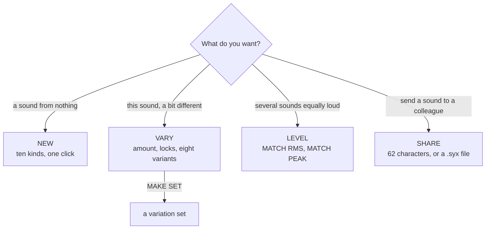
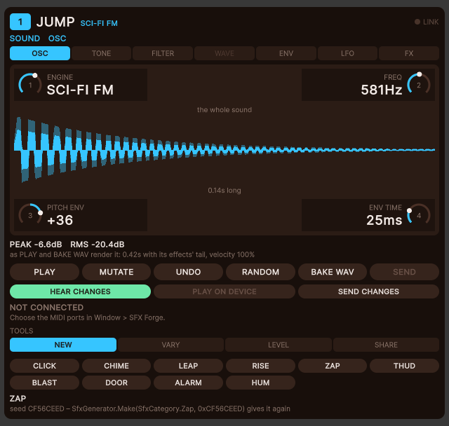
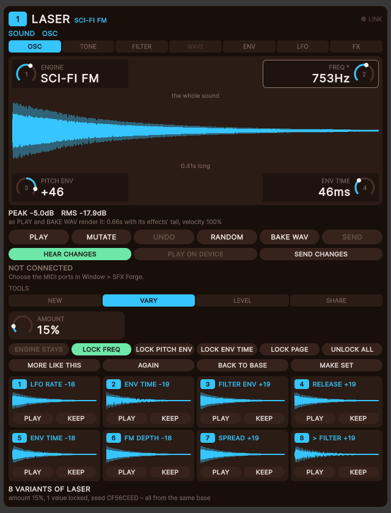
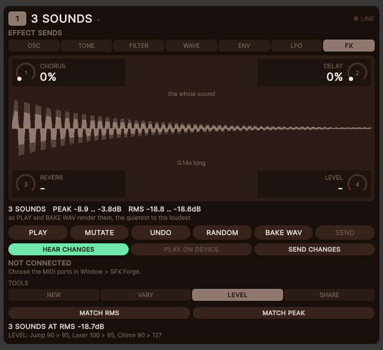
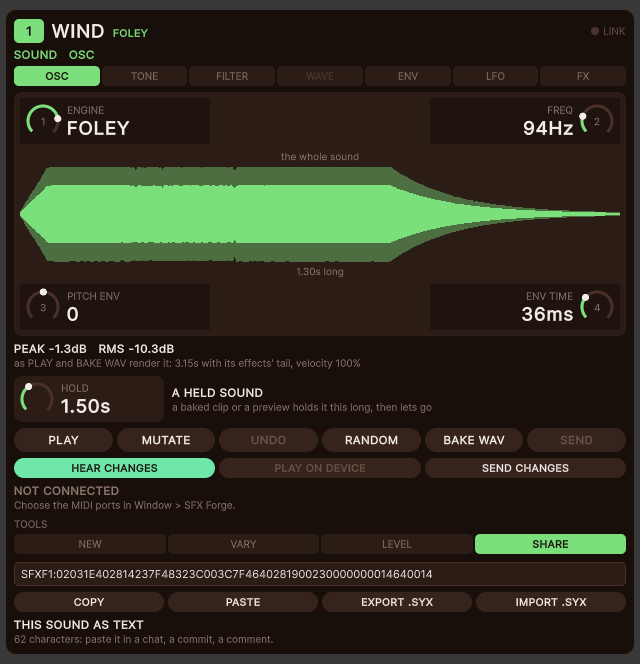

# Unity Sound Design Tools

This page is a tour of the four tools in a sound's Inspector: **NEW**, **VARY**, **LEVEL** and **SHARE**. For each
you get what it does, how to use it in three or four steps, and when you would reach for it. They make and shape
sounds in the editor, without the device.

## Where they are

Select an `SfxPreset` asset (a sound; see [Unity Presets And Patches](Unity-Presets-And-Patches)). Under the keys of
its Inspector is the word **TOOLS** and four tabs.



Three things hold for all four:

- **Every change a tool makes to a sound is one Undo step.** The UNDO key of the Inspector takes it back, and so
  does Unity's own Undo (Ctrl+Z). MAKE SET is the exception: it makes a new file and is not an Undo step.
- **Each tab has a note under its keys.** It says what the tool did last, or why it did nothing.
- **The pictures on this page** are the panels rendered by their tests, not photographs of the editor. Nobody has
  listened to what the tools make: see [What Is Tested](What-Is-Tested).

## NEW: a sound of a kind



*Tab NEW after a click on ZAP. The note under the ten keys names the kind and the seed.*

**What it does.** A click replaces the sound with a new one of that kind. Every click gives another.

| Key | The recipes aim at | Key | The recipes aim at |
|---|---|---|---|
| **CLICK** | the shortest sound | **THUD** | short and low |
| **CHIME** | a bright step up, or a small bell | **BLAST** | low noise that takes its time |
| **LEAP** | a short rise, one note | **DOOR** | a creak, or it shuts |
| **RISE** | a long rise | **ALARM** | held, and its pitch swings |
| **ZAP** | a fast fall | **HUM** | held, low, slowly alive |

1. Select a preset and open TOOLS > NEW.
2. Click a kind. The picture and the level line change, and the note names the kind and its seed. PLAY plays it.
3. Not it? Click again. Too far? UNDO.

**When would I use it?** At the start: you need a pickup sound and have nothing. Click CHIME until one is close,
then move on to VARY. With several presets selected, each gets its own new sound.

**Good to know.** ALARM and HUM make held sounds, the other eight one-shots. The seed in the note gives the same
sound again only while the recipes stay as they are: keep a sound you like as a preset or as its text (SHARE), not
as a seed. In code: `SfxGenerator.Make(SfxCategory.Zap, 0xCF56CEED)`.

## VARY: amount, locks, MORE LIKE THIS



*Tab VARY after MORE LIKE THIS, with FREQ locked: the key LOCK FREQ is lit and the FREQ tile above has an outline
and a star. Each variant's caption names the value that moved most from the base.*

**What it does.** It steers the MUTATE key, and shows eight variants of the sound to choose from.

| Part | What it does |
|---|---|
| **AMOUNT** | how far a value may move, 1 to 100 %. 15 % at first |
| **LOCK** *value* | one key for each value of the page shown (on OSC the first reads ENGINE STAYS: the engine never changes). A lit key: MUTATE and the variants leave that value alone |
| **LOCK PAGE** · **UNLOCK ALL** | locks the values of the page shown, or unlocks them when all are locked · unlocks everything, on every page |
| **MORE LIKE THIS** | takes the sound as it is now as the base and shows eight variants |
| **AGAIN** | eight other variants of the same base |
| **PLAY** · **KEEP** on a tile | hear that variant · the sound becomes that variant |
| **BACK TO BASE** | the sound becomes the base again |
| **MAKE SET** | makes a variation set next to the preset, named `<preset> Variations`, with this amount and these locks. With tiles shown it holds 9 variants: the sound and the eight tiles. Without: 6 |

1. Get the sound roughly right. Lock what must stay: open the page with that value and click its LOCK key.
2. Click **MORE LIKE THIS**. Eight tiles appear.
3. **PLAY** tiles. **KEEP** the one you like. The tiles stay, so you can still try another: all eight are variants
   of the base, not of each other.
4. Want to go further from there? Click MORE LIKE THIS again: the kept sound is the new base.

**When would I use it?** The laser is right but dull: lock FREQ so it stays in tune, and look for a better
envelope among the variants. Or you need six footsteps that belong together: MAKE SET, then see
[Unity Variations](Unity-Variations).

**Good to know.** AMOUNT and the locks belong to the editor session, not to the asset: they hold for every preset
until the editor closes. The engine, LEVEL and TABLE never move; a one-shot stays a one-shot and a held sound stays
held. MORE LIKE THIS works on one sound; with several selected only MUTATE does. The new set is not baked yet: see
[Unity Baking And WAV](Unity-Baking-And-WAV#a-variation-set-its-own-bake). In code:
`SfxMutate.Variant(basePatch, seed, index, percent, locked)`; index 0 is the base itself.

## LEVEL: how loud, and several sounds alike



*Three sounds selected, after MATCH RMS. The line under the picture gives the range of the three; the note says
which LEVEL each got.*

**What it does.** Two things. The **level line** under every sound's picture reads its loudness. **MATCH RMS** and
**MATCH PEAK** bring several selected sounds to the same reading.

| The level line reads | |
|---|---|
| `PEAK -5.0dB   RMS -17.9dB` | the largest sample, and the RMS of the sound's body, in dB below full scale |
| `CLIPS   PEAK +1.3dB …` in orange | the sound goes over full scale; a baked file of it is clamped |
| `SILENT` | nothing above −120 dB comes out |
| `3 SOUNDS   PEAK -8.9 .. -3.8dB …` | several selected: the quietest to the loudest |
| `NO LEVEL` | no native library here, or the engine did not render the sound |

RMS (root mean square) is an average level; peak is the single largest sample.

1. Select 2 to 32 presets in the Project window.
2. Open TOOLS > LEVEL and click **MATCH RMS** (or **MATCH PEAK**).
3. Read the note: `3 SOUNDS AT RMS -18.7dB`, and under it each sound's LEVEL before and after
   (`Jump 90 > 95`). One UNDO takes it all back. A silent sound is left as it is, and the note names it.

**When would I use it?** Before you bake a batch of UI sounds, so none jumps out. Or when the level line shows
CLIPS: lower LEVEL on the FX page until it does not.

**Good to know.** MATCH writes each sound's LEVEL (FX page) and nothing else. It measures; it does not hear: a
bright and a dull sound at the same RMS do not seem equally loud, so match first, then listen. It says nothing
about the game's mix, where sounds add up.

## SHARE: a sound as text, and as a .syx file



*Tab SHARE: the field with the sound's text, and the four keys.*

**What it does.** A sound is 28 bytes. As text it is `SFXF1:` and those bytes as hex, 62 characters. The default
laser is:

```
SFXF1:0202466E2D32460078143A0000002240283200000000000000640043
```

| Key | |
|---|---|
| the field | the sound's text. Type or paste another sound's text and press Enter: the sound becomes that one |
| **COPY** | the text to the clipboard |
| **PASTE** | the sound becomes the one whose text is on the clipboard. With several selected, all of them do |
| **EXPORT .SYX** | writes a 35-byte `.syx` file: the MIDI message that loads the sound into the chosen pad of the device (the number at the top left). One sound only |
| **IMPORT .SYX** | the sound becomes the first patch found in a `.syx` file: one this exports, or the device's EXPORT |

1. To send a sound: TOOLS > SHARE, **COPY**, paste it into a chat, a commit message or a code comment.
2. To take one: copy the text (the sentence around it may come along), select a preset, **PASTE**.
3. A text that is refused changes nothing, and the note says why: for example
   `damaged: the checksum does not fit`.

**When would I use it?** A colleague without the device asks for "that coin sound". Or you want a sound in version
control as one readable line. Or you want it on a device that is not linked to Unity: EXPORT .SYX and send the file
with any SysEx tool (that path was never tried against a device).

**Good to know.** The text is the patch only: not the asset's name, not HOLD, not a song. PASTE reads through
spaces, line breaks and quotes, and takes hex digits in lower case. In code: `SfxPatchText.ToText(patch)` and
`SfxPatchText.Parse(text, out SfxPatch patch)`, which returns an `SfxTextResult`; `SfxPatchText.Message(result)`
is the note's text.

## The same from code

What the keys are built on is in the runtime assembly, in classes that use nothing of Unity:

```csharp
using CatSplat.SfxForge;
using UnityEngine;

public class ToolsFromCode : MonoBehaviour
{
    void Start()
    {
        SfxPatch zap = SfxGenerator.Make(SfxCategory.Zap, 0xCF56CEED);          // NEW
        uint keep = SfxMutate.Bit(SfxParam.BaseFreq);                           // a lock
        SfxPatch other = SfxMutate.Variant(zap, 1234, 1, 15, keep);             // VARY: variant 1 at 15 %
        Debug.Log(SfxPatchText.ToText(other));                                  // SHARE
    }
}
```

## Next

- [Unity Variations](Unity-Variations): what MAKE SET gives you, and how to play it.
- [Unity Baking And WAV](Unity-Baking-And-WAV): turn the sounds into `.wav` files.
- [Unity Presets And Patches](Unity-Presets-And-Patches): every value of a sound.

## Reference

- [The Unity manual, section 11: Tools for designing sounds](../docs/UNITY.md#11-tools-for-designing-sounds)
- [NEW](../docs/UNITY.md#new-a-sound-of-a-kind) ·
  [VARY](../docs/UNITY.md#vary-mutates-amount-locks-and-more-like-this) ·
  [LEVEL](../docs/UNITY.md#level) ·
  [SHARE](../docs/UNITY.md#share-a-sound-as-text-and-as-a-syx-file)
- [The tools' core in the API](../docs/UNITY.md#the-tools-core-static-no-unity-in-it)
- Source: [SfxPresetPanel.cs](../unity/com.catsplat.sfxforge/Editor/SfxPresetPanel.cs),
  [SfxGenerator.cs](../unity/com.catsplat.sfxforge/Runtime/Core/SfxGenerator.cs),
  [SfxMutate.cs](../unity/com.catsplat.sfxforge/Runtime/Core/SfxMutate.cs),
  [SfxLevels.cs](../unity/com.catsplat.sfxforge/Runtime/Core/SfxLevels.cs),
  [SfxPatchText.cs](../unity/com.catsplat.sfxforge/Runtime/Core/SfxPatchText.cs)
