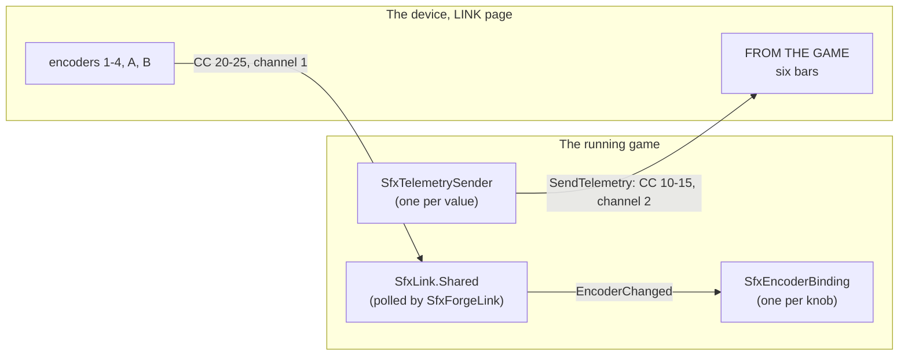
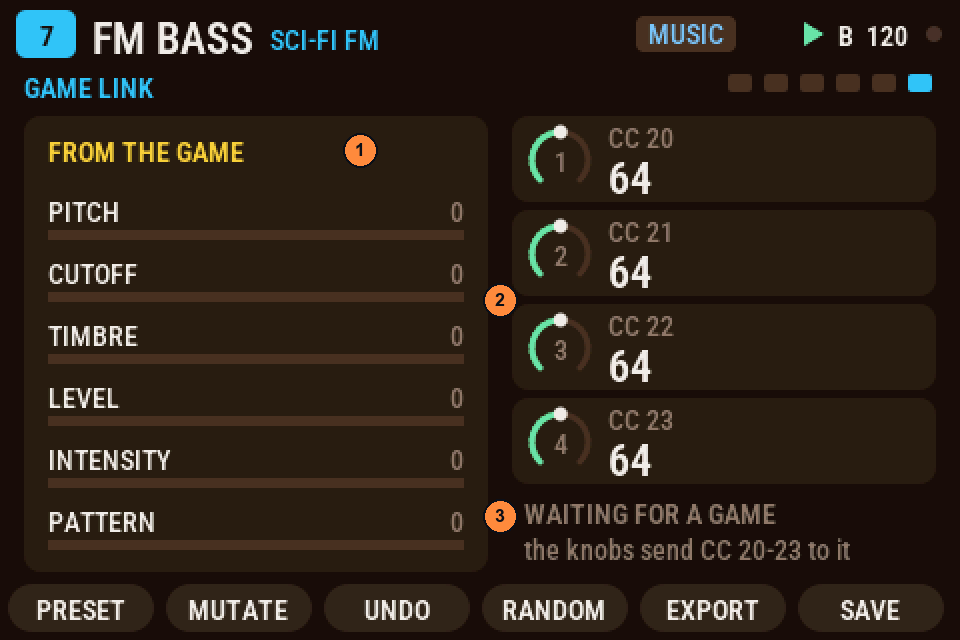

# Unity Telemetry And Encoders

This page covers the two live directions of the link. **Telemetry**: the game sends values to the device, so a
sound held on the device follows the game while you tune it. **Encoders**: the device's knobs send values to the
game, so you tune a game value by hand. It assumes the link is up
([Unity Device Link Setup](Unity-Device-Link-Setup)).



## The control changes

A control change (CC) is a MIDI message with a number and a value of 0 … 127.

**Game to device**, channel 2. `SfxLink.Shared.SendTelemetry(channel, value01)` takes 0 … 1:

| `SfxTelemetry` | CC | 0 … 1 becomes, on the device |
|---|---|---|
| `Pitch` | 10 | 0 … +24 semitones on the sound |
| `Cutoff` | 11 | −4 … about +4 octaves on the filter: (CC − 64) / 16. **0.5 is no change** |
| `FmDepth` | 12 | the timbre, 0 … 1 (FM depth, or a wavetable's position) |
| `Level` | 13 | the level, 0 … 1 |
| `Intensity` | 14 | the music's intensity: layers come in |
| `Pattern` | 15 | pattern A … H from the next bar line (the CC value divided by 16) |
| `Aux3`, `Aux4` | 16, 17 | kept by the device, not mapped to anything and not shown |

The device takes these on every page, not only on LINK. The first four move the sound that is playing; the
device shows all six as bars on its LINK page.

**Device to game**, channel 1, only while the device shows its LINK page:

| Encoder | CC | Index in `EncoderChanged` and `onEncoder` |
|---|---|---|
| 1, 2, 3, 4 | 20, 21, 22, 23 | 0, 1, 2, 3 |
| A | 24 | 4 |
| B | 25 | 5 |

Each encoder starts at 64 and sends its new value, 0 … 127, when you turn it. In Unity that is 0 … 1.

The pads send notes 36 – 51 on the sound pages, MASTER and LINK; they arrive as `PadDown(pad, velocity)` and
`PadUp(pad)`. The pages that use the pads for something else (SEQ, SONG, AUTO, PERFORM, MIX) do not send them.

## The device's side: the LINK page



*Press K6 on the device. **1**: what the game sent last. **2**: encoders 1 – 4 and the CC each sends. **3**:
WAITING FOR A GAME until a telemetry CC or a SysEx message of the link arrives, then LINKED in green. A text the
game sent replaces the line under it.*

The line under WAITING FOR A GAME names CC 20 – 23. Encoders A and B send too, as CC 24 and 25: on this page A is
not the output volume.

## Telemetry: the game drives the device

**Use case.** A hovercraft's engine hum should rise with speed. You hold the hum's pad on the device, drive in the
game, and turn the sound's knobs on the device until it sounds right at every speed. Then EXPORT it.

1. Put one **SFX Forge Link** in the scene (**Component > SFX Forge > SFX Forge Link**). It opens the ports.
2. On the vehicle, add **SFX Telemetry Sender** (**Component > SFX Forge > SFX Telemetry Sender**). Add one per
   value.
3. Set `channel` to `Pitch`, `source` to `RigidbodySpeed`, and `max` to the speed that should mean "all the way".
4. Press Play, open the device's LINK page (K6), and drive. The PITCH bar on the device follows the speed.

| Field | |
|---|---|
| `channel` | what the value moves (the table above) |
| `source` | `RigidbodySpeed`, `Rigidbody2DSpeed`, `AnimatorFloat` or `Manual`. The body or Animator is looked for on this object or a parent, once, in `Awake` |
| `animatorParameter` | for `AnimatorFloat`: the parameter's name (default `Speed`) |
| `value` | for `Manual`: set it from your code |
| `min`, `max` | the source value that becomes 0, and 1 (defaults 0 and 20) |
| `curve` | shapes the 0 … 1 value |
| `localPlayers`, `musicPlayers` | players in the game that follow the same value |

**`localPlayers` is what makes the game sound the same without the device.** Every frame the sender calls
`ApplyTelemetry(channel, value)` on each listed `SfxPlayer` and `SfxMusicPlayer`. A player does with the value what
the device does with that CC; a music player takes `Intensity` and `Pattern` only. So the same component is the
tuning rig and the shipped behaviour. `Normalized` is the value sent last, 0 … 1.

When the component is disabled it sends the rest value for a sound channel, to the device and to `localPlayers`:
no pitch, no timbre, the filter unmoved, full level. Intensity and pattern stay as they are.

From code, without the component:

```csharp
using CatSplat.SfxForge;
using UnityEngine;

public class DangerToDevice : MonoBehaviour
{
    [Range(0f, 1f)] public float danger;

    void Update()
    {
        SfxLink.Shared.SendIntensity(danger);            // CC 14
        if (danger > 0.9f) SfxLink.Shared.CuePattern(3); // CC 15: pattern D from the next bar line
    }
}
```

Calling every frame is fine: a value goes out only when its 7-bit value changes. A call returns `false` when it
sent nothing: no output is open, or the value is the one sent last.

## Encoders: the device drives the game

**Use case.** You want to set the music's volume in the mix by ear while playing. Bind encoder 1 to the mixer's
exposed parameter and turn the knob on the device.

1. Put one **SFX Forge Link** in the scene. The binding needs it: it opens the ports and polls the link.
2. Add **SFX Encoder Binding** (**Component > SFX Forge > SFX Encoder Binding**) to any object.
3. Set `encoder`, drag the AudioMixer into `mixer`, and type the name of its exposed parameter into
   `exposedParameter`.
4. Press Play, open the device's LINK page (K6), and turn that encoder.

| Field | |
|---|---|
| `encoder` | `Encoder1` … `Encoder4`, `A`, `B` |
| `mixer`, `exposedParameter` | optional: an AudioMixer and the name of one of its exposed parameters |
| `min`, `max` | the value with the encoder at 0 and at 127. Defaults −80 and 0: a volume in dB |
| `onValue` | a UnityEvent with the value between `min` and `max`, for anything else. It fires whenever that encoder turns |

For more than a mixer parameter, use the events of `SfxForgeLink` (`onPad(pad, velocity)` when a pad is played,
`onEncoder(encoder, value01)`) or subscribe in code:

```csharp
using CatSplat.SfxForge;
using UnityEngine;

public class TuneJumpHeight : MonoBehaviour
{
    public float jumpHeight = 2f;

    void OnEnable() => SfxLink.Shared.EncoderChanged += OnEncoder;
    void OnDisable() => SfxLink.Shared.EncoderChanged -= OnEncoder;

    void OnEncoder(int encoder, float value01)           // 0 … 5: encoders 1 – 4, then A, B
    {
        if (encoder != 1) return;                        // encoder 2
        jumpHeight = Mathf.Lerp(1f, 4f, value01);
        SfxLink.Shared.SendText("JUMP " + jumpHeight.ToString("0.0"));
    }
}
```

`SendText` sends up to 24 ASCII characters. The device shows them on its LINK page, in the line under LINKED (mark
**3** above): the page you are on while you turn the encoders. The package's comments call that "the top line";
the firmware draws the text on the LINK page only.

In the editor, the window's **FROM THE DEVICE** bars show the same six values without Play mode.

## Traps

- **Nothing arrives from the knobs.** The device sends CC 20 – 25 only on its LINK page.
- **No `SfxForgeLink` in the scene.** In a built player nobody then opens the ports or polls, and no event fires.
  In the editor the package polls the link by itself on every editor update, so events can fire there without it:
  do not take that for proof that the build will work.
- **Cutoff at 0 is four octaves down.** The rest value of `Cutoff` is 0.5, not 0.
- **Pattern is a cue.** It takes effect on the next bar line, and a repeated value is one cue.
- **Status.** Telemetry was sent to the emulator and the device's display was seen to follow intensity. Pads and
  encoders coming from the device, and `SfxEncoderBinding`, were never run against a device. See
  [What Is Tested](What-Is-Tested).

## Next

- [Unity Held Sounds](Unity-Held-Sounds): the sounds telemetry bends.
- [Unity Adaptive Music](Unity-Adaptive-Music): intensity and cues in the game itself.
- [Unity Recipes](Unity-Recipes): the engine hum and the tuning knob as full recipes.

## Reference

- [Telemetry: the game drives the device while you listen](../docs/UNITY.md#telemetry-the-game-drives-the-device-while-you-listen)
- [Encoders and pads: the device drives the game](../docs/UNITY.md#encoders-and-pads-the-device-drives-the-game)
- Recipes [4](../docs/UNITY.md#4-the-same-without-code-sfxtelemetrysender) and
  [13](../docs/UNITY.md#13-a-knob-on-the-device-tunes-a-game-value) of the Unity manual
- [The device's manual: tuning live](../docs/MANUAL.md#tuning-live)
- [The README's protocol table](../README.md#the-link-device--game-engine)
- Source: [SfxTelemetrySender.cs](../unity/com.catsplat.sfxforge/Runtime/SfxTelemetrySender.cs),
  [SfxEncoderBinding.cs](../unity/com.catsplat.sfxforge/Runtime/SfxEncoderBinding.cs),
  [SfxForgeLink.cs](../unity/com.catsplat.sfxforge/Runtime/SfxForgeLink.cs),
  [SfxProtocol.cs](../unity/com.catsplat.sfxforge/Runtime/Core/SfxProtocol.cs),
  [fw_pages.h](../sfx-forge/fw_pages.h), [fw_events.h](../sfx-forge/fw_events.h)
