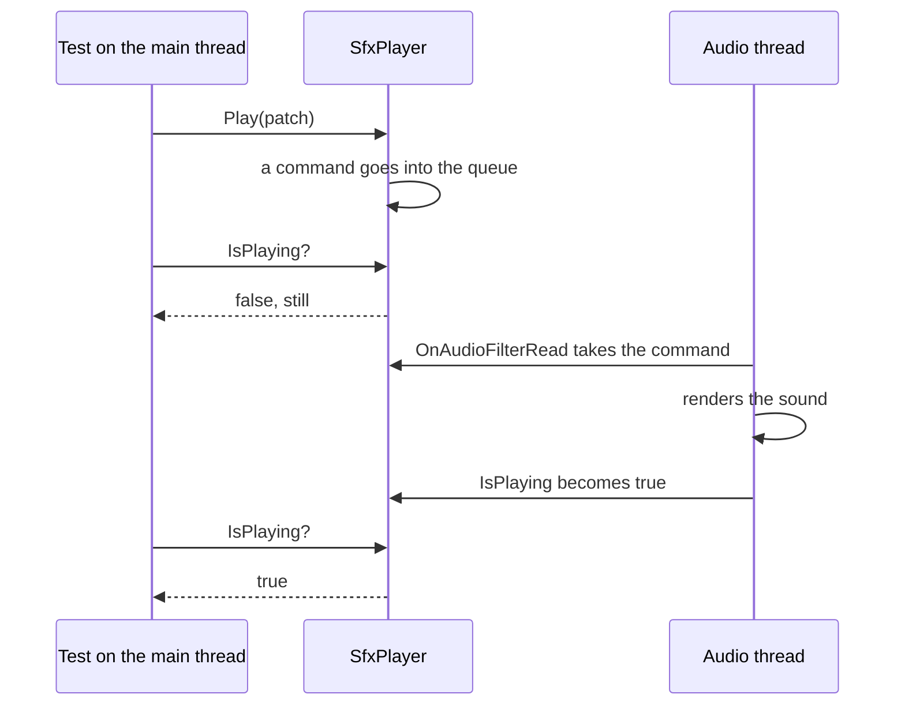

# Unity Testing Your Audio

Sound can be asserted. This page shows how the package and the showcase check their sound without anyone
listening, and gives you a Play mode test to start from in your own game.

A test cannot tell you that a sound is good. It can tell you that a sound is there, that it follows the game, that
the music moves on, and that the mix does not clip. That catches the common breakages: a silent build, a held
sound that never starts, a cue that no longer takes.

## Why you must wait: two threads

Your test runs on Unity's main thread. The sound is made on the audio thread. `Play` only puts a command in a
queue; the audio thread takes it a moment later.



So never assert on the line after `Play`. Wait for a condition, with a time limit. The same holds for
`SfxMusicPlayer.IsPlaying`, `Step`, `Pattern` and `Bar`.

## What you can assert

| To check that ... | Do this | The showcase does it in |
|---|---|---|
| a patch makes sound at all | bake it, look for a sample above 0.01 | `ShowcaseAudio.Check`, `IsAudible` (an editor check) |
| a baked clip really comes out | `AudioSource.GetOutputData`, largest sample above 0.01 | `AJumpIsHeardThroughSfxForge` |
| a live voice started | poll `SfxPlayer.IsPlaying` | the same test, for a Chime |
| the game bends a held sound | read `pitchSemitones`, `fm`, `level` after the game moved | `TheWindUpRevAndTheRollHumFollowThePlayer` |
| a held sound stops | wait for `IsPlaying` to become false, with seconds to spare for the release | the same test |
| the music runs and moves on | `IsPlaying`, then wait for `Bar` to grow | `EnteringASectionCuesItsPatternAndTheMusicStaysOnIt` |
| a cue took, and held | wait for `Pattern`, then watch it for three bars | the same test |
| `loopPattern` holds and lets go | a second, muted `SfxMusicPlayer` with the same song | `LoopPatternKeepsTheSongOnOnePatternAndLetsItGoAgain` |
| intensity follows the game | read your director's own value | `TheMusicsIntensityFollowsSpeedAndDropsOnAHit` |

All five tests are in
[`ShowcaseAudioTests.cs`](../unity/Demo/Assets/Showcase/Tests/ShowcaseAudioTests.cs). Read it next to this page.

## Four rules

| Rule | Why |
|---|---|
| **Wait, with a limit** | the audio thread is late. `yield return` in a loop until the condition holds or the time is up, then assert |
| **Use real time for sound** | wait on `Time.realtimeSinceStartup`, not `Time.time`. The showcase's other tests run on a fixed clock (`Time.captureDeltaTime`), faster than real time; a test that listens calls `UseRealTime()` first, which sets it back to 0 |
| **Drive the game through its own seam** | the showcase's tests write the same input interface the keyboard uses (`PlayerBase.InputOverride`) and count the same `GameEvents` the audio hears (`GameEventLog`). The test then checks the real path from the game to the sound |
| **Skip where there is no engine** | `if (!SfxNative.Available) Assert.Ignore(…)`. The native library is Windows x64 only |

## A test for your game

1. Make a folder `Assets/Tests/Audio` with an assembly definition for it. This one is modelled on the showcase's
   [`SfxShowcase.Tests.asmdef`](../unity/Demo/Assets/Showcase/Tests/SfxShowcase.Tests.asmdef); add the assemblies
   of your game to `references`. The project needs Unity's Test Framework package.

```json
{
  "name": "MyGame.AudioTests",
  "references": [ "CatSplat.SfxForge", "UnityEngine.TestRunner" ],
  "overrideReferences": true,
  "precompiledReferences": [ "nunit.framework.dll" ],
  "defineConstraints": [ "UNITY_INCLUDE_TESTS" ],
  "autoReferenced": false
}
```

2. Add this script to the folder. Set `SceneName` to a scene of your game that is in the build settings' scene
   list and has an `AudioListener` and an `SfxMusicPlayer` with a song.

```csharp
using System;
using System.Collections;
using CatSplat.SfxForge;
using NUnit.Framework;
using UnityEngine;
using UnityEngine.SceneManagement;
using UnityEngine.TestTools;

public class MyGameAudioTests
{
    const string SceneName = "Game";

    [UnitySetUp]
    public IEnumerator Load()
    {
        yield return SceneManager.LoadSceneAsync(SceneName, LoadSceneMode.Single);
        yield return null;
    }

    static void IgnoreWithoutTheNativeLibrary()
    {
        if (!SfxNative.Available) Assert.Ignore("No native library here: there is no sound to check.");
    }

    /// <summary>Waits until the condition holds, at most for some seconds of real time.</summary>
    static IEnumerator Until(Func<bool> condition, float seconds)
    {
        float end = Time.realtimeSinceStartup + seconds;
        while (Time.realtimeSinceStartup < end && !condition()) yield return null;
    }

    /// <summary>The largest sample an AudioSource is putting out right now.</summary>
    static float Loudest(AudioSource source)
    {
        var samples = new float[1024];
        float loudest = 0f;
        for (int channel = 0; channel < 2; channel++)
        {
            source.GetOutputData(samples, channel);
            foreach (float sample in samples) loudest = Mathf.Max(loudest, Mathf.Abs(sample));
        }

        return loudest;
    }

    [UnityTest]
    public IEnumerator ABakedClipComesOutOfItsSource()
    {
        IgnoreWithoutTheNativeLibrary();
        var go = new GameObject("baked test", typeof(AudioSource));
        var source = go.GetComponent<AudioSource>();
        int rate = AudioSettings.outputSampleRate;
        SfxPatch blip = SfxPatch.Create(SfxEngine.UiBlip, 60, 64, 40, 0, 0, 0, 120, 0, 35);
        float[] samples = SfxNative.BakeInterleaved(blip, rate);
        Assert.IsNotNull(samples, "the patch bakes");
        AudioClip clip = AudioClip.Create("blip", samples.Length / 2, 2, rate, false);
        clip.SetData(samples, 0);

        source.PlayOneShot(clip);
        float heard = 0f;
        yield return Until(
            () =>
            {
                heard = Mathf.Max(heard, Loudest(source));
                return heard > 0.01f;
            },
            1f
        );
        Assert.Greater(heard, 0.01f, "the baked clip comes out of its AudioSource");
        UnityEngine.Object.Destroy(go);
    }

    [UnityTest]
    public IEnumerator ALiveVoiceStarts()
    {
        IgnoreWithoutTheNativeLibrary();
        var go = new GameObject("live test", typeof(AudioSource), typeof(SfxPlayer));
        var voice = go.GetComponent<SfxPlayer>();
        Assert.IsFalse(voice.IsPlaying, "nothing sounds before Play");

        voice.Play(SfxPatch.Create(SfxEngine.UiBlip, 86, 64, 0, 37, 70, 0, 127, 0, 45), 1f, 0f, 76);
        yield return Until(() => voice.IsPlaying, 1f);
        Assert.IsTrue(voice.IsPlaying, "the patch sounds on the SfxPlayer");
        UnityEngine.Object.Destroy(go);
    }

    [UnityTest]
    public IEnumerator TheMusicRunsAndMovesOn()
    {
        IgnoreWithoutTheNativeLibrary();
        var music = UnityEngine.Object.FindFirstObjectByType<SfxMusicPlayer>();
        Assert.IsNotNull(music, "the scene has its music player");
        yield return Until(() => music.IsPlaying, 2f);
        Assert.IsTrue(music.IsPlaying, "the song runs");

        float barSeconds = music.song.StepsPerPattern * 60f / music.song.Bpm / 4f;
        int bar = music.Bar;
        yield return Until(() => music.Bar > bar, barSeconds + 1f);
        Assert.Greater(music.Bar, bar, "the song reached its next bar");
    }
}
```

3. Open **Window > General > Test Runner**, choose **PlayMode**, and run. On Windows x64 the three tests
   should pass; where the native library is missing they are skipped.

This sample was written for this page from the showcase's tests. It was compiled against the package in an
assembly like the one above, and not run: treat it as a starting point. The showcase's own tests are the ones that were run ([What Is Tested](What-Is-Tested)).

**Then test your game's own path.** The sample plays sounds itself. The more useful test makes your *game* play
them: script your input, wait for your own event, then assert as above on the `AudioSource` or `SfxPlayer` your
audio code uses. `AJumpIsHeardThroughSfxForge` is that test for a jump.

## The mix is measured

A test can also check that the mix does not clip. Unity limits its output to full scale before a script can read
it, so a recording at listener volume 1 can never show an overshoot. The showcase's capture rig works around that:

1. It records each take with `AudioListener.volume` at 0.5 (`CaptureRecorder.ListenerVolume`).
2. The take's largest sample, divided by 0.5, is what the game reaches at full volume.
3. Every take asserts that this is under 0.95 (`CaptureRecorder.MixCeiling`).

```csharp
// not compiled: a line of the showcase's capture tests; summary and CaptureRecorder are theirs
Assert.Less(summary.Peak / CaptureRecorder.ListenerVolume, CaptureRecorder.MixCeiling);
```

A peak says that nothing clips. It does not say that the effects and the music are balanced: for that, someone has
to listen.

## How the package tests itself

| Layer | Where | What it checks |
|---|---|---|
| the core, without Unity | `tests/dotnet` | patches, songs, the link's messages and the engine, as numbers read from rendered samples |
| the inspectors | `tests/unity-inspectors` (EditMode) | the editor panels: values, Undo, the tools, the windows |
| the game | `unity/Demo/Assets/SfxDemo/Tests`, `unity/Demo/Assets/Showcase/Tests` (PlayMode) | sound in a running scene, as on this page |

[Running The Tests](Running-The-Tests) has the commands, and [What Is Tested](What-Is-Tested) says what passed and
what nobody has checked.

## Next

- [Running The Tests](Running-The-Tests): run the package's own tests
- [Unity Troubleshooting](Unity-Troubleshooting): when a test finds silence
- [Unity Showcase Walkthrough](Unity-Showcase-Walkthrough): the game these tests play
- [What Is Tested](What-Is-Tested)

## Reference

- [The Unity manual: Testing sound without ears](../docs/UNITY.md#testing-sound-without-ears),
  [The core is tested without Unity](../docs/UNITY.md#the-core-is-tested-without-unity),
  [The inspectors are tested in a project of their own](../docs/UNITY.md#the-inspectors-are-tested-in-a-project-of-their-own),
  [The mix is measured, not heard](../docs/UNITY.md#the-mix-is-measured-not-heard)
- [The showcase's README: Check it, test it, rebuild it](../unity/Demo/Assets/Showcase/README.md#check-it-test-it-rebuild-it):
  the headless commands
- [ShowcaseAudioTests.cs](../unity/Demo/Assets/Showcase/Tests/ShowcaseAudioTests.cs),
  [ShowcaseTestBase.cs](../unity/Demo/Assets/Showcase/Tests/ShowcaseTestBase.cs),
  [GameEventLog.cs](../unity/Demo/Assets/Showcase/Tests/GameEventLog.cs),
  [CaptureRecorder.cs](../unity/Demo/Assets/Showcase/Tests/CaptureRecorder.cs),
  [ShowcaseAudio.cs](../unity/Demo/Assets/Showcase/Editor/ShowcaseAudio.cs)
