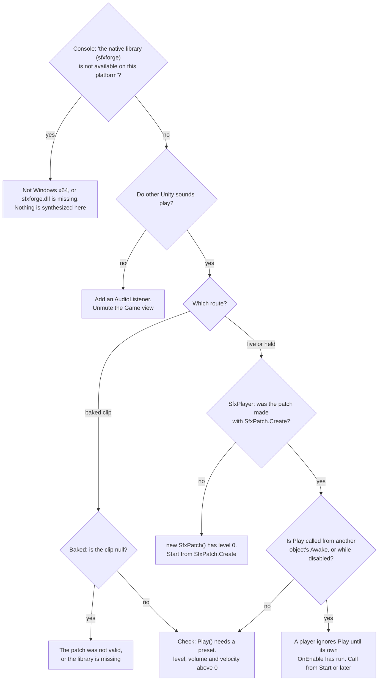
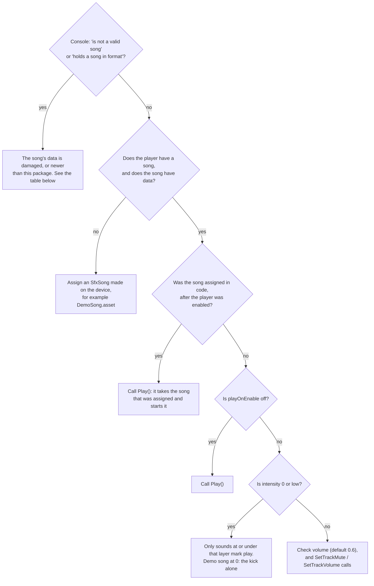

# Unity Troubleshooting

Find out why something is silent or wrong: two decision charts for silence, then the package's Console warnings
with their cause and fix, then the other symptoms. The texts are quoted as the code writes them.

## No sound at all

Start here when an `SfxPlayer`, a baked clip or a variation set makes no sound.

Defaults that help you check: `SfxPlayer.level` is 1, `SfxPlayer.volume` is 0.8. `Play()` without a preset does
nothing and says nothing; `Play(patch)` needs no preset.

## The music is silent

Start here when an `SfxMusicPlayer` makes no sound, or less than you expect. Go through the chart above first, to
its question "Do other Unity sounds play?".

An empty `SfxSong` asset plays nothing and logs nothing. A song's notes are written on the device, not in Unity:
[Unity Music First Song](Unity-Music-First-Song) shows where to get one. A player takes its song when it is enabled.
If you assign another song asset to `song` from code later, call `Play()`: it takes the asset that was assigned and
starts it (`Reload()` takes it without starting again). Assigning alone does nothing. When the contents of the
same asset changed, only `Reload()` takes them.

## The Console says

All of these are warnings. `…` stands for a name or a number. The Bake window also logs a report of each batch,
as a message, a warning or an error.

| Message | Cause | Fix |
|---|---|---|
| `SFX Forge: the native library (sfxforge) is not available on this platform – SfxPlayer stays silent. Only clips and WAV files baked beforehand, in the editor on Windows x64, play here: baking needs the library too.` | `sfxforge.dll` did not load: the platform is not Windows x64. Logged once for all `SfxPlayer`s | Run on Windows x64. Elsewhere, play clips that were baked to WAV files in the editor ([Unity Baking And WAV](Unity-Baking-And-WAV)) |
| `SFX Forge: the native library (sfxforge) is not available on this platform – SfxMusicPlayer stays silent.` | the same, for the music. Logged once | the same; there is no baked form of a song |
| `SFX Forge: '…' is not a valid song.` | the engine refused the song's data: a value in it is out of range | fetch the song again from the device ([Unity Send And Receive](Unity-Send-And-Receive)) |
| `SFX Forge: '…' holds a song in format …, this version of SFX Forge knows up to 6: it does not play here. Update the package to play it.` | the song was made by a newer firmware than this package reads | update the package |
| `SFX Forge: '…' was made by a newer SFX Forge (asset format …, this version knows …): what this version reads of it plays, the rest is left out. Saving it here loses what this version does not know. Update the package to use all of it.` | a preset, song or variation set asset written by a newer package. Logged once per asset | update the package before you save the asset |
| `SFX Forge: variation set '…' has no preset - nothing plays. Choose the sound it varies.` | the set's **Preset** field is empty | assign a preset |
| `SFX Forge: variation set '…' has no baked clips and the native library is not available on this platform - nothing plays. BAKE it in the editor.` | an unbaked set needs the engine to make its clips | press **BAKE** in the set's Inspector on Windows x64 |
| `SFX Forge: variation set '…' is out of date - the preset or the set changed since BAKE: the clips are the old sound. BAKE again.` | editor only: it still plays the old clips | press **BAKE** again |
| `SFX Forge: could not open every MIDI port (in '…', out '…'). Choose them in Window > SFX Forge.` | from the `SfxForgeLink` component: another program holds the port, or its name changed | choose the ports again in **Window > SFX Forge** ([Unity Device Link Setup](Unity-Device-Link-Setup)) |
| `SFX Forge: could not open every MIDI port (in '…', out '…'). Is another program holding it?` | the same, from the editor's window | close the other program, then connect again |
| `SFX Forge: nothing baked - ….` | a bake option is out of range; the message names it, for example a sample rate outside 8000..48000 | correct the option in the Bake window |
| `SFX Forge: nothing baked - the engine did not render '…'.` | the engine returned no samples for this preset | check the preset's values |
| `SFX Forge: nothing to bake (the native library is missing on this platform).` | a WAV was asked for where the engine is not there | bake on Windows x64 |
| `SFX Forge: the native library (sfxforge) is not available on this platform.` | the editor was asked to preview a sound (`SfxForgeEditorLink.Preview`) where the engine is not there | preview on Windows x64 |
| `SFX Forge: the device sent …, this SFX Forge knows up to …: it was not taken. Update the package to use it.` | with **Window > SFX Forge** open: a patch or a song came in a format above this package's. The window's log says the same after `NEWER:` | update the package |
| `SFX Forge: a song arrived without its 16 sounds – use FETCH SONG or SEND on the device's SONG page.` | only the packed song came over the link, not its sounds | press **FETCH SONG** in the window, or SEND on the device's SONG page |
| `SFX Forge: SfxForge.uss not found – its inspectors and its window show without their look. Reimport the package.` | the editor's stylesheet is missing | reimport the package |

The showcase adds two of its own: `SFX FORGE's native library is not available on this platform: the showcase runs
without sound.` and `MusicDirector has no SfxMusicPlayer: there will be no music.`

## Other symptoms

| What you notice | What it is | Fix |
|---|---|---|
| a sound never stops | a held patch (`sustain` above 0) | call `Release()`; for a note by hand, `ReleaseSound(sound, midiNote)` |
| a click when the music dips | `volume` jumped; it is applied without a ramp | ramp it over 50 ms ([recipe 9](Unity-Recipes-Music#9-ducking-the-music)) |
| live sounds change each other | two patches on one `SfxPlayer` | a player per patch, or a pool ([Unity Live Voices](Unity-Live-Voices)) |
| a pitched sound is out of tune with the song | it plays at the patch's FREQ | play it as a MIDI note: the `midiNote` argument |
| transposing a noise does nothing | pure noise has no pitch | change `filterCutoff`, or the `AudioSource`'s pitch for a baked clip |
| a cued pattern lasts only a bar or two | the song's arrangement contains it and walks on | switch `loopPattern` on ([recipe 8](Unity-Recipes-Music#8-a-pattern-per-area-held)) |
| `loopPattern` is on and the song still walks on | an older native library is loaded; it ignores the switch | close and reopen the editor after updating the package |
| a note by hand is off the beat | `PlaySound` is not quantised | wait for `Step` or `Bar` to change ([recipe 7](Unity-Recipes-Music#7-a-stinger-on-the-bar-line)) |
| a variation set is silent in a build | it is not baked | press **BAKE** in its Inspector |
| editing a preset in Play mode changes nothing | that sound was baked at start | live players follow an edit; baked clips do not |
| the 3D position of an `SfxPlayer` is ignored | the players add to a 2D mix | bake a clip for 3D ([recipe 11](Unity-Recipes#11-a-3d-one-shot)) |

## Words in the Inspector and the window

| You see | It means | Fix |
|---|---|---|
| `NATIVE LIBRARY NOT FOUND`, and PLAY and BAKE WAV are dark | not Windows x64. The values can still be edited | |
| `FROM A NEWER SFX FORGE` | the asset was written by a newer package | update the package before saving |
| `A NEWER SONG` | the packed song is in a format above 6. It does not play here | update the package |
| `OUT OF DATE` on a variation set | the preset or the set changed since BAKE | **BAKE** again |
| `NOT BAKED` on a variation set | it has no clips; it plays only where the engine is | **BAKE** |
| `ANOTHER PATCH FORMAT` under a sound's keys, SEND dark | the device speaks another patch format than this package | the line says which side to update |
| `ANOTHER FORMAT` under a song's keys, SEND dark | the device cannot take this song; the line says what to do | update the firmware, connect, or fetch again |
| `A DAMAGED SONG` under a song's keys, SEND dark | a value in the packed song is out of range | fetch the song again |
| `NO MIDI PORTS` in the window | no MIDI device and no virtual cable | install a virtual cable ([Unity Device Link Setup](Unity-Device-Link-Setup)) |
| a port tile says `NOT FOUND` | the port chosen earlier is not there now | start the device or the cable, then **REFRESH PORTS** |
| SEND, PLAY ON DEVICE or the window's pads are dark | no MIDI output is open | **CONNECT** in the window |

The manual's list is longer: [Other trouble](../docs/UNITY.md#other-trouble) has every line, including the
emulator and the browser.

## Still stuck

1. Run the showcase scene ([Unity Showcase Walkthrough](Unity-Showcase-Walkthrough#open-it-and-play)). If it
   sounds, the package works on your machine and the problem is in your scene.
2. Compare your scene with [the scene objects of the showcase](Unity-Copy-The-Showcase-Pattern#path-b-build-your-own).
3. Read the limits: [What Is Tested](What-Is-Tested) and [the manual's Limits](../docs/UNITY.md#limits).

## Next

- [Unity Testing Your Audio](Unity-Testing-Your-Audio): catch silence in a test before a player does
- [FAQ](FAQ)
- [Unity Device Link Setup](Unity-Device-Link-Setup): trouble with ports and the device
- [Unity Install](Unity-Install)

## Reference

- [The Unity manual: The silence checklist](../docs/UNITY.md#the-silence-checklist),
  [Other trouble](../docs/UNITY.md#other-trouble) and [Limits](../docs/UNITY.md#limits)
- [The Unity manual: When a song is not sent](../docs/UNITY.md#when-a-song-is-not-sent)
- Where the messages are written:
  [SfxPlayer.cs](../unity/com.catsplat.sfxforge/Runtime/SfxPlayer.cs),
  [SfxMusicPlayer.cs](../unity/com.catsplat.sfxforge/Runtime/SfxMusicPlayer.cs),
  [SfxPreset.cs](../unity/com.catsplat.sfxforge/Runtime/SfxPreset.cs),
  [SfxVariationSet.cs](../unity/com.catsplat.sfxforge/Runtime/SfxVariationSet.cs),
  [SfxForgeLink.cs](../unity/com.catsplat.sfxforge/Runtime/SfxForgeLink.cs),
  [SfxForgeEditorLink.cs](../unity/com.catsplat.sfxforge/Editor/SfxForgeEditorLink.cs),
  [SfxForgeWindow.cs](../unity/com.catsplat.sfxforge/Editor/SfxForgeWindow.cs)
