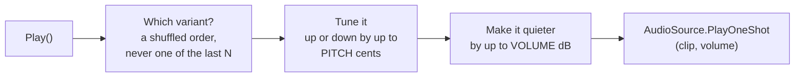
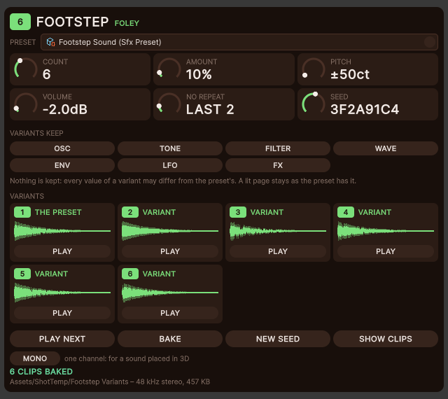
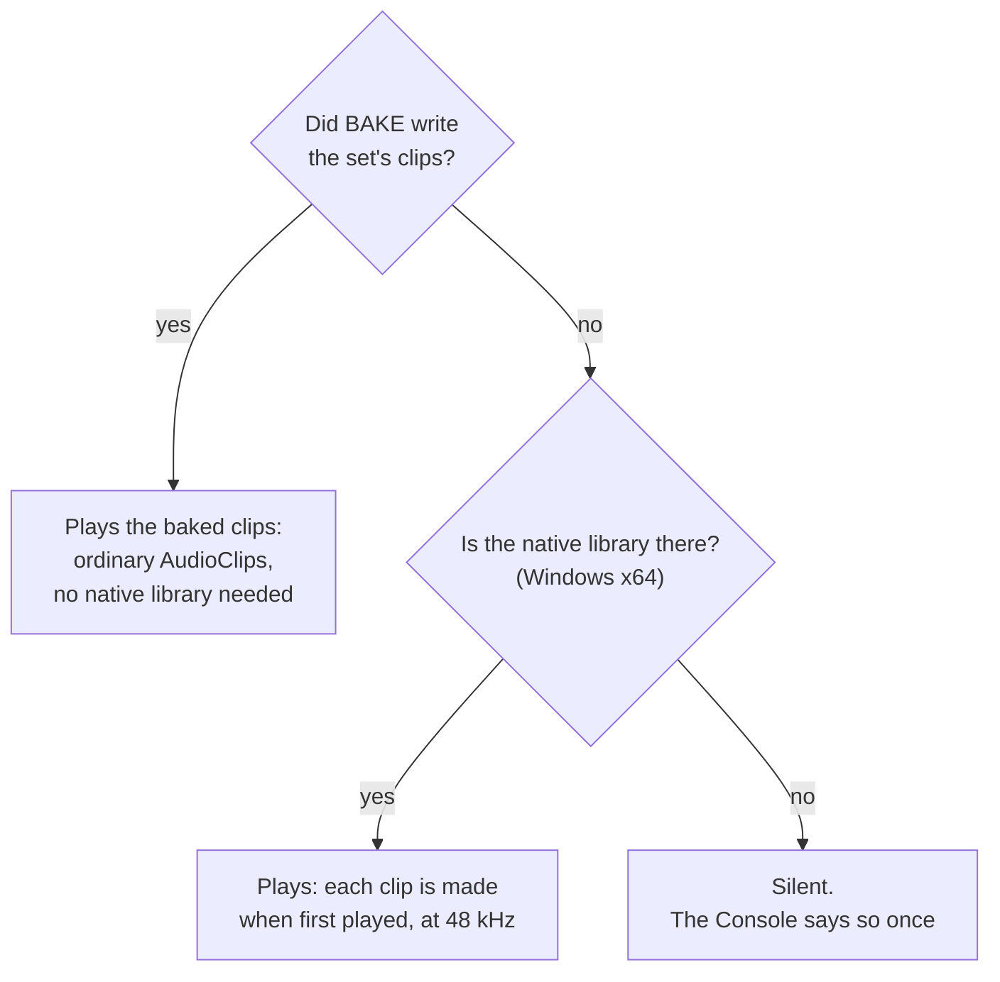

# Unity Variations

A variation set turns one sound into several, so a sound that fires often (a footstep, a hit, a coin) is never the
same twice. This page shows what a set is, how to make one in five steps, and how to play it.

## Why, and what a play does

The ear notices at once when the same sample repeats. A variation set (`SfxVariationSet`) answers that with three
things at every play:



The variants themselves are fixed. A preset and a seed give a row of them; variant 1 is the preset itself, and the
others are the preset with its values moved by up to AMOUNT per cent. The same preset, seed, amount and locks
always give the same variants.



*The Inspector of an `SfxVariationSet`. Six tiles, one for each variant; tile 1 is the preset. At the bottom it
says `6 CLIPS BAKED`. Rendered by the package's tests, not photographed in the editor.*

## Make one in five steps

1. Make the sound as a preset: **Assets > Create > SFX Forge > Preset**. For a footstep, open **TOOLS > NEW** in
   its Inspector and click **THUD** or **CLICK** until one is close ([Unity Sound Design Tools](Unity-Sound-Design-Tools#new-a-sound-of-a-kind)).
2. In the preset's Inspector, open **TOOLS > VARY** and press **MAKE SET**. A variation set named
   `<preset> Variations` appears next to the preset. (Or make an empty one with
   **Assets > Create > SFX Forge > Variation Set** and drag the preset into its **PRESET** field.)
3. Select the set. Press **PLAY NEXT** a few times: each press plays as the game would. The footer says which
   variant played, and with what pitch and volume.
4. Press **BAKE**. The variants are written as `.wav` files into a folder `<name> Variants` next to the set, and
   the Inspector says how many clips are baked.
5. On your character: **Add Component > SFX Forge > SFX Variation Player** (it adds the Audio Source), and drag the
   set onto its **Set** field. Call `PlayNext()` from an animation event, or `Play()` from code.

```csharp
using CatSplat.SfxForge;
using UnityEngine;

[RequireComponent(typeof(SfxVariationPlayer))]
public class Footsteps : MonoBehaviour
{
    SfxVariationPlayer steps;                    // its Set field holds the variation set

    void Awake() => steps = GetComponent<SfxVariationPlayer>();

    public void Step() => steps.Play();          // returns the variant played, -1 for none
}
```

No animation events yet? This script steps on a timer while the object moves. Put it on the character instead of
the one above; `stepSeconds` is the time between two steps.

```csharp
using CatSplat.SfxForge;
using UnityEngine;

[RequireComponent(typeof(SfxVariationPlayer))]
public class WalkSteps : MonoBehaviour
{
    public float stepSeconds = 0.35f;
    SfxVariationPlayer steps;
    Vector3 lastPosition;
    float wait;

    void Start()
    {
        steps = GetComponent<SfxVariationPlayer>();
        lastPosition = transform.position;
    }

    void Update()
    {
        bool moving = (transform.position - lastPosition).sqrMagnitude > 0.000001f;
        lastPosition = transform.position;
        wait -= Time.deltaTime;
        if (moving && wait <= 0f)
        {
            steps.Play();
            wait = stepSeconds;
        }
    }
}
```

It does not know whether the character is on the ground: add your own test to `moving`.

## The set's values

| In the Inspector | Field | At first | What it is |
|---|---|---|---|
| **PRESET** | `preset` | none | the sound the set varies |
| **COUNT** | `count` | `6` | how many variants, the preset included: 1 to 16 |
| **AMOUNT** | `amount` | `10%` | how far a variant's values move from the preset's, 0 to 100 %. At 0 every variant is the preset, and only pitch and volume vary |
| **PITCH** | `pitchCents` | `±50ct` | a play is tuned up or down by up to this much (100 cents = a semitone), up to 1200 |
| **VOLUME** | `volumeDb` | `-2.0dB` | a play is quieter by up to this much, up to 24 dB. Never louder |
| **NO REPEAT** | `noRepeat` | `LAST 2` | the last N variants played are not chosen again |
| **SEED** | `seed` | `00000001` | which variants these are, in hex. **NEW SEED** gives others |
| **VARIANTS KEEP** | `locked` | nothing | a key for each page of a sound. A lit page stays as the preset has it |
| **MONO** | `mono` | off | the clips as one channel, for a sound placed in 3D |

"At first" is a set from the Create menu. A set made with **MAKE SET** takes the AMOUNT and the locks of the
preset's VARY tool and a seed of its own. If MORE LIKE THIS is showing its eight variants, the set has those:
COUNT is then 9.

## Baked or not: where it plays



**Bake a set before you ship it.** Nothing checks this when the game is built. Baked clips are plain audio files,
so they need no library; that they play on another platform than Windows x64 follows from this and was not tried
([What Is Tested](What-Is-Tested)).

If the preset's sound or HOLD, or the set's COUNT, AMOUNT, SEED, kept pages or MONO change after BAKE, the
Inspector says `OUT OF DATE`. The set still plays its old clips until you press BAKE again. PITCH, VOLUME and
NO REPEAT act at each play and need no new bake.

## On an AudioSource of your own

The component is a convenience. For a source placed in 3D, or to add your own pitch, take the next play yourself:

```csharp
// in: SfxVariationSet set, AudioSource source
SfxShuffle order = set.NewOrder();                                       // once; keep it
AudioClip clip = set.Next(order, out float pitch, out float volume);     // every play
if (clip != null) { source.pitch = pitch; source.PlayOneShot(clip, volume); }
```

`SfxVariationPlayer.PlayOn(source, set, order)` does the last two lines and returns the variant it played.

## The player's fields

| Field | Default | What it is |
|---|---|---|
| `set` | none | the variation set it plays |
| `volume` | 1 | the volume of every play, 0 to 1. `Play(volumeScale)` multiplies it for one play |
| `prepareOnEnable` | on | makes the clips of a set that is not baked when the component is enabled, so the first plays do not have to |
| `orderSeed` | 0 | 0: another order every run. Anything else: the same order, pitches and volumes every run |
| `Last` (read only) | −1 | the variant played last; 0 is the preset itself |

## Common mistakes

| What you see | What it is |
|---|---|
| silent in a build, or on another platform | the set is not baked. Press BAKE |
| the Inspector says `OUT OF DATE` | the preset or the set's variants changed since BAKE. BAKE again |
| the Inspector says `NOT BAKED` | no clips yet: the set plays only where the native library is. Press BAKE |
| PLAY NEXT and BAKE are dark | no preset in the PRESET field, or the native library is not there |
| a ringing sound changes pitch when the next one plays | the player sets its AudioSource's pitch on every play, and one-shots still ringing on that source take it. For plays that overlap and must stay apart, use several players |
| the AudioSource's own pitch is lost | the player does not put back what it was |
| a hitch on the first plays | the set is not baked and `prepareOnEnable` is off: each variant renders when first played. Call `set.Prepare()` at load, or bake |
| it does not get louder than the clip | VOLUME only takes away |

## Next

- [Unity One Shots](Unity-One-Shots): the baked route the set is built on
- [Unity Sound Design Tools](Unity-Sound-Design-Tools): VARY, MORE LIKE THIS and MAKE SET
- [Unity Baking And WAV](Unity-Baking-And-WAV): what BAKE writes, and the Bake window
- [Unity Recipes](Unity-Recipes): footsteps that are never the same

## Reference

- [The Unity manual, "Variation sets"](../docs/UNITY.md#variation-sets)
- [The Unity manual, recipe 1: Footsteps that are never the same](../docs/UNITY.md#1-footsteps-that-are-never-the-same)
- [The Unity manual, "VARY: MUTATE's amount, locks, and MORE LIKE THIS"](../docs/UNITY.md#vary-mutates-amount-locks-and-more-like-this)
- [The Unity manual, API: SfxVariationSet and SfxVariationPlayer](../docs/UNITY.md#sfxvariationset-scriptableobject-and-sfxvariationplayer-component)
- [SfxVariationSet.cs](../unity/com.catsplat.sfxforge/Runtime/SfxVariationSet.cs),
  [SfxVariationPlayer.cs](../unity/com.catsplat.sfxforge/Runtime/SfxVariationPlayer.cs),
  [SfxShuffle.cs](../unity/com.catsplat.sfxforge/Runtime/Core/SfxShuffle.cs),
  [SfxMutate.cs](../unity/com.catsplat.sfxforge/Runtime/Core/SfxMutate.cs)
