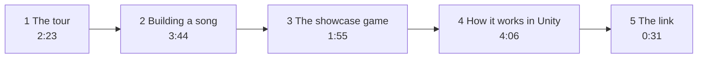

# Videos

Five videos show SFX FORGE at work. This page says what is in each and which pages go with it.

Scripts made them from the firmware and the game themselves: nobody held a controller or a camera. The sound is
what SFX FORGE produced, on the device or in Unity. There is no voice-over; captions say what happens. All are
1920 × 1080 with sound. A link below plays or downloads the file, as your browser decides.

All five in this order take under thirteen minutes.

## The device

| Video | Length | What it shows | Pages that go with it |
|---|---|---|---|
| [The tour](../videos/sfx-forge-tour.mp4) | 2:23 | sound effects, MUTATE, the five engines, the instruments, the sequencer and its finer grid, the song, layers that follow INTENSITY, automation, the mixer, the master effects, the link page | [Device Quick Start](Device-Quick-Start), [Device Controls And Pages](Device-Controls-And-Pages), [Device The Five Engines](Device-The-Five-Engines) |
| [Building a song](../videos/sfx-forge-build-a-song.mp4) | 3:44 | a song played in from nothing with pads and keys over a looping pattern, with ERASE and UNDO; a second pattern with a hi-hat roll on a grid of 1/32; then arranged, layered, automated, performed on the PERFORM page, mixed and sent to the game | [Device Recording](Device-Recording), [Device Finer Grids](Device-Finer-Grids), [Device Song And Arrangement](Device-Song-And-Arrangement), [Device Layers And Intensity](Device-Layers-And-Intensity), [Device Perform](Device-Perform) |

## Unity

| Video | Length | What it shows | Pages that go with it |
|---|---|---|---|
| [The showcase game](../videos/sfx-forge-unity-showcase.mp4) | 1:55 | *Brio: First Harmonic* played from start to goal, with a panel that names what SFX FORGE is doing at each moment | [Unity Showcase Walkthrough](Unity-Showcase-Walkthrough) |
| [How it works in Unity](../videos/sfx-forge-unity-how-it-works.mp4) | 4:06 | the three ways to play a sound and the adaptive music, one at a time: a page of the showcase's code, then the game doing it | [Unity Choosing A Route](Unity-Choosing-A-Route), [Unity One Shots](Unity-One-Shots), [Unity Live Voices](Unity-Live-Voices), [Unity Held Sounds](Unity-Held-Sounds), [Unity Adaptive Music](Unity-Adaptive-Music) |

## The link

| Video | Length | What it shows | Pages that go with it |
|---|---|---|---|
| [The link](../videos/sfx-forge-unity-link.mp4) | 0:31 | SFX FORGE in the emulator beside the game in Unity. SEND is pressed on the device and the song arrives in the running game; a sound is mutated, EXPORT is pressed, and the game plays the patch | [Unity Device Link Setup](Unity-Device-Link-Setup), [Unity Send And Receive](Unity-Send-And-Receive) |

## Three things to know

- **A video is not a test.** It shows what a script made the firmware or the game do. Nobody has listened to all
  of them: [What Is Tested](What-Is-Tested).
- **A video shows the version it was made from.** A video made before a page existed does not show it. The link
  video is one recorded session, made with the firmware 1.7.0 build of 23 Nov 2026, before the beat was added.
- **The device you see is drawn by the VIBE FM SDK's emulator** (Apache-2.0), in the two device videos and in the
  link video.

## Making them again

Each video has a script in `docs/video/`. The device videos need only the built firmware. The Unity videos and the
link video need takes recorded in Unity first. The commands are in
[the videos' README](../videos/README.md#making-them-again).

## Next

- [Device Quick Start](Device-Quick-Start): do what the tour shows.
- [Unity Showcase Walkthrough](Unity-Showcase-Walkthrough): the game of the third video, object by object.
- [Start Here](Start-Here): a reading list for your role.

## Reference

- [The videos' README](../videos/README.md): the list, what each was made from, and how to make them again
- [The showcase's README, Recording it](../unity/Demo/Assets/Showcase/README.md#recording-it)
- [docs/video/make_videos.py](../docs/video/make_videos.py),
  [docs/video/make_unity_videos.py](../docs/video/make_unity_videos.py),
  [docs/video/make_link_video.py](../docs/video/make_link_video.py)
