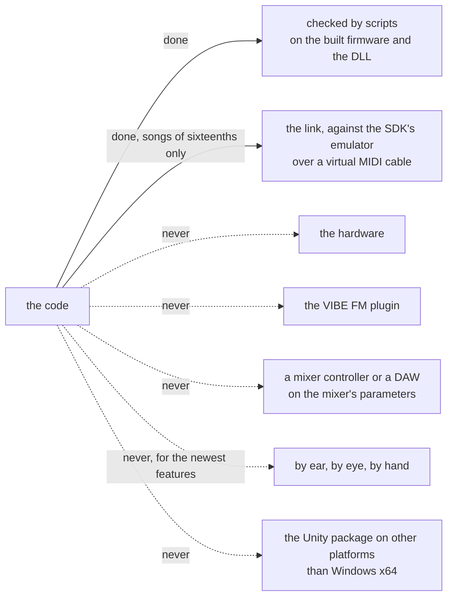

# What Is Tested

This is the one page that says how far SFX FORGE has been tried: what a script checks, what was only read from the
code, and what nobody has done. Other pages link here instead of repeating it. When a run is made again, change the
numbers and dates here.

## The short answer

- **Tested by scripts:** the firmware (`vibe-check`, 24 checks, a short fuzz run), the Unity package's core (205 checks),
  its editor UI (171 EditMode tests), the showcase (32 editor checks, 41 PlayMode tests).
- **Stressed by scripts** (firmware 1.7.2): a fuzzer as a wrong host on the built firmware, and the whole firmware on
  two threads as a native build. Not under the real plugin: [Hard and wrong use](#hard-and-wrong-use).
- **Tested against the emulator:** the link, with songs whose patterns all have 16 steps.
- **Never:** the hardware, the VIBE FM plugin, any platform but Windows x64, any Unity but 6000.3.8f1. Nobody has
  listened to the newest features (PERFORM, the beat) or played them by hand. Nobody has worked the mixer from a
  mixer controller or a DAW (firmware 1.7.1).

## The numbers, as last run

`sh build.sh` was run on 25 Nov 2026 with firmware 1.7.2, the firmware as it is now: 1.7.1 made hard against a host
that sends what it should not ([Hard and wrong use](#hard-and-wrong-use)). 1.7.2 is not released; 1.7.1 is. It was
run with the SDK in `.tools` (SDK 27) and with a newer one (SDK 28), with the same result; the built `.wasm` was the
same file both times (285292 bytes). `tests/dotnet` was run the same day with 1.7.2: its identity checks expect the
identity of 1.7.2. The other three rows are as the reference documents record their last run, made with firmware
1.7.0 (with PERFORM and the beat): they were not run again with 1.7.1 or 1.7.2. The package's code did not change
with either. The link runs have their dates further down.

| Suite | Result | What it runs on |
|---|---|---|
| `sh build.sh` | 26 lines `PASSED`, none failing: `vibe-check`, 24 checks and the short fuzz run. 274 `ok` lines (1.7.1 had 266; the 8 new are the fuzz run's seeds) | the built `.wasm`, in the SDK's `wasmtest` and on `tests/host.mjs` |
| `tests/dotnet` | 205 checks, all passing (25 Nov 2026, with 1.7.2) | `Runtime/Core` and the package's own `sfxforge.dll`, without Unity |
| `tests/unity-inspectors` | 171 of 171 EditMode tests | Unity 6000.3.8f1, Windows x64 |
| the showcase's `Verify` | 32 editor checks | the demo project, headless, on a copy |
| PlayMode | 41 tests: 26 passed, 15 skipped | the same. The skipped ones need a device or the emulator, or record, and run only when asked for by name |
| the stress tests, run long | all passed; the runs are under [Hard and wrong use](#hard-and-wrong-use) | the built `.wasm` on Node; a native build of the firmware on Windows |

Commands and how to read the output: [Running The Tests](Running-The-Tests).

## What the scripts can see

A script reads numbers. It hears the output as samples and reads the song the device sends and what it stores.

| The scripts check | The scripts do not check |
|---|---|
| the sound that comes out: levels, timing, that a click falls on a beat | what a page or a toast **says**: no check reads the display's text |
| the song after key presses, byte by byte | how PERFORM's grid, the shades and the bar strip are drawn |
| the SysEx messages, in and out, also doubled and out of order | the stage's buttons (its REC button on PERFORM among them) and its grids' shades |
| what the device stores (`kits.bin`, `song6.bin`, `meter.bin`, `song.bin`) | solo on PERFORM; ERASE across a change of pattern |
| that the display's picture changed (a hash of its pixels) | undo of RAMP and of a song loaded from a game; undo of FILL except on PERFORM |
| a format-5 song still renders bit for bit as before (by hashes) | a DAW's song position at a finer grid |

For the Unity editor UI the tests build the same elements in a test panel and press keys by code. Nobody has opened
the real Inspector or the real windows, opened their menus, or typed into a field. The full list is in
[the Unity manual](../docs/UNITY.md#the-inspectors-are-tested-in-a-project-of-their-own).

## The newest features

| Feature | Checked by | Not done |
|---|---|---|
| **the mixer as the host's parameters** (firmware 1.7.1) | `tests/check-mixer.mjs`, on `tests/host.mjs`: it reads the list of 71 parameters, sets levels, pans, mutes, solos and the selected sound with the SDK's own host functions (`vibe_wasm_param_set`, `_value`, `_changed`), presses MIX's keys and reads what the host is told, and reads from the samples that the song is silent when every sound is muted from the host. It also sets values that are no number, and runs the tour with `mix_select` from the host and DATA turned: every sound is as it was after it (27 `ok` lines) | nobody has tried it with a real mixer controller, in the VIBE FM plugin, in a DAW or in the Playground. The check does not see a controller's faders and lights, or how a host lists the parameters. That a fader moved by an automation lane is not reported is read from the code |
| **PERFORM** (firmware 1.7.0) | `tests/check-perform.mjs`: it presses the page's keys on the built firmware and reads the song and the sound (26 `ok` lines) | nobody has played the page, looked at it while it plays, or listened to it. The check does not see the display, the stage's REC button, or solo |
| **the beat and the time signature** (firmware 1.7.0) | `tests/check-meter.mjs`: what FILL writes, where the click falls, that the song's bytes stay as they were, what SAVE stores (21 `ok` lines) | nobody has listened to the click at any beat, turned SHIFT + B by hand, or read the words (`BAR 6/8`, `BEAT 3/8: BAR 6/8`). Not tried: swing with a beat of three sixteenths, a bar that is not a whole number of beats, SHIFT + B on SONG, and that DEMO, a song from a game and UNDO leave the beat |
| **a finer grid** (firmware 1.6.0) | the firmware's grid checks; `tests/dotnet`; eight EditMode tests of the song's Inspector | a pattern at 1/32 or 1/64 has not crossed a MIDI port. Nobody has listened to a finer pattern in Unity |

## Hard and wrong use

Firmware 1.7.2 adds no feature. It is what three new stress tests found, fixed. The commands:
[Running The Tests](Running-The-Tests#stress-tests).

| Test | Run on 25 Nov 2026 | Not done |
|---|---|---|
| `tests/stress-fuzz.mjs`: a seeded fuzzer as the host of the built `.wasm`, one flow | 40 seeds of 2 device-minutes at each of levels 0, 1 and 2: all 120 passed (level 2: 80.7 device-minutes, 2.7 million blocks, 1.9 million events, 537 restarts). 8 seeds of 30 device-minutes at level 2: all passed. Before the fixes level 0 failed 5 of 40 seeds and level 1 all 40, both by the overshoot only; level 2 failed all 40 (NaN, 6 traps, hangs) | it cannot see a race between the two flows, a memory error that stays inside the firmware's own memory, or whether it sounds right. It runs on Node, not in the plugin |
| `tests/stress-flows.sh`: the whole firmware as a native build with the undefined-behaviour sanitizer, audio and controls in two real threads | seeds 1 to 5 for 20 s: passed. Seed 7 for 120 s: passed (about 760 thousand events, 130 thousand draws). Seeds 1 to 5 for 20 s with `hostile wild`: passed. In its default mode it found nothing before the fixes either | Windows only. No address sanitizer, and no thread sanitizer in these runs: a race shows only when it does harm. It is not the `.wasm` |
| `tests/midi-torture/`: heavy and hostile MIDI to a MIDI port, for the real plugin | it was built, and `--list` was run | nothing was ever sent to a port, and the plugin was never under it. It is the owner's tool to run |
| `tests/emulator-torture.mjs`: that tool's stream into the SDK's emulator page in Chrome, through a stand-in for Web MIDI | 25 Nov 2026, firmware 1.7.2: the self-test, seeds 1 to 4 at level 1, seeds 1 and 5 at level 2, all passed; two runs spoiled by hand failed | no MIDI driver or cable; not the plugin's native half; level 3 was not run |

The long runs were made on the build just before the version number was set to 1.7.2: the same code but for the
number. The short fuzz run in `sh build.sh` ran on the final build.

What was fixed in the firmware:

- **A host's song position or tempo that is an infinity** while the song played made the audio read past the song: a
  crash (a WebAssembly trap). A tempo or position that is no number, or beyond what a song can be, is now not
  followed: the player's own clock runs.
- **A host parameter set to NaN** (`volume`, `mod_pitch`, `mod_cutoff`, `mod_fm`, `mod_level`) made the sound NaN
  until a restart: the SDK's clamp lets NaN through. Every read of a host parameter now gives its start value
  instead.
- **A pad, key or note with a velocity that is an infinity** gave NaN in the sound. A velocity is now kept within 0
  to 1.
- **The output could be one float step over full scale** (1.0000001) on single samples of a loud mix, also with a
  correct host. The output is now always clamped to -1 to +1.
- **An event's value** that is no number is taken as 0, and none is beyond a million. An encoder's turn is at most
  100 detents. A SysEx event's length must be within the SDK's buffer of 4096 bytes.

Where this is in the code: [Firmware Internals](Firmware-Internals#what-the-host-hands-over).

Known and not fixed:

- **A loop in the SDK's runtime, not in the firmware.** With SHIFT held, DATA turned by more than about 16 million
  detents (or by NaN) never comes back: `vibe_sdk.c` counts the turn down one by one, before the firmware sees the
  event. No real control sends such a turn. The fuzzer and `stress-flows` cut that one input to a million. It is
  worth reporting to the SDK's author.
- **A song's pieces do not say which song they belong to.** If one stray piece of another song with the same count
  of pieces arrives and a whole song follows within 2 seconds, the device can take a song made of both. It needs a
  broken or interleaved transfer. The MIDI torture tool's stream showed it, and it was reproduced on the `.wasm`.
  It is not changed, because the protocol allows the pieces in any order (`tests/check-identity.mjs` sends them in
  reverse).

## The link

The link was tested end to end against the SDK's emulator, with this package in Unity 6000.3 on Windows 11, over
two loopMIDI ports, headless.

| When | Firmware | What ran | Result |
|---|---|---|---|
| 25 Nov 2026 | 1.7.1, then 1.7.2 | nothing of the link. Only the firmware's own checks (`sh build.sh`), `tests/dotnet` and, for 1.7.2, the stress tests ran | the link, the Unity suites, the showcase's `Verify` and the videos were not run or made again with 1.7.1 or 1.7.2. No SysEx message changed in either; the identity says 1.7.2 now |
| 24 Nov 2026 | 1.7.0, the build with PERFORM and the beat, before the LINK page's footer was corrected (`CC 20-23` became `CC 20-25`). That text is all the last 1.7.0 differs from it in; 1.7.1 has the mixer's parameters and one fix to the tour besides, and 1.7.2 the hardening. The link was not run again with any of them | the six link tests (`Tests/LinkTakes.cs`), one run | all six passed |
| 23 Nov 2026 | 1.7.0, the build of that day, before the beat | the six link tests, one run; the recorded session (`Tests/LinkSession.cs`), once | passed. The link video is that recording; it was not run again |
| 22 Nov 2026 | 1.6.0 | the six link tests, four times; the recorded session | passed |

What the six tests did: a patch and the song came from the device; the device said its identity; twenty transfers
in a row arrived whole; a song and its sounds sent to the device came back the same; pads, intensity, a cue and
text left for the device (nothing comes back for those, so the test only says that every message left).

What they did not do:

- PERFORM was not open in any run, and the beat was a quarter.
- Every pattern in those songs has 16 steps.
- Pads and encoders coming **from** the device were not tried, nor `SendPatch`, nor the keys of the SFX Forge
  window and the Inspectors against a device.
- The recorded session ran headless. Nobody heard it, and nobody has listened to the video.

Details and what the earlier runs found: [the Unity manual, section 6](../docs/UNITY.md#6-from-the-device-to-the-game).

## Only read from the code

These are believed correct because someone read the code, not because a test ran them.

- **Two real flows inside the built firmware.** The hosts of the `.wasm` call both flows from one thread. On two
  threads ran `song_way.h` alone (`tests/stress-song-way.c`) and, from 1.7.2, the whole firmware as a native build
  (`tests/stress-flows.sh`), without a thread sanitizer. So the queue and the `volatile` values are still correct by
  reading: a race would have shown only by doing harm.
- **A firmware up to 1.5.0** against any of this. What the documents say of an older firmware is read from its
  code.
- **Swing with a beat of three sixteenths.** That the click is uneven there is read from the code.

## Never done

- **The hardware and the plugin.** Everything ran in the SDK's `wasmtest`, on `tests/host.mjs`, on the stress tests'
  own hosts, or in the SDK's emulator. Nobody has held a VIBE with this firmware. Nobody has run 1.7.2 in the
  plugin, a DAW or the Playground, and the MIDI torture tool has sent nothing.
- **A mixer controller or a DAW.** The mixer's parameters (firmware 1.7.1) were set and read only by a script,
  through the SDK's host functions. No control surface, no plugin, no DAW and not the Playground.
- **Listening.** The tests read numbers from rendered samples. Nobody listened to a generated sound, a variant, a
  baked file, or the click.
- **Any Unity but 6000.3.8f1, any platform but Windows x64.** MIDI is implemented for Windows only (winmm), and
  the native library is built for Windows x64 only.
- **The showcase's standalone build** was last run before firmware 1.5 and not again.
- **The videos are not a test.** Scripts make them from the firmware and the game. A video made before a page
  existed does not show it.

## How to keep this page true

1. After a run, change the numbers and the date in "The numbers, as last run".
2. A test made with the version before keeps its version here until it is run again. Never write that something
   was run with a newer version than it was.
3. When you add a feature, add a row to "The newest features": what checks it, and what nobody has done.
4. Never claim more than a run showed. "Passed" means the script's conditions held, not that it sounds right.

## Next

- [Running The Tests](Running-The-Tests): run the suites yourself.
- [Release Checklist](Release-Checklist): when this page must be updated.
- [Unity Troubleshooting](Unity-Troubleshooting): when something does not work in a game.
- [FAQ](FAQ): short answers, also about platforms.

## Reference

- [The maintainer's guide, Never tested](../docs/MAINTAINING.md#never-tested) and
  [Fragile spots](../docs/MAINTAINING.md#fragile-spots)
- [tests/stress-fuzz.mjs](../tests/stress-fuzz.mjs), [tests/stress-flows.c](../tests/stress-flows.c),
  [tests/midi-torture/Program.cs](../tests/midi-torture/Program.cs): what each stress test shows and cannot see
- [README, Build](../README.md#build): what each firmware check sees and does not see.
  [README, Unity](../README.md#unity): the numbers as last run
- [The Unity manual, 6. From the device to the game](../docs/UNITY.md#6-from-the-device-to-the-game),
  [The core is tested without Unity](../docs/UNITY.md#the-core-is-tested-without-unity),
  [The inspectors are tested in a project of their own](../docs/UNITY.md#the-inspectors-are-tested-in-a-project-of-their-own),
  [Limits](../docs/UNITY.md#limits)
- [The videos' README](../videos/README.md): what each video was made from
