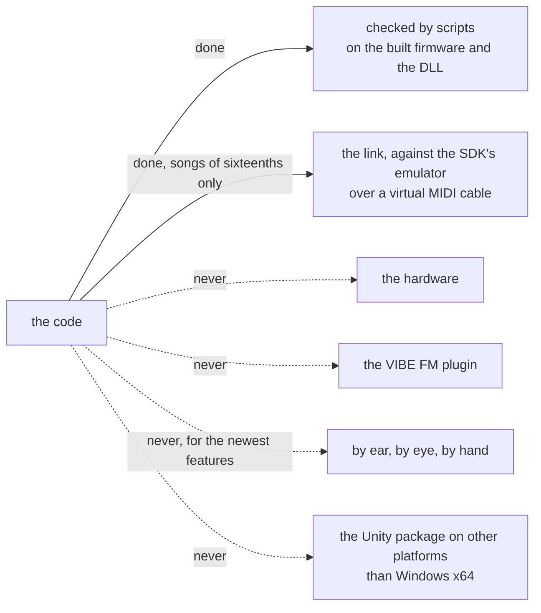

# What Is Tested

This is the one page that says how far SFX FORGE has been tried: what a script checks, what was only read from the
code, and what nobody has done. Other pages link here instead of repeating it. When a run is made again, change the
numbers and dates here.

## The short answer

- **Tested by scripts:** the firmware (24 checks), the Unity package's core (205 checks), its editor UI (169
  EditMode tests), the showcase (32 editor checks, 41 PlayMode tests).
- **Tested against the emulator:** the link, with songs whose patterns all have 16 steps.
- **Never:** the hardware, the VIBE FM plugin, any platform but Windows x64, any Unity but 6000.3.8f1. Nobody has
  listened to the newest features (PERFORM, the beat) or played them by hand.

## The numbers, as last run

All with firmware 1.7.0 as it is now (with PERFORM and the beat), as the reference documents record the last run.
The link runs have their dates further down.

| Suite | Result | What it runs on |
|---|---|---|
| `sh build.sh` | 24 lines `PASSED`, none failing; 239 `ok` lines | the built `.wasm`, in the SDK's `wasmtest` and on `tests/host.mjs` |
| `tests/dotnet` | 205 checks, all passing | `Runtime/Core` and the package's own `sfxforge.dll`, without Unity |
| `tests/unity-inspectors` | 169 of 169 EditMode tests | Unity 6000.3.8f1, Windows x64 |
| the showcase's `Verify` | 32 editor checks | the demo project, headless, on a copy |
| PlayMode | 41 tests: 26 passed, 15 skipped | the same. The skipped ones need a device or the emulator, or record, and run only when asked for by name |

Commands and how to read the output: [Running The Tests](Running-The-Tests).

## What the scripts can see

A script reads numbers. It hears the output as samples and reads the song the device sends and what it stores.

| The scripts check | The scripts do not check |
|---|---|
| the sound that comes out: levels, timing, that a click falls on a beat | what a page or a toast **says**: no check reads the display's text |
| the song after key presses, byte by byte | how PERFORM's grid, the shades and the bar strip are drawn |
| the SysEx messages, in and out, also doubled and out of order | the stage's buttons (its REC button on PERFORM among them) and its grids' shades |
| what the device stores (`kits.bin`, `song6.bin`, `meter.bin`, `song.bin`) | solo on PERFORM; ERASE across a change of pattern |
| that the display's picture changed (a hash of its pixels) | undo of RAMP and of a song loaded from a game; undo of FILL except on PERFORM |
| a format-5 song still renders bit for bit as before (by hashes) | a DAW's song position at a finer grid |

For the Unity editor UI the tests build the same elements in a test panel and press keys by code. Nobody has opened
the real Inspector or the real windows, opened their menus, or typed into a field. The full list is in
[the Unity manual](../docs/UNITY.md#the-inspectors-are-tested-in-a-project-of-their-own).

## The newest features

| Feature | Checked by | Not done |
|---|---|---|
| **PERFORM** (firmware 1.7.0) | `tests/check-perform.mjs`: it presses the page's keys on the built firmware and reads the song and the sound (26 `ok` lines) | nobody has played the page, looked at it while it plays, or listened to it. The check does not see the display, the stage's REC button, or solo |
| **the beat and the time signature** (firmware 1.7.0) | `tests/check-meter.mjs`: what FILL writes, where the click falls, that the song's bytes stay as they were, what SAVE stores (21 `ok` lines) | nobody has listened to the click at any beat, turned SHIFT + B by hand, or read the words (`BAR 6/8`, `BEAT 3/8: BAR 6/8`). Not tried: swing with a beat of three sixteenths, a bar that is not a whole number of beats, SHIFT + B on SONG, and that DEMO, a song from a game and UNDO leave the beat |
| **a finer grid** (firmware 1.6.0) | the firmware's grid checks; `tests/dotnet`; eight EditMode tests of the song's Inspector | a pattern at 1/32 or 1/64 has not crossed a MIDI port. Nobody has listened to a finer pattern in Unity |

## The link

The link was tested end to end against the SDK's emulator, with this package in Unity 6000.3 on Windows 11, over
two loopMIDI ports, headless.

| When | Firmware | What ran | Result |
|---|---|---|---|
| 24 Nov 2026 | 1.7.0, the build with PERFORM and the beat | the six link tests (`Tests/LinkTakes.cs`), one run | all six passed |
| 23 Nov 2026 | 1.7.0, the build of that day, before the beat | the six link tests, one run; the recorded session (`Tests/LinkSession.cs`), once | passed. The link video is that recording; it was not run again |
| 22 Nov 2026 | 1.6.0 | the six link tests, four times; the recorded session | passed |

What the six tests did: a patch and the song came from the device; the device said its identity; twenty transfers
in a row arrived whole; a song and its sounds sent to the device came back the same; pads, intensity, a cue and
text left for the device (nothing comes back for those, so the test only says that every message left).

What they did not do:

- PERFORM was not open in any run, and the beat was a quarter.
- Every pattern in those songs has 16 steps.
- Pads and encoders coming **from** the device were not tried, nor `SendPatch`, nor the keys of the SFX Forge
  window and the Inspectors against a device.
- The recorded session ran headless. Nobody heard it, and nobody has listened to the video.

Details and what the earlier runs found: [the Unity manual, section 6](../docs/UNITY.md#6-from-the-device-to-the-game).

## Only read from the code

These are believed correct because someone read the code, not because a test ran them.

- **Two real flows inside the firmware.** Only `song_way.h` was run on two threads
  (`tests/stress-song-way.c`). The queue and the `volatile` values are correct by reading. The test hosts call
  both flows from one thread.
- **A firmware up to 1.5.0** against any of this. What the documents say of an older firmware is read from its
  code.
- **Swing with a beat of three sixteenths.** That the click is uneven there is read from the code.

## Never done

- **The hardware and the plugin.** Everything ran in the SDK's `wasmtest`, on `tests/host.mjs`, or in the SDK's
  emulator. Nobody has held a VIBE with this firmware.
- **Listening.** The tests read numbers from rendered samples. Nobody listened to a generated sound, a variant, a
  baked file, or the click.
- **Any Unity but 6000.3.8f1, any platform but Windows x64.** MIDI is implemented for Windows only (winmm), and
  the native library is built for Windows x64 only.
- **The showcase's standalone build** was last run before firmware 1.5 and not again.
- **The videos are not a test.** Scripts make them from the firmware and the game. A video made before a page
  existed does not show it.

## How to keep this page true

1. After a run, change the numbers and the date in "The numbers, as last run".
2. A test made with the version before keeps its version here until it is run again. Never write that something
   was run with a newer version than it was.
3. When you add a feature, add a row to "The newest features": what checks it, and what nobody has done.
4. Never claim more than a run showed. "Passed" means the script's conditions held, not that it sounds right.

## Next

- [Running The Tests](Running-The-Tests): run the suites yourself.
- [Release Checklist](Release-Checklist): when this page must be updated.
- [Unity Troubleshooting](Unity-Troubleshooting): when something does not work in a game.
- [FAQ](FAQ): short answers, also about platforms.

## Reference

- [The maintainer's guide, Never tested](../docs/MAINTAINING.md#never-tested) and
  [Fragile spots](../docs/MAINTAINING.md#fragile-spots)
- [README, Build](../README.md#build): what each firmware check sees and does not see.
  [README, Unity](../README.md#unity): the numbers as last run
- [The Unity manual, 6. From the device to the game](../docs/UNITY.md#6-from-the-device-to-the-game),
  [The core is tested without Unity](../docs/UNITY.md#the-core-is-tested-without-unity),
  [The inspectors are tested in a project of their own](../docs/UNITY.md#the-inspectors-are-tested-in-a-project-of-their-own),
  [Limits](../docs/UNITY.md#limits)
- [The videos' README](../videos/README.md): what each video was made from
